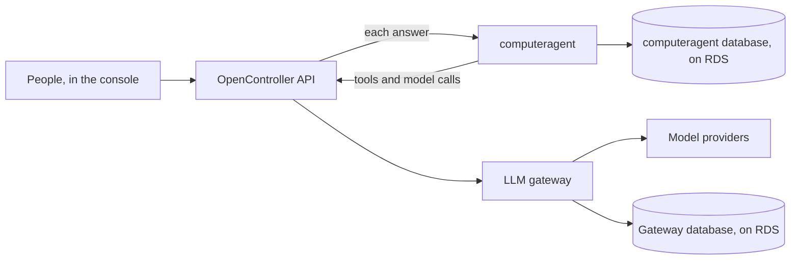

<Note>For whoever runs your OpenController, after installing it with the installation guide (`CLIENT-GUIDE.md`). People who use Ask Ctrl see no change.</Note>

Ask Ctrl's runtime is the service that runs each answer. By default it is Ask Ctrl's own runtime, which keeps nothing
between answers. computeragent is the other runtime. It runs the same Ask Ctrl, with the same tools and permissions,
through your LLM gateway, and keeps every answer as a session in a PostgreSQL database of its own. You turn it on with
one setting, and turn it off the same way.

## What changes

| | Ask Ctrl's own runtime (default) | computeragent |
|---|---|---|
| **Answers** | Ask Ctrl's tools and the person's permissions. A change is only proposed until a person confirms it. | The same. |
| **What it keeps** | Nothing between answers. | Every answer, as a session, in its own database on Amazon RDS. |
| **Model calls** | Through OpenController's API to your LLM gateway. | The same. |
| **How text arrives** | Word by word. | A message at a time. |
| **API replicas** | Any number. | One. |



computeragent reaches only OpenController's API, its own database and DNS. It never reaches the internet, a model
provider or your other systems. Its agent can call OpenController's tools and nothing else: no shell, no files, no web.

<Note>
Before you start:
- OpenController is installed with the installation guide, with the **LLM gateway** and the assistant on. Both are on by
  default (`parts` in file 3).
- Your release supports computeragent: a `chart_version` that has `askCtrl.runtime`, and a tag for the
  `ask-ctrl-computeragent` image in Lyzr's registry. Ask Lyzr for both.
  {/* TODO verify: the first release whose chart has askCtrl.runtime, and that the release publishes ask-ctrl-computeragent to Lyzr's registry */}
- You can run the installation guide's commands: OpenTofu, the AWS CLI, kubectl and jq, signed in to your AWS account,
  with kubectl connected to the cluster (installation guide, step 3). In private mode, run them from inside your VPC or
  over your VPN.
- The API runs one replica. That is the default. If your `overrides.yaml` sets `api.replicas`, remove it.
</Note>

Every command below runs in `infra/tofu/customer/aws`, unless it says `foundation`. If you changed `name` in files 1
and 3, use that name in place of `opencontroller`.

## Step 1: Choose computeragent's database

<Tabs>
  <Tab title="The gateway's RDS (recommended)">
    computeragent uses the Amazon RDS for PostgreSQL instance the installation made for the LLM gateway. You create
    nothing in AWS. The instance is already encrypted with your KMS key, backed up daily, and requires TLS.

    Before computeragent starts, the chart's `database` step makes a database and a login on that instance, both named
    `computeragent`. It signs in as the gateway's database user to do it. The login owns that one database: it is not a
    superuser, and it cannot make databases or logins. The gateway's own database is not touched.
    {/* TODO verify: the gateway's database user is the RDS instance's admin (tofu/modules/postgres-aws), so it may make the login and the database */}

    You choose this in step 3, with `postgres.shared: true`. Go on to step 2.
  </Tab>
  <Tab title="A separate RDS instance">
    Use this when your security team wants computeragent's data on an instance of its own. Run the commands from a
    machine that can reach the VPC, in one terminal: later commands use what earlier ones keep in variables.

    <Steps>
      <Step title="Read your network and your key">
        ```bash
        cd foundation
        VPC=$(tofu output -raw vpc_id)                                   # your VPC
        SUBNETS=$(tofu output -json private_subnets | jq -r 'join(" ")')  # its private subnets
        KMS_KEY=$(tofu output -raw kms_key_arn)                          # your KMS key
        CIDR=$(aws ec2 describe-vpcs --vpc-ids "$VPC" --query 'Vpcs[0].CidrBlock' --output text)   # your VPC's range
        cd ..
        ```
      </Step>
      <Step title="Let the VPC reach the database">
        A security group that lets the VPC reach PostgreSQL's port, and a subnet group in the private subnets:

        ```bash
        SG=$(aws ec2 create-security-group --group-name opencontroller-computeragent-db \
          --description "computeragent database" --vpc-id "$VPC" --query GroupId --output text)
        aws ec2 authorize-security-group-ingress --group-id "$SG" --protocol tcp --port 5432 --cidr "$CIDR"
        aws rds create-db-subnet-group --db-subnet-group-name opencontroller-computeragent \
          --db-subnet-group-description "computeragent database" --subnet-ids $SUBNETS
        ```
      </Step>
      <Step title="Create the instance">
        RDS makes the admin's password and keeps it in AWS Secrets Manager, encrypted with your key. Nobody types or
        sees it.

        ```bash
        aws rds create-db-instance --db-instance-identifier opencontroller-computeragent \
          --engine postgres --db-instance-class db.t4g.medium \
          --allocated-storage 50 --storage-type gp3 --storage-encrypted --kms-key-id "$KMS_KEY" \
          --master-username caadmin --manage-master-user-password --master-user-secret-kms-key-id "$KMS_KEY" \
          --db-subnet-group-name opencontroller-computeragent --vpc-security-group-ids "$SG" \
          --no-publicly-accessible --backup-retention-period 7 --multi-az \
          --deletion-protection --copy-tags-to-snapshot
        aws rds wait db-instance-available --db-instance-identifier opencontroller-computeragent   # 10 to 20 minutes
        ```

        For a trial, leave out `--multi-az`. RDS for PostgreSQL 15 and newer requires TLS by default.
        {/* TODO verify: the oldest PostgreSQL version computeragent supports (its in-cluster image is 17) */}
      </Step>
      <Step title="Make computeragent's database and login">
        This needs `psql`. It makes the login's password here, keeps it in `CA_PW` for step 2, and never shows it.

        ```bash
        HOST=$(aws rds describe-db-instances --db-instance-identifier opencontroller-computeragent \
          --query 'DBInstances[0].Endpoint.Address' --output text)
        ADMIN=$(aws rds describe-db-instances --db-instance-identifier opencontroller-computeragent \
          --query 'DBInstances[0].MasterUserSecret.SecretArn' --output text)
        CA_PW=$(openssl rand -hex 24)
        PGPASSWORD=$(aws secretsmanager get-secret-value --secret-id "$ADMIN" --query SecretString --output text | jq -r .password) \
          psql "host=$HOST user=caadmin dbname=postgres sslmode=require" -v ON_ERROR_STOP=1 -v pw="$CA_PW" <<'SQL'
        CREATE ROLE computeragent LOGIN PASSWORD :'pw';
        GRANT computeragent TO CURRENT_USER;
        CREATE DATABASE computeragent OWNER computeragent;
        SQL
        ```

        The login owns its database and nothing else. Keep this terminal open for step 2.
      </Step>
    </Steps>
  </Tab>
</Tabs>

## Step 2: Store computeragent's keys

computeragent needs these keys:

| Key | What it is for |
|---|---|
| `CA_BOOTSTRAP_KEY` | The key OpenController's API signs in to computeragent with. |
| `CA_SEAL_KEYS` | Seals the sessions' state and keys in computeragent's database. |
| `CA_ISSUER_SEED`, `CA_SKILLS_SEED` | Sign the short-lived tokens computeragent gives its agent. |
| `CA_POSTGRES_PASSWORD` | With the gateway's RDS: the password of computeragent's own login. |
| `CA_POSTGRES_URL` | With a separate instance: computeragent's database, as a connection address. |

You generate them straight into AWS Secrets Manager, encrypted with your KMS key, like the installation's other
passwords. Then you make the Kubernetes Secret the chart reads, from Secrets Manager. No value is printed or written
to a file.

<Steps>
  <Step title="Generate the keys into Secrets Manager">
    <Tabs>
      <Tab title="The gateway's RDS">
        ```bash
        KMS_KEY=$(cd foundation && tofu output -raw kms_key_arn)
        jq -n \
          --arg bootstrap "ca_admin$(openssl rand -hex 6).$(openssl rand -hex 16)" \
          --arg seal "1:$(openssl rand -base64 32)" \
          --arg issuer "$(openssl rand -base64 32)" \
          --arg skills "$(openssl rand -base64 32)" \
          --arg pg "$(openssl rand -hex 24)" \
          '{CA_BOOTSTRAP_KEY: $bootstrap, CA_SEAL_KEYS: $seal, CA_ISSUER_SEED: $issuer, CA_SKILLS_SEED: $skills, CA_POSTGRES_PASSWORD: $pg}' |
        aws secretsmanager create-secret --name opencontroller/deploy/ask-ctrl --kms-key-id "$KMS_KEY" \
          --secret-string file:///dev/stdin --query Name --output text
        ```
      </Tab>
      <Tab title="A separate RDS instance">
        In the terminal from step 1, which holds `HOST` and `CA_PW`:

        ```bash
        jq -n \
          --arg bootstrap "ca_admin$(openssl rand -hex 6).$(openssl rand -hex 16)" \
          --arg seal "1:$(openssl rand -base64 32)" \
          --arg issuer "$(openssl rand -base64 32)" \
          --arg skills "$(openssl rand -base64 32)" \
          --arg url "postgres://computeragent:$CA_PW@$HOST:5432/computeragent?sslmode=require" \
          '{CA_BOOTSTRAP_KEY: $bootstrap, CA_SEAL_KEYS: $seal, CA_ISSUER_SEED: $issuer, CA_SKILLS_SEED: $skills, CA_POSTGRES_URL: $url}' |
        aws secretsmanager create-secret --name opencontroller/deploy/ask-ctrl --kms-key-id "$KMS_KEY" \
          --secret-string file:///dev/stdin --query Name --output text
        ```
      </Tab>
    </Tabs>
  </Step>
  <Step title="Make the Kubernetes Secret">
    ```bash
    aws secretsmanager get-secret-value --secret-id opencontroller/deploy/ask-ctrl --query SecretString --output text |
      jq -r 'to_entries[] | "\(.key)=\(.value)"' |
      kubectl -n opencontroller create secret generic opencontroller-ask-ctrl-env --from-env-file=/dev/stdin
    ```
  </Step>
</Steps>

<Warning>
Keep `opencontroller/deploy/ask-ctrl` in Secrets Manager. If the Kubernetes Secret is deleted, make it again from
there with the last command. New keys would leave computeragent unable to read the sessions it sealed.
</Warning>

<Info>
On its first start with computeragent, the API keeps a copy of `CA_BOOTSTRAP_KEY` in its own secrets manager. To change
that key later, change it in both places, then restart both the API and computeragent.
</Info>

## Step 3: Turn computeragent on

The settings go in your `overrides.yaml`, as the installation guide's section 6 shows ("Add your own application
settings").

<Steps>
  <Step title="Find your VPC's address range">
    ```bash
    VPC=$(cd foundation && tofu output -raw vpc_id)
    aws ec2 describe-vpcs --vpc-ids "$VPC" --query 'Vpcs[0].CidrBlockAssociationSet[].CidrBlock' --output text
    ```

    computeragent may reach its database only inside this range. Without it, the cell's network policy holds it back.
  </Step>
  <Step title="Add the settings">
    If you have no `overrides.yaml` yet, run `cp overrides.yaml.example overrides.yaml`. Then add:

    <Tabs>
      <Tab title="The gateway's RDS">
        ```yaml
        askCtrl:
          runtime: computeragent
          computeragent:
            postgres:
              shared: true                        # its own database on the gateway's RDS
              egressTo:
                - ipBlock: {cidr: 10.0.0.0/16}    # your VPC's range, from the step before
        image:
          askCtrlComputeragent:
            repository: <image_registry>/ask-ctrl-computeragent   # image_registry: as in file 3
            tag: "<the tag from your release>"
        ```
      </Tab>
      <Tab title="A separate RDS instance">
        ```yaml
        askCtrl:
          runtime: computeragent
          computeragent:
            postgres:
              egressTo:
                - ipBlock: {cidr: 10.0.0.0/16}    # your VPC's range, from the step before
        image:
          askCtrlComputeragent:
            repository: <image_registry>/ask-ctrl-computeragent   # image_registry: as in file 3
            tag: "<the tag from your release>"
        ```

        computeragent reads its database's address from `CA_POSTGRES_URL`, in the Secret from step 2.
      </Tab>
    </Tabs>

    Keep `image_registry` exactly as file 3 has it, so the image comes from Lyzr's registry like the others.
  </Step>
  <Step title="Use the file">
    In file 3, remove `#` from the `overrides_file` line, if it still has one.
  </Step>
</Steps>

## Step 4: Apply

```bash
tofu apply                                                  # type: yes
kubectl -n argocd get application opencontroller            # repeat until SYNC STATUS Synced, HEALTH STATUS Healthy
kubectl -n opencontroller get pods | grep ask-ctrl          # opencontroller-ask-ctrl-…: Running, READY 1/1
```

With the gateway's RDS, the `database` step runs first. Its log ends without an error:

```bash
kubectl -n opencontroller logs deploy/opencontroller-ask-ctrl -c database
```
{/* TODO verify: the lines the database step prints when it makes and when it updates the login */}

## Step 5: Check it works

1. In the console, open **Ask Ctrl** and ask "Which agents can reach the internet directly?". The answer shows its
   lookups as it goes, then the answer, as before.
2. Select **Brief me**. Each specialist's row shows it at work, then Ask Ctrl gives one answer from what they found.
3. Ask Ask Ctrl to make a change you may make. An approval card appears, and nothing changes until you confirm it.
4. computeragent's log shows no errors:

   ```bash
   kubectl -n opencontroller logs deploy/opencontroller-ask-ctrl -c computeragent --tail=50
   ```

## Switch back

In `overrides.yaml`, set `runtime: agui` under `askCtrl`, or delete the `askCtrl` and `askCtrlComputeragent` lines you
added. Then run `tofu apply`. Ask Ctrl's own runtime answers again, and nothing else changes.

computeragent's data stays until you delete it:

- **The gateway's RDS:** as the instance's admin, run `DROP DATABASE computeragent;` and `DROP ROLE computeragent;`.
- **A separate instance:** turn off its deletion protection, then delete the instance in the RDS console.
- **Its keys:** delete the Secret with `kubectl -n opencontroller delete secret opencontroller-ask-ctrl-env`, and
  delete `opencontroller/deploy/ask-ctrl` in Secrets Manager.

<Warning>Deleting the database deletes every session computeragent kept. It cannot be undone, except from a backup.</Warning>

## Good to know

- **One API replica.** computeragent calls the model through the API, and each answer's token lives in the API pod
  that asked. The chart refuses more than one API replica with computeragent.
- **The database grows.** computeragent keeps every session's events, and nothing deletes them yet. Watch the
  instance's free storage (`FreeStorageSpace` in CloudWatch), and raise its storage before it runs out.
- **Text arrives a message at a time**, not word by word.
- **What computeragent keeps** is encrypted at rest by RDS, with your KMS key. The sessions' state and keys are also
  sealed with `CA_SEAL_KEYS`.
- **Isolation.** computeragent's agent runs as a process in computeragent's own pod. It is held to OpenController's
  tools by its grant, and to the API, its database and DNS by the cell's network policy.

## If something goes wrong

| You see | Cause | Fix |
|---|---|---|
| The `opencontroller-ask-ctrl` pod stays in `Init` | The `database` step can't reach the gateway's RDS, or can't make the login | `kubectl -n opencontroller logs deploy/opencontroller-ask-ctrl -c database` names the problem. Check that `egressTo` holds your VPC's range. |
| `CreateContainerConfigError` on the pod | The Secret `opencontroller-ask-ctrl-env`, or a key in it, is missing | Step 2. |
| `ImagePullBackOff` on the pod | The image's `repository` or `tag` is wrong, or your release has no computeragent image | Check `image.askCtrlComputeragent` against your release notes. If it matches, ask Lyzr. |
| The application stays `OutOfSync`, and its conditions name `api.replicas` | Your `overrides.yaml` sets more than one API replica | Remove `api.replicas`, then `tofu apply`. `kubectl -n argocd get application opencontroller -o jsonpath='{.status.conditions}'` shows the message. |
| Ask Ctrl shows an error in place of an answer | computeragent is up, but an answer fails | `kubectl -n opencontroller logs deploy/opencontroller-ask-ctrl -c computeragent` names the problem. |

## Next steps

<CardGroup cols={2}>
  <Card title="Ask Ctrl" icon="message-circle-question-mark" href="/get-started/ask-ctrl">
    What Ask Ctrl does, and how people use it.
  </Card>
  <Card title="Secrets and sign-in" icon="lock-keyhole" href="/administer/secrets-auth">
    Where OpenController keeps every credential.
  </Card>
</CardGroup>
