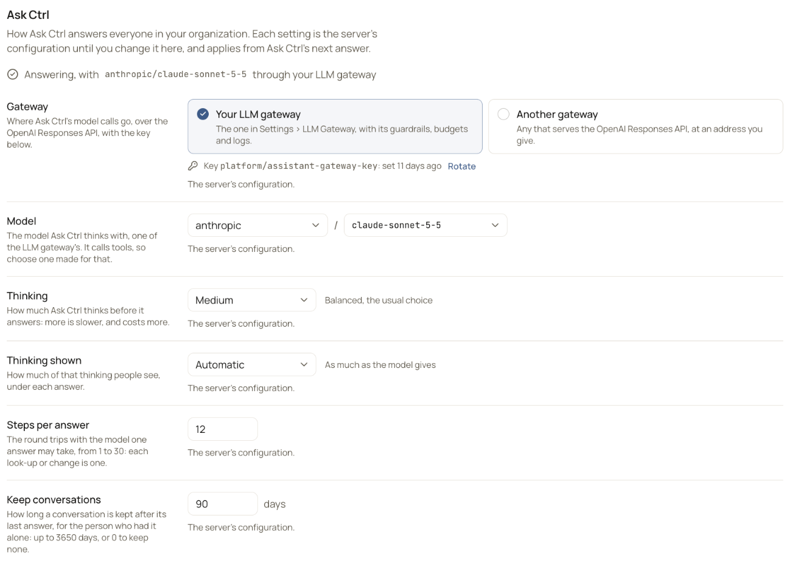

These settings decide how [Ask Ctrl](/get-started/ask-ctrl) answers everyone in your organization. Each setting starts as the server's configuration. A change you save here applies from Ask Ctrl's next answer.

<Note>Ask Ctrl is part of every OpenController. If whoever runs yours turned it off (`FEATURES=assistant=off`), **Ask Ctrl** and **MCP server** are not listed in **Settings**.</Note>

## Open the settings

Go to **Settings** > **Ask Ctrl**. The line under the title says whether Ask Ctrl is answering, for example **Answering, with `anthropic/claude-sonnet-5-5` through your LLM gateway**. When it is not answering, the line says why.

{/* SCREENSHOT: ask-ctrl-settings | crop | Settings > Ask Ctrl with nothing changed: "Answering, with anthropic/claude-sonnet-5-5 through your LLM gateway"; Gateway: Your LLM gateway; Model: anthropic, claude-sonnet-5-5; Thinking: Medium; Thinking shown: Automatic; Steps per answer: 12; Keep conversations: 90 days. Each reads "The server's configuration." Crop to the form. */}
<Frame caption="Settings > Ask Ctrl">
  
</Frame>

## Change a setting

<Steps>
  <Step title="Change it">
    Change one or more settings. A bar appears at the bottom: **Unsaved changes. They apply from Ask Ctrl's next answer.**
  </Step>
  <Step title="Save">
    Select **Save**, or **Discard** to keep the settings as they were. The change applies from Ask Ctrl's next answer, for everyone.
  </Step>
</Steps>

Under each setting, **The server's configuration.** means the setting follows the configuration. A setting you changed shows **Configured:** and the configuration's value instead. To go back to that value, select **Use it**, then **Save**. The setting then follows the configuration again, so a later change there reaches it.

## The settings

| Setting | What it decides | Default |
|---|---|---|
| **Gateway** | Where Ask Ctrl's model calls go: **Your LLM gateway**, or **Another gateway** at an address you give. | **Your LLM gateway** |
| **Model** | The model Ask Ctrl thinks with. Ask Ctrl calls tools, so choose a model made for that. | `anthropic/claude-sonnet-5-5` |
| **Thinking** | How much Ask Ctrl thinks before it answers: **None**, **Minimal**, **Low**, **Medium**, **High** or **Extra high**. More is slower, and costs more. | **Medium** |
| **Thinking shown** | How much of that thinking people see under each answer: **Hidden**, **Automatic** (as much as the model gives), **Brief** or **Detailed**. | **Automatic** |
| **Steps per answer** | How many round trips with the model one answer may take, from 1 to 30. Each look-up or change is one. | 12 |
| **Keep conversations** | How many days a conversation is kept after its last answer, from 0 to 3650. **0** keeps none. | 90 days |

Whoever runs your OpenController may have configured other defaults. The page shows the values in use.

### Gateway and model

By default, Ask Ctrl calls its model through your LLM gateway, the one in **Settings** > **LLM Gateway**. Its calls then follow that gateway's guardrails, budgets and logs. Under **Model**, choose a provider and one of its models.

You can give Ask Ctrl another gateway instead: any gateway that serves the OpenAI Responses API.

<Steps>
  <Step title="Choose Another gateway">
    Under **Gateway**, select **Another gateway**.
  </Step>
  <Step title="Type its address">
    Type the gateway's base address, for example `https://gateway.example.com`. Ask Ctrl calls `https://gateway.example.com/v1/responses`. Leave out `/v1`, any query, and any name or password.
  </Step>
  <Step title="Type the model">
    Under **Model**, type the model's name as that gateway names it, without spaces.
  </Step>
  <Step title="Save and check">
    Select **Save**. Then ask Ctrl a question: the line under the title names the gateway's host.
  </Step>
</Steps>

<Warning>With another gateway, Ask Ctrl's questions, and what it reads of your estate to answer them, go to that gateway. They do not pass through your LLM gateway's guardrails and logs.</Warning>

**The gateway's key.** Ask Ctrl's model calls carry the secret `platform/assistant-gateway-key` as their key, whichever gateway they go to. A gateway that asks for no key needs none. Under **Gateway**, the **Key** line says when the key was set, and **Set** or **Rotate** changes it. You can also change it in [Secrets](/administer/secrets-auth). The value is never shown.

### Keep conversations

Each person's conversations are kept for this many days after their last answer, for that person alone. They open one again with **Earlier conversations** in the Ctrl panel, from any browser.

With **0**, no conversation is kept from then on: a conversation lasts as long as the page shows it. Conversations kept before still expire when they would have.

### Steps per answer

When an answer needs more steps than this, Ctrl stops and says so (see [When Ask Ctrl cannot answer](#when-ask-ctrl-cannot-answer)). Raise **Steps per answer**, up to 30, or ask a narrower question.

## Limit what Ask Ctrl may do

**Ask Ctrl's role**, below the settings, is the most Ask Ctrl may do for anyone. An **Admin** sees it there. Ask Ctrl acts for whoever asks it, and does only what both they and its role allow. It reads on its own. Every change it prepares waits for the person to confirm it, and the audit log records the change as theirs, via Ask Ctrl.

| Ask Ctrl holds | What it may do |
|---|---|
| **Admin (the default)** | Whatever the person asking may. |
| A lesser role, for example **Viewer** | At most what that role holds, and never more than the person asking may. |
| **None (turned off)** | Nothing, for anyone. |

Choose the role and select **Save**. The same setting is also in **Settings** > **Roles**. When your access rules are set in the server's configuration, the role is too (`DISCOVERY_AGENT_ROLE`): the page shows it, and whoever runs OpenController changes it there.

Ask Ctrl's role also limits what agents read through the [MCP server](/administer/mcp-server).

<Info>Whatever its role, Ask Ctrl changes nothing under **Settings**, and does not propose to. It never handles a credential: a secret that a change needs is typed by the person where they confirm the change.</Info>

## When Ask Ctrl cannot answer

When an answer fails, Ctrl says why. The common reasons:

| Ctrl says | What to do |
|---|---|
| "Ask Ctrl has no gateway to reach its model through: …" | Connect the LLM gateway in **Settings** > **LLM Gateway** (see [Modules](/administer/modules)), or give Ask Ctrl another gateway here. |
| "Ask Ctrl's gateway could not be reached: …" | Check the address under **Gateway**, and that OpenController can reach it. |
| "Ask Ctrl's gateway has an address that is not valid: …" | Correct the address under **Gateway**. |
| "Ask Ctrl's gateway answered 401: …" (or another code) | The gateway refused the call, for the reason shown. A `401` or `403` is usually the key: set or rotate it under **Gateway**. Otherwise check **Model**. |
| "The LLM gateway's guardrails blocked this request: …" | A content rule in your LLM gateway blocked Ask Ctrl's call, for the reason shown, for example "detected PII". An **Admin** reviews the rule in [Content rules](/secure/routing-and-mcp#content-rules). |
| "This answer called the model as often as one answer may: …" | Ask a narrower question, or raise **Steps per answer**. |
| "the answer took too long; try a narrower question" | An answer may take 2 minutes (`DISCOVERY_CHAT_TIMEOUT`). Ask a narrower question. |

## See who changed what

Under the settings, **Last changed by** names who saved last, and when. Every change is also in **Settings** > **Audit log** > **Identity & access**, as `ask_ctrl_settings.changed`. Its **Detail** says what moved, from and to, for example `model anthropic/claude-sonnet-5-5 → anthropic/claude-opus-5-5; history days 90 → 30`. A setting given back to the configuration shows `(as configured)`. See [Audit log](/administer/audit-log).

## Set the defaults in the configuration

Whoever runs your OpenController sets each default in its configuration. A setting follows it until an **Admin** changes the setting here.

| Setting | Configuration | When unset |
|---|---|---|
| **Gateway** | `ASK_CTRL_GATEWAY_URL` | The LLM gateway module's address |
| The gateway's key | `ASK_CTRL_GATEWAY_KEY`, stored as `platform/assistant-gateway-key` on first start | No key |
| **Model** | `DISCOVERY_CHAT_MODEL` | `anthropic/claude-sonnet-5-5` |
| **Thinking** | `ASK_CTRL_REASONING_EFFORT`: `none`, `minimal`, `low`, `medium`, `high` or `xhigh` | `medium` |
| **Thinking shown** | `ASK_CTRL_REASONING_SUMMARY`: `none` (Hidden), `auto` (Automatic), `concise` (Brief) or `detailed` (Detailed) | `auto` |
| **Steps per answer** | `ASK_CTRL_MAX_TURNS` | `12` |
| **Keep conversations** | `ASK_CTRL_HISTORY_DAYS` | `90` |
| **Agents may connect** ([MCP server](/administer/mcp-server)) | `ASK_CTRL_MCP` | `true` |

## Who can use it

- Every role can see **Settings** > **Ask Ctrl** (the `chat:read` permission).
- **Admin** changes the settings (`chat:settings`) and Ask Ctrl's role (`access:agent`).
- Setting or rotating the gateway's key needs the right to change secrets, which **Admin** holds.

## Next steps

<CardGroup cols={2}>
  <Card title="MCP server" icon="plug" href="/administer/mcp-server">
    Connect Claude Code, Cursor or Codex to OpenController.
  </Card>
  <Card title="Set up the LLM gateway" icon="route" href="/secure/set-up-gateway">
    Connect the gateway Ask Ctrl calls its model through.
  </Card>
</CardGroup>
