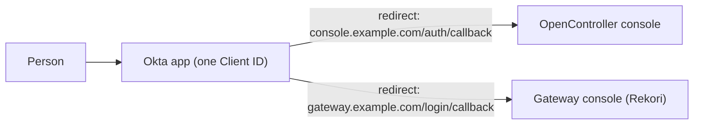

OpenController and the LLM gateway (Rekori) each have a console at their own address. With this guide, both
sign people in through **the same Okta app**. People use one Okta account and one set of groups, and you manage
one app in Okta.

**What you need:**
- **Owner** in OpenController, and an Okta administrator.
- Single sign-on with Okta already working for the OpenController console. If not, follow
  [Set up single sign-on with Okta](/administer/guide-sso-okta) first. This guide reuses that app.
- The gateway's address. This guide uses `https://gateway.example.com`, and `https://console.example.com` for
  OpenController.
- The gateway administrator's username and password, as a way in if Okta sign-in to the gateway fails.

## How it fits together



- Each console checks the Okta **access token** against the same issuer, Client ID and audience.
- The two consoles keep their own sessions. Signing in to one also signs you in to Okta, so the other one signs
  you in without asking for your password again.
- Signing in to the gateway through Okta does not change anything inside OpenController, and the reverse.

## Step 1: Let the Okta app send people back to the gateway

In Okta, open the app from the OpenController guide (**Applications** > your app > **General**):

1. **Sign-in redirect URIs**: keep `https://console.example.com/auth/callback`, and add
   `https://gateway.example.com/login/callback`.
2. Save.

Then in **Security** > **API** > **Trusted Origins**, add `https://gateway.example.com` for **CORS** and
**Redirect**, next to the console's address.

<Warning>The gateway's browser talks to Okta directly. Without the trusted origin, the gateway's sign-in fails
with a CORS error in the browser, and no error in the gateway.</Warning>

## Step 2: Collect the values

You need the same values as for the console:

| Value | Example | Where |
|---|---|---|
| **Issuer** | `https://your-org.okta.com/oauth2/default` | **Security** > **API** > **Authorization Servers**, the **Issuer URI** |
| **Client ID** | `0oa…abcd` | The app's **General** tab |
| **Audience** | `api://default` | The same authorization server's **Audience** |

<Warning>The audience is the authorization server's audience, usually `api://default`. It is **not** the Client
ID. With the Client ID as audience, every token is refused.</Warning>

## Step 3: Turn on Okta sign-in in the gateway

Do this from the gateway's own console. You can do it in two ways: choose **one**.

<Tabs>
  <Tab title="In the gateway's console (recommended)">
    1. Open `https://gateway.example.com` and sign in with the gateway administrator's username and password.
    2. In the sidebar, go to **Routing** > **API Gateway**, and scroll to the **Identity Providers (OIDC)** card.
    3. Fill in:

       | Field | Value |
       |---|---|
       | **name (slug)** | `okta` |
       | **issuer url** | The issuer from step 2 |
       | **audiences (csv)** | `api://default` |
       | **console client id (SPA)** | The Client ID from step 2 |
       | **console scopes** | `openid profile email offline_access` |
       | **console redirect path** | Leave empty: `/login/callback` |

    4. Select **Front the console sign-in with this provider**.
    5. Select **Add provider**.

    The change is stored in the gateway's database and takes effect at once. No restart, no deploy.
  </Tab>
  <Tab title="In the gateway's configuration">
    Whoever runs the gateway sets these environment variables and restarts it:

    ```bash
    DASHBOARD_SSO_ISSUER=https://your-org.okta.com/oauth2/default
    DASHBOARD_SSO_CLIENT_ID=0oa…abcd
    DASHBOARD_SSO_AUDIENCES=api://default
    ```

    Optional: `DASHBOARD_SSO_SCOPES` (default `openid profile email offline_access`),
    `DASHBOARD_SSO_REDIRECT_PATH` (default `/login/callback`), `DASHBOARD_SSO_NAME` (default `dashboard-sso`).

    Use this when the gateway is set up from code, for example from Helm values. On every start, the gateway
    writes these values over the provider named `dashboard-sso`, so a change made on the page to that provider
    is lost.
  </Tab>
</Tabs>

<Warning>Do not use both ways. With both, the gateway has two providers fronting its sign-in, and the
environment overwrites its own one on every restart. Pick the page for a single gateway you manage by hand, and the
environment for gateways deployed from code.</Warning>

<Note>**Front the console sign-in with this provider** also closes the gateway's management API to any call
without a credential. Apps that call models through the gateway with a virtual key are not affected.
OpenController keeps managing the gateway with its own credential.</Note>

## Step 4: Give people roles in each console

Each console gives roles on its own, from the same Okta groups. Okta sends each person's groups in the access
token (the `groups` claim from [the Okta guide](/administer/guide-sso-okta)), and each console reads them.

**In OpenController:**

1. Go to **Settings** > **Role mappings**.
2. Map each Okta group to a role, for example `oc-admins` to **Admin** and `oc-viewers` to **Viewer**. Map
   **Owner** only to a small group.
3. Check the result in **Settings** > **Members**: each person shows their groups and the role they get.

See [Map groups to roles](/administer/sso#map-groups-to-roles).

**In the gateway:**

1. In the gateway's console, go to **Access** > **Roles**.
2. Open a role, or select **New role** and choose its permissions.
3. Under **Granted automatically to these groups**, type the Okta group name, for example `oc-admins`, and press
   Enter. Okta sends group names, so type the name exactly as in Okta.
4. Save.

The first time someone from a mapped group signs in to the gateway, it creates their account with that role.

<Note>The two mappings are separate. Someone can be **Admin** in OpenController and have a narrower role in the
gateway, or the reverse. Changing a person's Okta groups changes both on their next sign-in.</Note>

## Step 5: Test it

1. In a **private browser window**, open `https://gateway.example.com`.
2. Select the Okta sign-in, and sign in as your test user.
3. You land in the gateway's workspace, with the role from step 4.
4. In the same window, open `https://console.example.com` and select **Sign in with Okta**. Okta signs you in
   without asking for your password again.

The gateway administrator's username and password still work, as the way in if Okta fails.

## Step 6 (optional): Turn off password sign-in in OpenController

Once everyone signs in through Okta, you can stop OpenController from accepting email and password, and stop the
sign-in page from offering a service-account key.

1. Sign in to OpenController **with Okta**, as an **Owner**.
2. Go to **Settings** > **Authentication** > **Ways in**.
3. Switch off **Email and password**, or **Service-account key at the sign-in page**.
4. Type `turn off` to confirm.

Each change is recorded in the audit log, with who made it.

- **Email and password** can only be turned off by an **Owner** who signed in with single sign-on, so you
  prove it works for you first. Turning it off ends every password session at once.
- **Service-account key at the sign-in page** only stops people signing in to the console with a `cpk_…` key.
  Agents, scripts and the MCP server keep calling the API with their keys.
- Turning a way back on is never blocked.

<Info>Whoever runs OpenController can fix either way in the configuration, with `DISCOVERY_PASSWORD_LOGIN` and
`DISCOVERY_CREDENTIAL_LOGIN` (`true` or `false`). A value set there wins over the switch: the switch shows it and
cannot change it.</Info>

## Troubleshooting

<AccordionGroup>
  <Accordion title="The switch says “Sign in with single sign-on to turn this off”">
    You are signed in with an email and password: the key icon in your menu, **Change password**, shows that.
    Sign out, then select **Sign in with Okta**. Check your role is still **Owner** at the foot of the menu. If
    it is not, map your Okta group to **Owner** in **Settings** > **Role mappings**, then sign in with Okta again.
  </Accordion>
  <Accordion title="The gateway keeps redirecting between pages">
    The browser still holds the session cookie from an earlier password sign-in to the gateway. Clear the
    gateway site's cookies, or use a private window, and sign in again.
  </Accordion>
  <Accordion title="Every Okta sign-in is refused">
    Check the audience is `api://default` (or your server's audience), not the Client ID, and that the issuer
    ends with `/oauth2/default` (or your server's id).
  </Accordion>
  <Accordion title="“The identity provider could not be read” in OpenController">
    OpenController could not read Okta's discovery document. Check the **Okta org URL** is your Okta org,
    for example `https://your-org.okta.com`, not your company's domain, and the **Authorization server** exists.
  </Accordion>
  <Accordion title="Okta shows “redirect_uri is not allowed”">
    The address in the error is missing from the app's **Sign-in redirect URIs**. Add it exactly, including
    `https://` and the path.
  </Accordion>
</AccordionGroup>

## Next steps

<CardGroup cols={2}>
  <Card title="Single sign-on" icon="key-round" href="/administer/sso">
    Every single sign-on setting in OpenController.
  </Card>
  <Card title="Set up the LLM gateway" icon="server" href="/secure/set-up-gateway">
    Connect OpenController to the gateway.
  </Card>
</CardGroup>
