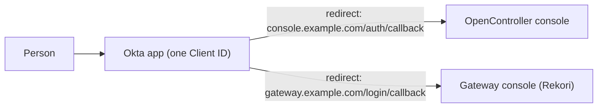
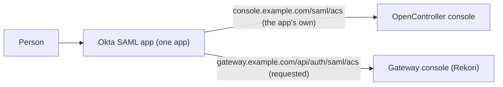

OpenController and the LLM gateway (Rekori) each have a console at their own address. With this guide, both
sign people in through **the same Okta app**. People use one Okta account and one set of groups, and you manage
one app in Okta.

Steps 1 to 5 use OpenID Connect. If OpenController signs in with SAML 2.0, follow
[Sign in to the gateway with SAML](#sign-in-to-the-gateway-with-saml) instead.

**What you need:**
- **Owner** in OpenController, and an Okta administrator.
- Single sign-on with Okta already working for the OpenController console. If not, follow
  [Set up single sign-on with Okta](/administer/guide-sso-okta) first. This guide reuses that app.
- The gateway's address. This guide uses `https://gateway.example.com`, and `https://console.example.com` for
  OpenController.
- The gateway administrator's username and password, to sign in to the gateway's console before Okta fronts it.

## How it fits together



- Each console checks the Okta **access token** against the same issuer, Client ID and audience.
- The two consoles keep their own sessions. Signing in to one also signs you in to Okta, so the other one signs
  you in without asking for your password again.
- Signing in to the gateway through Okta does not change anything inside OpenController, and the reverse.

## Step 1: Let the Okta app send people back to the gateway

In Okta, open the app from the OpenController guide (**Applications** > your app > **General**):

1. **Sign-in redirect URIs**: keep `https://console.example.com/auth/callback`, and add
   `https://gateway.example.com/login/callback`.
2. Save.

Then in **Security** > **API** > **Trusted Origins**, add `https://gateway.example.com` for **CORS** and
**Redirect**, next to the console's address.

<Warning>The gateway's browser talks to Okta directly. Without the trusted origin, the gateway's sign-in fails
with a CORS error in the browser, and no error in the gateway.</Warning>

## Step 2: Collect the values

You need the same values as for the console:

| Value | Example | Where |
|---|---|---|
| **Issuer** | `https://your-org.okta.com/oauth2/default` | **Security** > **API** > **Authorization Servers**, the **Issuer URI** |
| **Client ID** | `0oa…abcd` | The app's **General** tab |
| **Audience** | `api://default` | The same authorization server's **Audience** |

<Warning>The audience is the authorization server's audience, usually `api://default`. It is **not** the Client
ID. With the Client ID as audience, every token is refused.</Warning>

## Step 3: Turn on Okta sign-in in the gateway

Do this from the gateway's own console. You can do it in two ways: choose **one**.

<Tabs>
  <Tab title="In the gateway's console (recommended)">
    1. Open `https://gateway.example.com` and sign in with the gateway administrator's username and password.
    2. In the sidebar, go to **Routing** > **API Gateway**, and scroll to the **Identity Providers (OIDC)** card.
    3. Fill in:

       | Field | Value |
       |---|---|
       | **name (slug)** | `okta` |
       | **issuer url** | The issuer from step 2 |
       | **audiences (csv)** | `api://default` |
       | **console client id (SPA)** | The Client ID from step 2 |
       | **console scopes** | `openid profile email offline_access` |
       | **console redirect path** | Leave empty: `/login/callback` |

    4. Select **Front the console sign-in with this provider**.
    5. Select **Add provider**.

    The change is stored in the gateway's database and takes effect at once. No restart, no deploy.
  </Tab>
  <Tab title="In the gateway's configuration">
    Whoever runs the gateway sets these environment variables and restarts it:

    ```bash
    DASHBOARD_SSO_ISSUER=https://your-org.okta.com/oauth2/default
    DASHBOARD_SSO_CLIENT_ID=0oa…abcd
    DASHBOARD_SSO_AUDIENCES=api://default
    ```

    Optional: `DASHBOARD_SSO_SCOPES` (default `openid profile email offline_access`),
    `DASHBOARD_SSO_REDIRECT_PATH` (default `/login/callback`), `DASHBOARD_SSO_NAME` (default `dashboard-sso`).

    Use this when the gateway is set up from code, for example from Helm values. On every start, the gateway
    writes these values over the provider named `dashboard-sso`, so a change made on the page to that provider
    is lost.
  </Tab>
</Tabs>

<Warning>Do not use both ways. With both, the gateway has two providers fronting its sign-in, and the
environment overwrites its own one on every restart. Pick the page for a single gateway you manage by hand, and the
environment for gateways deployed from code.</Warning>

<Note>**Front the console sign-in with this provider** also closes the gateway's management API to any call
without a credential. Apps that call models through the gateway with a virtual key are not affected.
OpenController keeps managing the gateway with its own credential.</Note>

## Step 4: Give people roles in each console

Each console gives roles on its own, from the same Okta groups. Okta sends each person's groups in the access
token (the `groups` claim from [the Okta guide](/administer/guide-sso-okta)), and each console reads them.

**In OpenController:**

1. Go to **Settings** > **Role mappings**.
2. Map each Okta group to a role, for example `oc-admins` to **Admin** and `oc-viewers` to **Viewer**. Map
   **Owner** only to a small group.
3. Check the result in **Settings** > **Members**: each person shows their groups and the role they get.

See [Map groups to roles](/administer/sso#map-groups-to-roles).

**In the gateway:**

1. In the gateway's console, go to **Access** > **Roles**.
2. Open a role, or select **New role** and choose its permissions.
3. Under **Granted automatically to these groups**, type the Okta group name, for example `oc-admins`, and press
   Enter. Okta sends group names, so type the name exactly as in Okta.
4. Save.

The first time someone from a mapped group signs in to the gateway, it creates their account with that role.

<Note>The two mappings are separate. Someone can be **Admin** in OpenController and have a narrower role in the
gateway, or the reverse. Changing a person's Okta groups changes both on their next sign-in.</Note>

## Step 5: Test it

1. In a **private browser window**, open `https://gateway.example.com`.
2. Select the Okta sign-in, and sign in as your test user.
3. You land in the gateway's workspace, with the role from step 4.
4. In the same window, open `https://console.example.com` and select **Sign in with Okta**. Okta signs you in
   without asking for your password again.

Once a provider fronts the gateway's sign-in, the gateway's sign-in page offers only single sign-on: keep the window
you set it up in open until the test works. The administrator's username and password keep working for
OpenController, which manages the gateway with them (**Settings** > **LLM Gateway**).

## Step 6 (optional): Turn off password sign-in in OpenController

Once everyone signs in through Okta, you can stop OpenController from accepting email and password, and stop the
sign-in page from offering a service-account key.

1. Sign in to OpenController **with Okta**, as an **Owner**.
2. Go to **Settings** > **Authentication** > **Ways in**.
3. Switch off **Email and password**, or **Service-account key at the sign-in page**.
4. Type `turn off` to confirm.

Each change is recorded in the audit log, with who made it.

- **Email and password** can only be turned off by an **Owner** who signed in with single sign-on, so you
  prove it works for you first. Turning it off ends every password session at once.
- **Service-account key at the sign-in page** only stops people signing in to the console with a `cpk_…` key.
  Agents, scripts and the MCP server keep calling the API with their keys.
- Turning a way back on is never blocked.

<Info>Whoever runs OpenController can fix either way in the configuration, with `DISCOVERY_PASSWORD_LOGIN` and
`DISCOVERY_CREDENTIAL_LOGIN` (`true` or `false`). A value set there wins over the switch: the switch shows it and
cannot change it.</Info>

## Sign in to the gateway with SAML

If OpenController signs people in with SAML 2.0 ([Okta](/integrations/identity/okta), the **SAML 2.0** tab), the
gateway can use that same Okta app. Okta answers each sign-in at the address of the console that asked for it.

**What you need:**
- SAML sign-in with Okta working for the OpenController console.
- A gateway whose **Routing** > **API Gateway** page has a **Console sign-in (SAML 2.0)** card.
- A gateway administrator who can open that page.



- The gateway asks Okta to answer at its own address. Okta answers only at addresses listed on the app, so you add
  the gateway's.
- Okta addresses every answer to the app's audience, which is OpenController's. The gateway is told to expect that
  same audience as its entity ID.
- Each console keeps its own session. A gateway session lasts 8 hours at most, less if the Okta session ends sooner.
  Signing out of the gateway ends only that session: you stay signed in to Okta.
- The app's tile on the Okta dashboard opens OpenController. Open the gateway at its own address.

<Steps>
  <Step title="Let the Okta app answer at the gateway">
    In Okta, open the SAML app OpenController signs in with (**Applications** > your app). On its **General** tab,
    under **SAML Settings**, select **Edit**, then:

    1. Select **Next**, then **Show Advanced Settings**.
    2. Under **Other Requestable SSO URLs**, select **Add Another**. Enter **URL**
       `https://gateway.example.com/api/auth/saml/acs` and **Index** `1`, or the next free index.
    3. Leave **Assertion Encryption** at **Unencrypted**: the gateway reads signed assertions, not encrypted ones.
    4. Select **Next**, then **Finish**.

    The **General** tab now lists the address under **Requestable SSO URLs**.
  </Step>
  <Step title="Check the app sends the groups">
    The gateway gives roles from the groups in Okta's answer, as OpenController does. On the app's **Sign On** tab,
    under **Attribute statements**, select **Show legacy configuration**. Under **Group attribute statements**, look
    for **Name** `groups` with **Filter** **Matches regex** `.*`. If it is missing, select **Edit**, add it, and
    select **Save**.

    <Note>`.*` sends every group the person is in, Okta's **Everyone** included. Never grant a role to
    **Everyone**. To send fewer, use a filter such as **Starts with** `oc-`.</Note>
  </Step>
  <Step title="Collect the values">
    | Value | Example | Where |
    |---|---|---|
    | **Metadata URL** | `https://your-org.okta.com/app/<app id>/sso/saml/metadata` | The app's **Sign On** tab, under **Metadata details** |
    | **Audience** | `https://console.example.com/saml/metadata` | The app's **General** tab, under **SAML Settings**: **Audience Restriction** |

    <Warning>The gateway's entity ID must be this audience, OpenController's. Left at its default, the gateway's own
    address, the gateway refuses every answer from this app.</Warning>
  </Step>
  <Step title="Turn on SAML sign-in in the gateway">
    Choose **one** way.

    <Tabs>
      <Tab title="In the gateway's console (recommended)">
        1. Sign in to `https://gateway.example.com` as a gateway administrator.
        2. In the sidebar, go to **Routing** > **API Gateway**, and scroll to the **Console sign-in (SAML 2.0)** card.
        3. Fill in:

           | Field | Value |
           |---|---|
           | **Name** | `okta-saml` |
           | **Console address** | `https://gateway.example.com`. The page fills in its own address. |
           | **Identity provider metadata URL** | The metadata URL from the previous step |
           | **Entity ID (optional)** | The audience from the previous step, `https://console.example.com/saml/metadata` |

           Leave **Email attribute**, **Name attribute** and **Groups attribute** empty: the gateway takes the email
           from Okta's Name ID, and the groups from `groups`.
        4. Under the form, **Register the console at the identity provider** should show the address from the first
           step as **Single sign-on URL (ACS)**, and OpenController's audience as **Audience / entity ID**.
        5. Select **Front the console sign-in with this provider**, then **Save provider**.

        The provider's row shows **console sign-in**, and **identity provider:** `http://www.okta.com/<app id>` once the
        gateway has read Okta's metadata. **metadata not read** means it could not: check the metadata URL. The change
        takes effect at once.
      </Tab>
      <Tab title="In the gateway's configuration">
        Whoever runs the gateway sets these environment variables and restarts it:

        ```bash
        DASHBOARD_SAML_BASE_URL=https://gateway.example.com
        DASHBOARD_SAML_METADATA_URL=https://your-org.okta.com/app/<app id>/sso/saml/metadata
        DASHBOARD_SAML_ENTITY_ID=https://console.example.com/saml/metadata
        ```

        Optional: `DASHBOARD_SAML_METADATA_XML` (the metadata document itself, in place of the URL),
        `DASHBOARD_SAML_EMAIL_ATTRIBUTE`, `DASHBOARD_SAML_NAME_ATTRIBUTE`, `DASHBOARD_SAML_GROUPS_ATTRIBUTE`, and
        `DASHBOARD_SAML_NAME` (default `dashboard-saml`).

        On every start, the gateway writes these values over the provider named `dashboard-saml`, which fronts the
        sign-in. If it cannot read the metadata at the first start, it still creates the provider, and SAML sign-in
        fails until a start reads it: the sign-in stays closed, never open. A later start that cannot reach Okta keeps
        the metadata it read before. Metadata is read only over https.
      </Tab>
    </Tabs>

    <Note>The gateway can front its sign-in with OpenID Connect and SAML at once. Its sign-in page then offers both,
    **Sign in with Okta** and **Sign in with SAML single sign-on**. Like OpenID Connect, fronting closes the gateway's
    management API to any call without a credential; OpenController keeps managing the gateway with its own.</Note>
  </Step>
  <Step title="Give people roles in the gateway">
    In the gateway's console, go to **Access** > **Roles**. Open a role, or select **New role**, and under **Granted
    automatically to these groups** type the Okta group names exactly as Okta sends them in `groups`. Save.

    - Someone who already has a gateway account under the same email keeps the roles assigned to it in **Access** >
      **Members**.
    - The first SAML sign-in creates an account only when one of the person's groups maps to a role. Anyone else is
      turned back with **You are signed in, but you have no role here yet.**
    - Okta sends the groups when the person signs in. A change to their Okta groups reaches the gateway at their next
      SAML sign-in, at most 8 hours later. A change to a role's groups applies at once.
  </Step>
  <Step title="Test it">
    1. In a **private browser window**, open `https://gateway.example.com`.
    2. Select **Sign in with SAML single sign-on**, and sign in to Okta as your test user.
    3. You land in the gateway's workspace, with the role from the previous step.

    Keep the window you set it up in open until this works.
  </Step>
</Steps>

### Provision people in the gateway with SCIM (optional)

With SCIM, Okta creates people in the gateway before they sign in and keeps their names and groups current.
Deactivating someone in Okta stops them in the gateway on their next request, without waiting for their session to
end.

An Okta app sends SCIM to one place, so the gateway gets its own app, one that no one signs in with:

1. In the gateway's console, go to **Access** > **Provisioning**. Switch **SCIM provisioning** on, select
   **Generate token**, and copy the token: it is shown once. The **SCIM base URL** is
   `https://gateway.example.com/scim/v2`. If a token exists already, **Rotate token** replaces it and stops the old one.
2. In Okta, create a provisioning app as for OpenController: follow steps 2 to 5 of
   [Provision people with SCIM](/integrations/identity/okta#provision-people-with-scim-optional), with the gateway's
   values:
   - **Single sign-on URL** `https://gateway.example.com/api/auth/saml/acs` and **Audience URI (SP Entity ID)**
     `https://gateway.example.com/api/auth/saml/metadata`. Okta asks for them, though no one signs in with this app.
   - **SCIM connector base URL** `https://gateway.example.com/scim/v2`, and the gateway's token as the Bearer token.
3. Push the groups you map in **Access** > **Roles**. They appear on **Access** > **Provisioning**, with how many
   members each has.

People are matched by email. Unlike OpenController, the gateway does not limit sign-in to the people SCIM
provisioned: anyone whose groups map to a role can still sign in.

## Troubleshooting

<AccordionGroup>
  <Accordion title="The switch says “Sign in with single sign-on to turn this off”">
    You are signed in with an email and password: the key icon in your menu, **Change password**, shows that.
    Sign out, then select **Sign in with Okta**. Check your role is still **Owner** at the foot of the menu. If
    it is not, map your Okta group to **Owner** in **Settings** > **Role mappings**, then sign in with Okta again.
  </Accordion>
  <Accordion title="The gateway keeps redirecting between pages">
    The browser still holds the session cookie from an earlier password sign-in to the gateway. Clear the
    gateway site's cookies, or use a private window, and sign in again.
  </Accordion>
  <Accordion title="Every Okta sign-in is refused">
    Check the audience is `api://default` (or your server's audience), not the Client ID, and that the issuer
    ends with `/oauth2/default` (or your server's id).
  </Accordion>
  <Accordion title="“The identity provider could not be read” in OpenController">
    OpenController could not read Okta's discovery document. Check the **Okta org URL** is your Okta org,
    for example `https://your-org.okta.com`, not your company's domain, and the **Authorization server** exists.
  </Accordion>
  <Accordion title="Okta shows “redirect_uri is not allowed”">
    The address in the error is missing from the app's **Sign-in redirect URIs**. Add it exactly, including
    `https://` and the path.
  </Accordion>
  <Accordion title="SAML: the gateway says “Single sign-on did not complete”">
    The gateway refused Okta's answer, and its log says why. Most often the provider's **Entity ID** is not the app's
    audience, OpenController's `https://console.example.com/saml/metadata`. If Okta's signing certificate changed,
    open the provider on **Routing** > **API Gateway**, select **Edit**, then **Save changes**: saving reads the
    metadata URL again.
  </Accordion>
  <Accordion title="SAML: Okta shows “Bad Request” and “Bad SAML request”">
    The gateway asked Okta to answer at an address the app does not list. Its address is missing from the app's
    **Other Requestable SSO URLs**, or differs from the **Single sign-on URL (ACS)** the gateway shows under **Register
    the console at the identity provider**. Compare them exactly: `https://`, host and path.
  </Accordion>
  <Accordion title="SAML: Okta says the user is not assigned to the application">
    Assign them, or a group they are in, on the app's **Assignments** tab.
  </Accordion>
  <Accordion title="SAML: “You are signed in, but you have no role here yet”">
    None of the person's Okta groups maps to a gateway role, and no role is assigned to their account. Map a group in
    **Access** > **Roles**, or assign a role in **Access** > **Members**, then sign in again. If their group is
    mapped, check the app sends `groups` (the step “Check the app sends the groups”).
  </Accordion>
</AccordionGroup>

## Next steps

<CardGroup cols={2}>
  <Card title="Single sign-on" icon="key-round" href="/administer/sso">
    Every single sign-on setting in OpenController.
  </Card>
  <Card title="Set up the LLM gateway" icon="server" href="/llm-gateway/get-started/quickstart">
    Connect OpenController to the gateway.
  </Card>
  <Card title="Okta" icon="log-in" href="/integrations/identity/okta">
    Every Okta setting for OpenController: OpenID Connect, SAML and SCIM.
  </Card>
</CardGroup>
