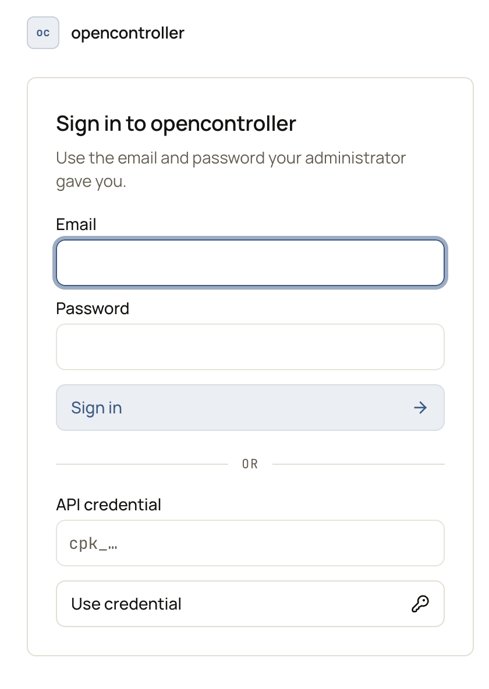

**What you need:**
- **Owner** in OpenController, and an Okta administrator who can create applications and edit an authorization server.
- The console's address, from **Settings** > **Authentication** > **Console address**. This guide uses `https://console.example.com`.
- A local **Owner** account with an email and password, as a way in if sign-in through Okta fails.
- A test user in Okta, for example `bob@example.com`, in one of the groups you will map.

This guide uses OpenID Connect. For SAML, see [Okta](/integrations/identity/okta#saml).

## Step 1: Create the app in Okta

1. **Applications** > **Create App Integration** > **OIDC - OpenID Connect** > **Single-Page Application**.
2. **Sign-in redirect URI**: `https://console.example.com/auth/callback`.
3. **Sign-out redirect URI**: `https://console.example.com/signed-out`.
4. **Assignments**: the groups that may use OpenController, for example `oc-admins`, `oc-operators` and `oc-viewers`.
5. Save, and copy the **Client ID**.

The app is public (Authorization Code with PKCE). OpenController stores no Okta secret.

## Step 2: Send the email and groups in the access token

In **Security** > **API** > **Authorization Servers**, open **default** (or your custom server):

1. **Access Policies**: add a rule for the new app that allows Authorization Code and Refresh Token, and the scopes
   `openid`, `profile`, `email` and `offline_access`.
2. **Claims**: add `email`, included in the **Access Token**, value `user.email`.
3. **Claims**: add `groups`, included in the **Access Token**, value type **Groups**, filter **Matches regex** `.*`. {/* TODO verify: Okta Admin Console labels in steps 1 to 3 (app type "OIDC - OpenID Connect", claim "Value type: Groups") against the current Okta UI. */}
4. Note the server's **Audience**, for example `api://default`.

<Warning>OpenController reads the email and groups from the **access token**, not the ID token. Okta's access token
carries no email unless you add the claim: without it, every sign-in is refused as outside your domains. Without
groups, nobody gets a role from a group.</Warning>

## Step 3: Connect Okta in OpenController

In **Settings** > **Single sign-on**, enter:

| Field | Value |
|---|---|
| **Identity provider** · **Signs in with** | **Okta** · **OpenID Connect** |
| **Okta org URL** | `https://your-org.okta.com` |
| **Authorization server** | `default`, or your custom server's id |
| **Client id** | The Client ID from step 1 |
| **Audience** | The audience from step 2, for example `api://default` |
| **Email domains** | `example.com` |

Select **Connect Okta**. See [Connect your identity provider](/administer/sso#connect-your-identity-provider).

## Step 4: Map Okta groups to roles

In **Settings** > **Role mappings**, map **Admin** to `oc-admins`, **Operator** to `oc-operators` and **Viewer** to `oc-viewers`. Leave **Anyone signed in whom nothing maps gets** at **no access** to refuse everyone else. See [Map groups to roles](/administer/sso#map-groups-to-roles).

<Tip>Map **Owner** only on purpose, to a small group. Owners can change single sign-on and role mappings.</Tip>

## Step 5 (optional): Provision people with SCIM

With SCIM, **Settings** > **Members** lists everyone in Okta who may use OpenController, with their groups and role, and deactivating someone in Okta ends their access on their next request.

Okta offers no SCIM on the Single-Page Application from step 1. Provisioning uses a second Okta app, of type **SAML 2.0**, that no one signs in with. Follow [Provision people with SCIM](/integrations/identity/okta#provision-people-with-scim-optional): it creates that app, turns SCIM on, and pushes the groups you mapped in step 4.

<Warning>Once you select **Generate token**, only people Okta has provisioned can sign in through Okta. Finish all of step 5 before your people next sign in.</Warning>

## Step 6: Test the sign-in

1. In a private browser window, open `https://console.example.com` and select **Sign in with Okta** as your test user.
   {/* SCREENSHOT: sso-okta-signin | crop | The sign-in card. With single sign-on on, a Sign in with button shows here too. */}
   
2. Check the user sees only what their group's role allows.
3. In your own session, **Settings** > **Audit log** > **Identity & access**, with **Show** set to `sign_in`, lists the sign-in.

<Info>Once single sign-on works, whoever runs your OpenController can turn email-and-password sign-in off (`DISCOVERY_PASSWORD_LOGIN=false`). Keep it on until you are sure you will not need the local **Owner** account.</Info>

## Step 7 (optional): Change roles from the console

Okta groups decide each person's role. To change a role from **Settings** > **Members** instead of in Okta, connect a third Okta app, of type **API Services**: OpenController then moves the person between the mapped groups in Okta for you. Follow [Change roles from OpenController](/integrations/identity/okta#change-roles-from-opencontroller-optional).

<Tip>Three things trip this step up: the **Okta domain** must be your Okta org (`your-org.okta.com`), not your company's domain; the **Client ID** must be the API Services app's, not the sign-in app's; and the API Services app needs the **Group Membership Administrator** admin role, besides its scopes.</Tip>

## Next steps

<CardGroup cols={2}>
  <Card title="Members, roles and teams" icon="users" href="/administer/members-roles-teams#teams-group-people-and-the-assets-they-own">
    Link Okta groups to teams and the assets they own.
  </Card>
  <Card title="Okta" icon="book" href="/integrations/identity/okta">
    Every Okta setting, and SAML.
  </Card>
</CardGroup>
