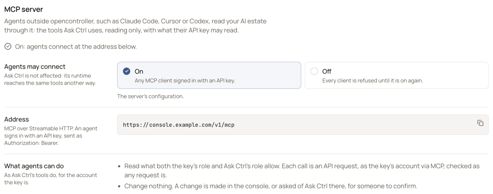
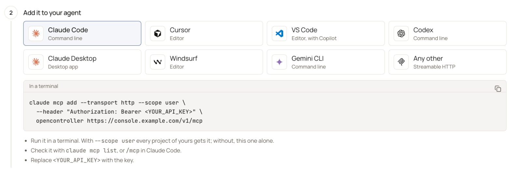
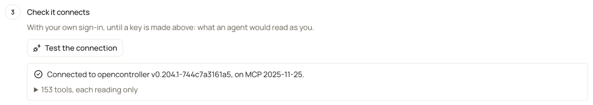

OpenController is an MCP server. An agent outside it, such as Claude Code, Cursor, VS Code with Copilot, Codex, Claude Desktop, claude.ai, Windsurf, Gemini CLI or a Copilot Studio agent, connects with an API key. It then reads your AI estate with the tools [Ask Ctrl](/get-started/ask-ctrl) uses. It only reads: nothing changes through it.

<Info>This is OpenController's own MCP server, for agents to read OpenController. The MCP servers your agents reach through the LLM gateway are a different thing: see [MCP servers](/secure/routing-and-mcp#mcp-servers).</Info>

Go to **Settings** > **MCP server**. The line under the title says whether agents may connect: **On: agents connect at the address below.** or **Off: every agent is refused.**

{/* SCREENSHOT: mcp-server | crop | Settings > MCP server, on: "On: agents connect at the address below."; Agents may connect: On, "The server's configuration."; Address https://console.example.com/v1/mcp; What agents can do. Crop above Connect an agent. */}
<Frame caption="Settings > MCP server">
  
</Frame>

## What an agent can do

- **Read what two roles allow**: its key's role, and [Ask Ctrl's role](/administer/ask-ctrl-settings#limit-what-ask-ctrl-may-do). A **Viewer** key reads the estate: assets, findings, scans, traces and the rest a **Viewer** may read.
- **Change nothing.** No tool that changes something is offered, and a call to one is refused. A change is made in the console, or asked of Ask Ctrl there, for someone to confirm.
- **Never see a credential.** No tool returns a password, a secret's value or a key.

Each call is an API request, made as the key's service account through MCP, and checked like any other request.

**Address** is your console's address with `/v1/mcp`, for example `https://console.example.com/v1/mcp`. It speaks MCP over Streamable HTTP. An agent sends its API key as `Authorization: Bearer <key>`, or as `X-API-Key: <key>`.

## Connect an agent

**Connect an agent**, under the settings, takes you through three steps.

<Steps>
  <Step title="Get an API key">
    Under **Get an API key**, choose a service account and select **Create key**. A **Viewer** account is enough, since an agent only reads. Make one account for each agent, so you can revoke one without the others. With no service account yet, make one with the **Viewer** role in [Service accounts](/administer/service-accounts), then come back.

    <Warning>The key is shown once: copy it now. The console also writes it into the next step's settings. Keep it out of chat, tickets and files you commit.</Warning>
  </Step>
  <Step title="Add it to your agent">
    Under **Add it to your agent**, select your agent. The console writes its settings with your address, and with the key once you have created one. Put them where the console says. Each agent's settings are [below](#settings-for-each-agent).

    {/* SCREENSHOT: mcp-connect | crop | Settings > MCP server > Connect an agent, step 2 Add it to your agent: the agent cards (Claude Code selected, Cursor, VS Code, Codex, Claude Desktop, Windsurf, Gemini CLI, Any other) and the claude mcp add command for https://console.example.com/v1/mcp with <YOUR_API_KEY>. */}
    <Frame caption="Add it to your agent">
      
    </Frame>
  </Step>
  <Step title="Check it connects">
    Under **Check it connects**, select **Test the connection**. With the key created above, the console connects as your agent will. Without one, it uses your own sign-in, and shows what an agent would read as you.

    It shows **Connected to opencontroller** with the version of MCP it answered in, and the tools the agent gets, each reading only.

    {/* SCREENSHOT: mcp-test | crop | Step 3 Check it connects after Test the connection: "Connected to opencontroller …, on MCP 2025-11-25." and the folded list of tools, each reading only. */}
    <Frame caption="Check it connects">
      
    </Frame>
  </Step>
</Steps>

## Settings for each agent

These are the settings the console writes. Replace `https://console.example.com` with your console's address, and `<YOUR_API_KEY>` with the key. The console fills both in for you.

<Tabs>
  <Tab title="Claude Code">
    Run in a terminal:

    ```bash
    claude mcp add --transport http --scope user \
      --header "Authorization: Bearer <YOUR_API_KEY>" \
      opencontroller https://console.example.com/v1/mcp
    ```

    With `--scope user`, every project of yours gets it; without it, the current project alone. Check it with `claude mcp list`, or `/mcp` in Claude Code.
  </Tab>
  <Tab title="Cursor">
    Merge this into `~/.cursor/mcp.json`, beside any servers already there. In a project, `.cursor/mcp.json` gives it to that project alone.

    ```json
    {
      "mcpServers": {
        "opencontroller": {
          "url": "https://console.example.com/v1/mcp",
          "headers": {
            "Authorization": "Bearer <YOUR_API_KEY>"
          }
        }
      }
    }
    ```

    Cursor lists it in its settings, under MCP.
  </Tab>
  <Tab title="VS Code">
    Put this in `.vscode/mcp.json`. It holds no key: VS Code asks for it.

    ```json
    {
      "inputs": [
        {
          "type": "promptString",
          "id": "opencontroller-key",
          "description": "opencontroller API key",
          "password": true
        }
      ],
      "servers": {
        "opencontroller": {
          "type": "http",
          "url": "https://console.example.com/v1/mcp",
          "headers": {
            "Authorization": "Bearer ${input:opencontroller-key}"
          }
        }
      }
    }
    ```

    Start the server from the file. VS Code asks for the key once, and keeps it in its secret storage. Copilot Chat uses the tools in agent mode.
  </Tab>
  <Tab title="Codex">
    Put this in `~/.codex/config.toml`:

    ```toml
    [mcp_servers.opencontroller]
    url = "https://console.example.com/v1/mcp"
    bearer_token_env_var = "OPENCONTROLLER_API_KEY"
    ```

    Codex reads the key from `OPENCONTROLLER_API_KEY`. Set it in the shell Codex starts from, or in your shell's profile:

    ```bash
    export OPENCONTROLLER_API_KEY=<YOUR_API_KEY>
    ```

    Check it with `codex mcp list`, or `/mcp` in Codex.
  </Tab>
  <Tab title="Claude Desktop">
    There are two ways. Prefer [Claude's connector](#claude-desktop-claudeai-and-cowork) when your organization has it: it needs nothing on each computer, and it also works on claude.ai and in Cowork. Use this file when the connector is not available to you, or when your console is reachable only from your own network.

    Open `claude_desktop_config.json` from Claude Desktop with **Settings** > **Developer** > **Edit Config**. Merge this in, then quit Claude Desktop completely and open it again.

    ```json
    {
      "mcpServers": {
        "opencontroller": {
          "command": "npx",
          "args": [
            "-y",
            "mcp-remote",
            "https://console.example.com/v1/mcp",
            "--transport",
            "http-only",
            "--header",
            "Authorization:${AUTH_HEADER}"
          ],
          "env": {
            "AUTH_HEADER": "Bearer <YOUR_API_KEY>"
          }
        }
      }
    }
    ```

    - **It needs Node.js** on the computer: `npx` runs `mcp-remote`, which relays Claude Desktop's calls to OpenController over HTTP. The first start downloads it.
    - **`--transport http-only`** keeps `mcp-remote` on Streamable HTTP, the only transport OpenController speaks. Without it, a first request that fails makes `mcp-remote` try an older transport, and the server's `405` hides the real error.
    - **The key is in `AUTH_HEADER`**, with no space after `Authorization:` in the arguments, so it passes intact on Windows too.
    - **It connects from the computer**, so it reaches a console that is only on your network. A server set up in this file is not available in Cowork or on claude.ai.
  </Tab>
  <Tab title="Windsurf">
    Merge this into `~/.codeium/windsurf/mcp_config.json`, beside any servers already there:

    ```json
    {
      "mcpServers": {
        "opencontroller": {
          "serverUrl": "https://console.example.com/v1/mcp",
          "headers": {
            "Authorization": "Bearer <YOUR_API_KEY>"
          }
        }
      }
    }
    ```

    Refresh Windsurf's MCP servers to connect it.
  </Tab>
  <Tab title="Gemini CLI">
    Merge this into `~/.gemini/settings.json`, beside any settings already there:

    ```json
    {
      "mcpServers": {
        "opencontroller": {
          "httpUrl": "https://console.example.com/v1/mcp",
          "headers": {
            "Authorization": "Bearer <YOUR_API_KEY>"
          }
        }
      }
    }
    ```

    Check it with `/mcp` in Gemini CLI.
  </Tab>
  <Tab title="Any other">
    Any client that speaks MCP over Streamable HTTP and can send a header connects. Give it the address, and the key as `Authorization: Bearer <YOUR_API_KEY>`. This lists the tools it would get:

    ```bash
    curl https://console.example.com/v1/mcp \
      -H "Authorization: Bearer <YOUR_API_KEY>" \
      -H "Content-Type: application/json" \
      -d '{"jsonrpc":"2.0","id":1,"method":"tools/list"}'
    ```
  </Tab>
</Tabs>

<Warning>Most of these files hold the key. Keep them out of source control: prefer your own user-level file to a project's.</Warning>

<Note>ChatGPT connectors sign in only with OAuth, which OpenController's MCP server does not offer yet. For Claude, see the next section.</Note>

## Claude Desktop, claude.ai and Cowork

Claude reaches OpenController as a custom connector, sending the API key in a request header. One connector works in Claude Desktop, on claude.ai and in Cowork.

<Warning>Request headers on Claude's custom connectors are in beta, and only some organizations have them. If **Request headers** is not in the **Add custom connector** dialog, use the [Claude Desktop file](#settings-for-each-agent) instead.</Warning>

Before you start:

- **Claude connects from Anthropic's cloud**, not from each person's computer. Your console's address must be reachable from the internet. If it accepts only your network, allow [Anthropic's IP addresses](https://platform.claude.com/docs/en/api/ip-addresses), or use the Claude Desktop file.
- **Everyone who connects shares one key**, so they read as one service account. Give that account the **Viewer** role, and name it for the connector, so its calls are told apart in the audit log.
- **On Team and Enterprise plans, an Owner adds the connector** for the organization. On Enterprise, so can a custom role that manages the organization's libraries.

<Steps>
  <Step title="Get an API key">
    Follow [Get an API key](#connect-an-agent) above, with a **Viewer** service account made for Claude.
  </Step>
  <Step title="Add the connector">
    In Claude, go to **Organization settings** > **Connectors**, select **Add**, then **Custom**. On a Free, Pro or Max plan, go to **Customize** > **Connectors** and select **Add custom connector** instead.

    | Field | Value |
    |---|---|
    | Name | `OpenController` |
    | Remote MCP server URL | `https://console.example.com/v1/mcp` |
    | Authentication | **No sign-in** |
    | Request headers | `authorization`, with the value `Bearer <YOUR_API_KEY>`, marked **Required** |

    Enter `Bearer `, with its space, before the key: Claude sends the value exactly as written. Select **Add**.
  </Step>
  <Step title="Connect">
    Each person goes to **Customize** > **Connectors**, finds **OpenController** with the **Custom** label, and selects **Connect**. In a chat, turn it on from **+** > **Connectors**.
  </Step>
</Steps>

To change the key later, remove the connector and add it again: Claude does not let you edit its headers.

## Microsoft Copilot

### Copilot Studio

A Copilot Studio agent uses OpenController's tools through Copilot Studio's MCP wizard.

<Steps>
  <Step title="Get an API key">
    Follow [Get an API key](#connect-an-agent) above, with a **Viewer** service account made for the agent.
  </Step>
  <Step title="Add the MCP server">
    In Copilot Studio, open your agent, go to **Tools**, and select **Add a tool** > **New tool** > **Model Context Protocol**.

    | Field | Value |
    |---|---|
    | Server name | `OpenController` |
    | Server description | `Reads the organization's AI estate: agents, models, keys, findings, spend and traces.` The agent decides from this when to call it. |
    | Server URL | `https://console.example.com/v1/mcp` |
    | Authentication | **API key** |
    | Type | **Header** |
    | Header name | `X-API-Key` |

    Select **Create**.
  </Step>
  <Step title="Connect it">
    In **Add tool**, select **Create a new connection**, and enter the API key alone, with no `Bearer`. Select **Add to agent**.
  </Step>
</Steps>

- **Use `X-API-Key`**, not `Authorization`: OpenController takes the key as it is in that header, so there is no prefix to get wrong.
- **Copilot Studio connects from Microsoft's cloud.** Your console's address must be reachable from the internet, as for Claude's connector.
- **Your Power Platform data policies apply.** Copilot Studio reaches MCP servers through connectors, so a data policy that blocks custom connectors blocks this one.

### Copilot Cowork

Not yet. Microsoft 365 Copilot Cowork adds MCP servers through plugins, and its plugins do not take an API key yet: they need OAuth, which OpenController's MCP server does not offer yet.


## Agent platforms that run MCP servers as a command

Some agent platforms run each MCP server as a command, for example in a sandbox for each session, and cannot add a remote server with a header. There, run `mcp-remote` as the command. It connects to OpenController over HTTP and relays the agent's calls.

| Field | Value |
|---|---|
| Name, or server key | `opencontroller`. The agent's tools are named after it. |
| Command | `npx` |
| Arguments | As below, one per line. |
| Environment | Nothing more. |

```text
-y
mcp-remote
https://console.example.com/v1/mcp
--transport
http-only
--header
X-API-Key:${OPENCONTROLLER_API_KEY}
```

- **Keep the key in the platform's secrets**, given to the command as the environment variable `OPENCONTROLLER_API_KEY`. Never put the key itself in the arguments. `mcp-remote` fills in `${OPENCONTROLLER_API_KEY}` from its environment.
- **Why `X-API-Key`:** it has no space in it, so it passes through platforms that split arguments on spaces. OpenController takes the key either way.
- **What the command needs:** Node.js, and network access to your console's address. The first start downloads `mcp-remote`, so allow it a minute.

If the platform can add a remote server with a header, use that instead: the address, and the header `X-API-Key` with the key.

{/* TODO verify: run this once on an agent platform against a cell. Checked against mcp-remote's source (header expansion from the environment, --transport http-only), not yet run end to end. */}

## Turn it on or off

The MCP server is on unless the configuration turns it off.

<Steps>
  <Step title="Choose On or Off">
    In **Settings** > **MCP server**, under **Agents may connect**, select **On** or **Off**.
  </Step>
  <Step title="Save">
    Select **Save**. It applies from each agent's next request.
  </Step>
</Steps>

When it is off, every agent is refused with `403` and the message "opencontroller's MCP server is off: an administrator can turn it on in Settings → MCP server". Ask Ctrl in the console is not affected: it reaches the same tools another way. An agent you set up while it is off connects once it is on again.

As on [Ask Ctrl settings](/administer/ask-ctrl-settings#change-a-setting), **Configured:** shows the configuration's value when you changed it, and **Use it** goes back to it. The change is in **Settings** > **Audit log** > **Identity & access** as `ask_ctrl_settings.changed`, with the detail `MCP server on → off`. Whoever runs your OpenController sets the default with `ASK_CTRL_MCP`: `true` unless set.

## If an agent cannot connect

| What you see | Why | What to do |
|---|---|---|
| `401`, or "The key was refused: it may have been revoked, or its account disabled." | The key is wrong or revoked, or its service account is disabled. | Create a new key, or enable the account in [Service accounts](/administer/service-accounts). |
| `403` with "opencontroller's MCP server is off" | An **Admin** turned the MCP server off. | Turn it on under **Agents may connect**. |
| `403` for another reason | The key's role does not hold `chat:ask`. Every built-in role holds it; a custom role may not. | Add `chat:ask` to the custom role, or use a key with a built-in role. |
| Connected, but "It offers no tools" | Neither the key's role nor Ask Ctrl's role allows a read. With Ask Ctrl's role set to **None (turned off)**, agents get no tools. | Use a key whose role reads, or give Ask Ctrl a role in [Ask Ctrl settings](/administer/ask-ctrl-settings#limit-what-ask-ctrl-may-do). |
| `405` on `GET` | The agent asked for a stream. The server answers each `POST` with JSON, with no session and no stream. | Choose Streamable HTTP in the agent, not SSE. With `mcp-remote`, add `--transport http-only`. |
| Claude Desktop shows the server as failed, and its log says `unable to get local issuer certificate` or `self-signed certificate` | Your network inspects HTTPS with its own certificate, which Node.js does not trust. | Add `"NODE_EXTRA_CA_CERTS": "<path to your organization's root certificate, PEM>"` to the server's `env` in `claude_desktop_config.json`, beside `AUTH_HEADER`. Or use [Claude's connector](#claude-desktop-claudeai-and-cowork). |
| `mcp-remote` opens a browser to sign in | The key was refused, and `mcp-remote` then tries OAuth, which OpenController does not offer. | Check the key and the `Bearer ` before it in `AUTH_HEADER`. |
| Claude's connector says it couldn't reach the server | Anthropic's cloud cannot reach your console's address. | Allow [Anthropic's IP addresses](https://platform.claude.com/docs/en/api/ip-addresses), or use the Claude Desktop file. |

## Who can use it

- Every role sees **Settings** > **MCP server**, and can test the connection with its own sign-in.
- **Admin** turns the MCP server on or off (`chat:settings`), and creates service accounts and their keys.
- An agent's key needs `chat:ask`, which every built-in role holds. It reads only what its role and Ask Ctrl's role allow.

## Next steps

<CardGroup cols={2}>
  <Card title="Service accounts and API keys" icon="bot" href="/administer/service-accounts">
    Make an account for each agent, and rotate or revoke its key.
  </Card>
  <Card title="Ask Ctrl settings" icon="sliders-horizontal" href="/administer/ask-ctrl-settings">
    Choose Ask Ctrl's role, which limits what agents read.
  </Card>
</CardGroup>
