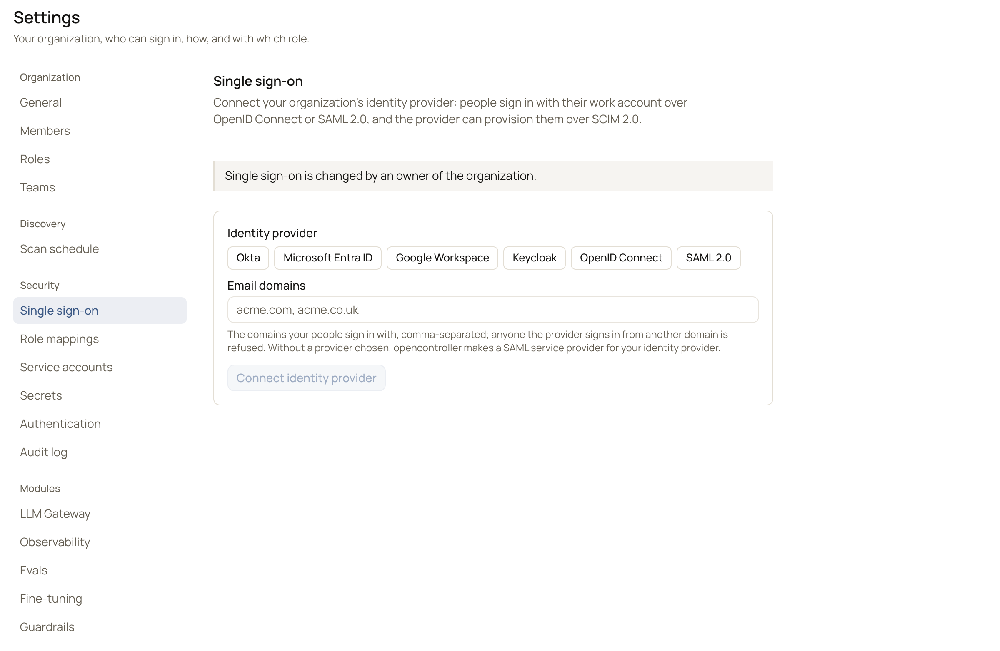
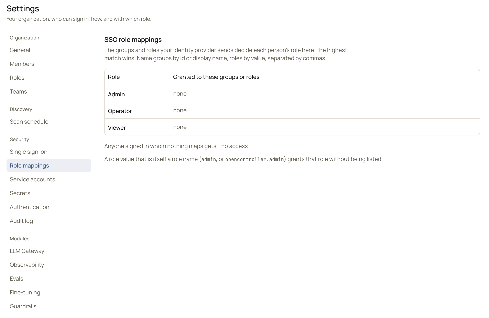

<Note>Keep one local **Owner** account with an email and password. If sign-in through the provider fails, you can still get in.</Note>

Each identity provider has a setup guide for its own side:

| Identity provider | Signs in with | Guide |
|---|---|---|
| Okta | OpenID Connect or SAML 2.0 | [Okta](/integrations/identity/okta) |
| Microsoft Entra ID | OpenID Connect or SAML 2.0 | [Microsoft Entra ID](/integrations/identity/entra) |
| Google Workspace | OpenID Connect or SAML 2.0 | [Google Workspace](/integrations/identity/google) |
| Keycloak | OpenID Connect or SAML 2.0 | [Keycloak](/integrations/identity/keycloak) |
| OpenID Connect (any provider) | OpenID Connect | [Any OpenID Connect provider](/integrations/identity/oidc) |
| SAML 2.0 (any provider) | SAML 2.0 | [Any SAML 2.0 provider](/integrations/identity/saml) |

## Connect your identity provider

For OpenID Connect, create a public, single-page application at your provider (Authorization Code with PKCE) with the redirect URI `https://console.example.com/auth/callback`. There is no client secret. The console's address is under **Settings** > **Authentication** > **Console address**.

- **Audience** (optional): what the provider puts in access tokens for the API. Empty means the client id.
- **Email domains**: anyone the provider signs in with another domain is refused.

{/* SCREENSHOT: sso-connect-form | crop | Settings > Single sign-on before connecting: provider choices, Email domains, Connect identity provider. */}
<Frame caption="Settings > Single sign-on, not connected">
  
</Frame>

When you select **Connect** *provider*, the provider is read at once and sign-in works right away.

### With SAML 2.0

OpenController acts as the service provider. After you connect, copy the values the page shows into your provider. Send the email address as the NameID, and the user's groups as a `groups` claim. Then paste the **Identity provider metadata URL** (Entra ID: *App Federation Metadata Url*; Okta: *Metadata URL*) and select **Save metadata**.

For a named provider such as Okta, OpenController can work out the metadata URL from the fields you gave, so it may already be filled. {/* TODO verify: after connecting Okta (or Entra, Google, Keycloak) over SAML, box 2 shows the derived metadata URL and the badge is IdP connected without Save metadata. */} The **SAML 2.0** provider choice works with any identity provider, given its metadata URL.

### Sign in from a dashboard tile (SAML)

People can open OpenController from a tile on their identity provider's dashboard, such as the Okta End-User Dashboard or Microsoft My Apps. The sign-in then starts at the provider, not in the console. OpenController accepts these sign-ins by default, so the tile works with no extra setup.

**Allow sign-in from your identity provider's dashboard**, under **Settings** > **Single sign-on**, turns this on or off. It shows only for SAML, and only to an **Owner**. A change applies at once and is recorded in the [audit log](/administer/audit-log).

{/* SCREENSHOT: sso-idp-initiated | crop | Settings > Single sign-on connected over SAML: the "Allow sign-in from your identity provider's dashboard" switch, on, with its hint text. Crop to that card. */}

<Warning>A sign-in started at the provider is not tied to the browser that receives it. Another site could sign someone in to an account of its choosing. To accept only sign-ins started in the console, turn the switch off.</Warning>

With the switch off, a dashboard tile gets an error. Point the tile at the **Sign-on URL** instead (`https://console.example.com/saml/login`), so the console starts the sign-in. {/* TODO verify: what the person sees when the switch is off and they use a provider-started tile (a bare 403 "Forbidden" page?). */}

If the provider sends a RelayState with the sign-in, OpenController opens it only when it is a path on the console, such as `/inventory`. Any other address is ignored, and the person lands on the console's home page. {/* TODO verify: the landing page when the RelayState is empty or dropped is "/". */}

The switch is for SAML only. With OpenID Connect, a tile can open the console's address, and the person signs in from the sign-in page. {/* TODO verify: whether an OpenID Connect app's "Initiate login URI" (Okta) set to the console address signs the person in without a click on Sign in with <provider>. */}

Whoever runs OpenController with the provider set in the server's configuration, not in Settings, uses `DISCOVERY_SAML_ALLOW_IDP_INITIATED` (`true` by default) instead.

### Provision people with SCIM (optional)

With SCIM, your identity provider decides who exists and which groups they are in. Only provisioned, active people can then sign in through single sign-on. Deactivating someone at the provider ends their access on their next request.

Paste **SCIM base URL (Tenant URL)**, for example `https://console.example.com/scim/v2`, and the token from **Generate token** into your provider's provisioning settings. Everyone provisioned is then listed under **Settings** > **Members** > **Single sign-on**, with their groups and role.

<Note>With Okta, provisioning needs an app of its own: Okta offers no SCIM on the Single-Page Application people sign in with. See [Okta: provision people with SCIM](/integrations/identity/okta#provision-people-with-scim-optional).</Note>

<Warning>Once a SCIM token exists, only provisioned, active people can sign in through single sign-on. Set up provisioning at your provider straight after you generate it.</Warning>

<Warning>The SCIM token is shown once. Only its hash is kept. **Replace token** makes a new one, and the old token stops working.</Warning>

### Change roles from OpenController (Okta, optional)

**4. Change roles from opencontroller (Okta, optional)** connects OpenController to Okta's API, so an **Admin** can
change a provisioned person's role from **Members**: OpenController moves the person between the mapped groups in
Okta. It needs an Okta **API Services** app. See
[Change roles from OpenController](/integrations/identity/okta#change-roles-from-opencontroller-optional).

## Map groups to roles

**Role mappings** decide each person's role from the groups and roles your identity provider sends. The highest match wins. Name groups by id or by display name. Custom roles can be mapped too.

{/* SCREENSHOT: sso-role-mappings | crop | Settings > Role mappings: Owner row empty, Admin "oc-admins", Operator "oc-operators, platform-eng", Viewer "oc-viewers"; below, "Anyone signed in whom nothing maps gets" set to no access; Save and Discard buttons visible. Crop to the section. */}
<Frame caption="Role mappings">
  
</Frame>

- **Anyone signed in whom nothing maps gets**: set it to **no access** to refuse people outside the mapped groups. It can never be **Owner**.
- A role value that is itself a role name, such as `admin` or `opencontroller.admin`, grants that role without being listed.
- To change roles from **Members** through Okta, map each role from exactly one group.

<Tip>Role mappings are here, under **Role mappings**. **Settings** > **Roles** says what each role may do, not who gets it.</Tip>

## Change or disconnect

- **Change provider** keeps the email domains, the SAML signing key and the SCIM token. People signed in through the old provider are signed out on their next request, so do this as a local administrator.
- **Disconnect** turns single sign-on off and forgets the provider and the SCIM token. Members with a password, and service accounts, are not affected.

Once single sign-on works, you can turn off email and password sign-in under **Settings** > **Authentication** > **Ways in**. See [Turn sign-in methods off](/administer/secrets-auth#ways-in-turn-sign-in-methods-off).

## Who can use it

- **Admin** reads the single sign-on settings and role mappings.
- **Owner** connects, changes and disconnects single sign-on, and changes role mappings.

## Next steps

<CardGroup cols={2}>
  <Card title="Set up single sign-on with Okta" icon="route" href="/administer/guide-sso-okta">
    The full walkthrough, from the Okta app to the first sign-in.
  </Card>
  <Card title="Members, roles and teams" icon="users" href="/administer/members-roles-teams#teams-group-people-and-the-assets-they-own">
    Link your identity provider's groups to teams and the assets they own.
  </Card>
</CardGroup>
