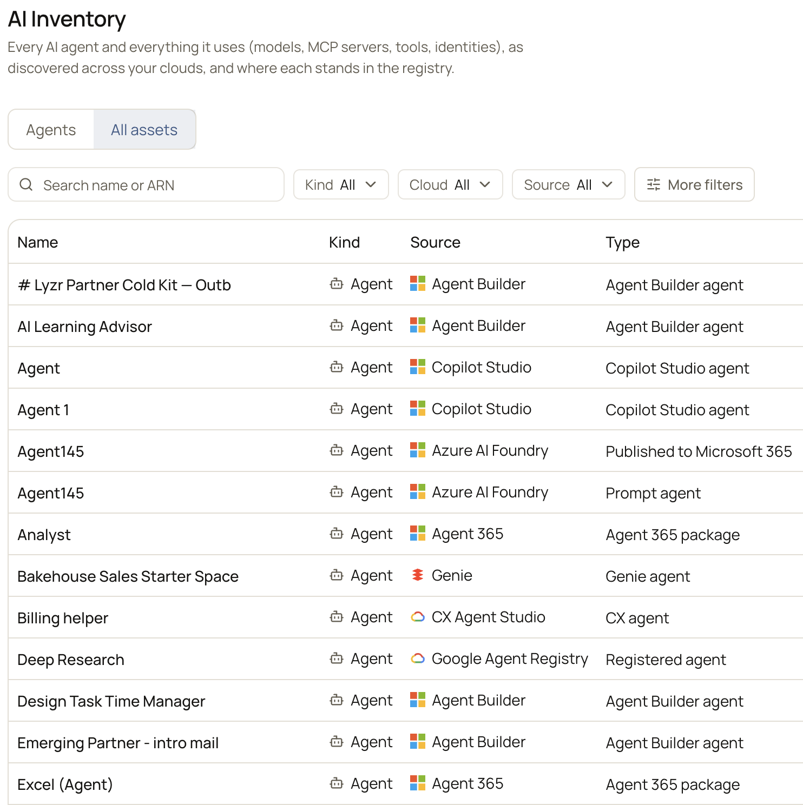

It opens on **Agents**; select **All assets** to see every kind.

{/* SCREENSHOT: inventory-hero | crop | AI Inventory on "All assets": the title, the Agents / All assets switch, the filter bar, and 13 rows with Name, Kind, Source and Type. Cropped before Account (tenant and project IDs). */}

## Filter the list

The same filter bar is on **Shadow AI** and **Registry**.

- **Search** matches the name or the ARN.
- **More filters** adds **Exposure** (**Public**, **Organization**, **Private**), **Authentication** (**None** means anyone can call it), **Account** and **Region**.
- **Include removed** also shows assets no longer discovered, faded, with the status **Removed**.
- **Cost, 30 days** keeps assets that were billed anything in the last 30 days (**Has spend**), nothing (**No spend**), or more than an amount (**Over $100**, **Over $1,000**, **Over $10,000**). It shows to anyone who can read spend.
- Filters are kept in the page address, so you can bookmark a filtered view or send it to someone.

## Sort the list

Select a column heading to sort the whole list by it, not just the page you see: **Name**, **Kind**, **Source**, **Status**, **Cost** or **Last synced**. The first click sorts A to Z, or for **Cost** and **Last synced** the costliest or latest first; the second reverses it; the third returns to the usual order, by kind and then name. The order is kept in the page address, as the filters are.

## What each asset cost

The **Cost** column is what each asset cost over the last 30 days: its bill, or its share of one where no bill names it, as [Spend](/discover/people-and-spend) counts it. Sorting and filtering by cost use the same 30 days, so the order matches the figures. A cost under a cent shows as **< $0.01**.

Costs in different currencies are never added together. Where your assets were billed in more than one currency, an **In** choice beside the cost filter picks the one the column, the order and the filter use, dollars first. An asset billed only in another currency shows a dash; hold the pointer over it to see what it was billed.

## The Registry column

| Registry | Meaning |
|---|---|
| **Registered** | Approved, with an owner and a purpose. See [Registry](/govern/registry). |
| **Awaiting approval** | Someone requested its registration. |
| **Shadow** | Its kind must be registered, and nobody has. See [Find shadow AI](/discover/shadow-ai). |
| **Not governed** | Its kind does not need registering. |

The column shows only when your deployment runs the registry. A registered asset its cloud no longer reports keeps **Registered**, but is not counted as part of the estate; see [Registry](/govern/registry). When the registry holds more active registrations than the console reads at once (20,000), a notice on **Overview** and on this page says so: standings beyond that are not coloured.

## Who answers for each asset

The **Team**, **Owner** and **Sponsor** columns say who answers for each asset, as its **Ownership** tab does: a team
pinned or covered by a team's rule, an owner named or the one its platform records (marked **the platform's**), and a
sponsor. A gap shows in warning colour: **no team**, **contested**, **no owner**, **left** or **no access**. An asset whose
ownership record cannot be read says **cannot be read**; the other rows are unaffected.

The list shows the columns that fit its width, in the order they matter: **Owner** first, then **Team** and **Region**,
then **Sponsor**, and the cloud **Account** on the widest screens. Open an asset to see them all on its **Ownership**
tab.

An Admin changes them where they are shown: select a cell, then pick the team (or **As the teams' rules say**), or type
the person's email (or select **Clear**). The change shows at once, and **Undo** in its notice, which stays for 10
seconds, puts it back. Each change is in the [audit log](/administer/audit-log). Anyone else reads the cells as text.

## Open an asset

Select a row to open it in a side panel: its details, graph, registration, who can reach it and who owns it. See [Asset details](/discover/asset-details). Cmd-click (Ctrl-click) its name to open it on its own page.

An asset you deleted in your cloud stays listed until the next scan marks it removed.

## The estate report

On **Overview**, **Estate report** downloads the estate as a **PDF report**, to read and share, or an **Excel workbook** of every metric and asset, to filter and chart. It is built in the browser from what you may see, and reads the whole inventory: while it builds, a note says how far it is ("*N* of *M* assets"). Relationships, what each asset uses, come from the graph's first 5,000 assets, and the report says so when the estate is larger.

## Who can use it

| Role | What they can do |
|---|---|
| **Viewer** | Read, filter, sort and open any asset, and see what each cost. |
| **Operator** | Also rescan an asset and change an agent's sharing. |
| **Admin** | Also name an asset's team, owner and sponsor, on its row or its **Ownership** tab. |
| **Owner** | The same as Admin. |

## Next steps

<CardGroup cols={2}>
  <Card title="Asset details" icon="list" href="/discover/asset-details">
    Every tab and card in an asset's side panel.
  </Card>
  <Card title="Find shadow AI" icon="eye" href="/discover/shadow-ai">
    Register what nobody has registered yet.
  </Card>
</CardGroup>
