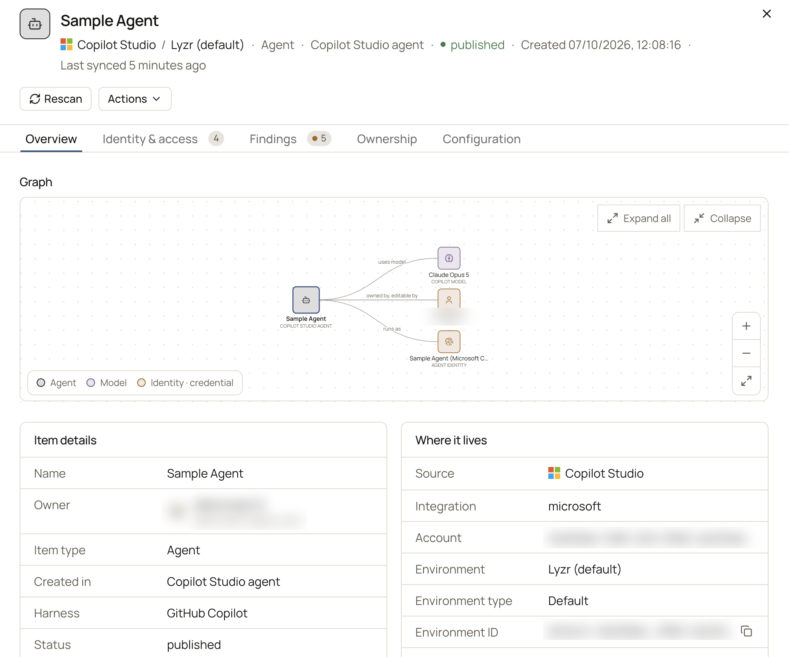
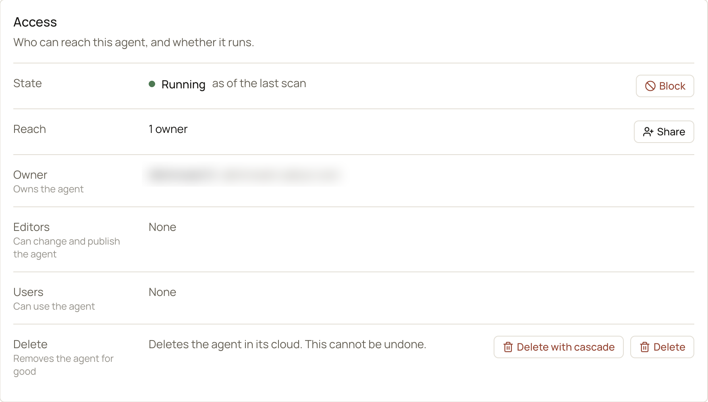

Select a row in [AI Inventory](/discover/ai-inventory) to open the asset in a side panel; **Actions** > **Open full page** opens it on its own page. Every kind of asset uses the same layout, and a part shows only where it applies: a model, for example, has no **Access** card.

{/* SCREENSHOT: asset-panel | crop | An agent's side panel on the Overview tab: the header with Rescan and Actions, the tab row, the Graph and the top of the fact cards. Crop to the panel; owner, account and environment IDs blurred. */}
<Frame caption="An agent's side panel, Overview tab">
  
</Frame>

- **Rescan** scans again only the clouds that reported this asset.
- **Actions** > **Open in Shadow AI map** and **View on the map** show only when your deployment runs the registry.
- **Spend, 30 days** shows only when a bill names the asset. It, the **Spend** tab's **Last 30 days** and the **Cost** column on [AI Inventory](/discover/ai-inventory#what-each-asset-cost) count the same 30 whole days the same way: the asset's bill, or its share of one where no bill names it, never both, as the share is part of that bill.
- The **Registration** card lets an Operator **Register** a shadow asset and an Admin approve, reject or revoke. For a kind the registry policy does not govern, it says so, with **Change the policy** for an Admin. See [Approvals](/govern/approvals).

## Access and sharing

The **Access** card, on **Identity & access**, says who can reach an agent and whether it runs, and changes both in the agent's own cloud. The controls show only when the cloud's integration has its **Control** credential (see [Connect your accounts](/discover/connect-accounts)); without it, the card is read-only. It shows for:

- **Microsoft:** Copilot Studio, Agent Builder, Agent 365 catalog agents, Foundry agents
- **Google Cloud:** Agent Runtime, CX Agent Studio apps
- **AWS:** AgentCore runtimes and gateways
- **Snowflake:** Cortex Agents, Snowflake-managed MCP servers
- **Cloudera:** workbench models and applications (Agent Studio workflows among them), workbenches, model endpoints, projects, environments

{/* SCREENSHOT: asset-sharing | crop | The Access card of a Copilot Studio agent: State Running with Block, Reach with Share, Owner (blurred), Editors and Users, and Delete with cascade and Delete. Crop to the card. */}
<Frame caption="The Access card of a Copilot Studio agent">
  
</Frame>

- Every change asks for a **Reason**, kept in the [audit log](/administer/audit-log). The change shows as pending (for example, **Block pending**) until the next rescan confirms it.
- Where the registry runs, an agent is blocked only once its owner and purpose are on record: blocking an unregistered agent registers it as pending in the same step.
- Some Microsoft changes need a Microsoft administrator signed in (**Sign in to Microsoft**). The sign-in lasts about an hour.

<Warning>**Delete** removes the agent in its cloud for good, not only in OpenController. It cannot be undone.</Warning>

## LLM gateway

The **LLM gateway** card, also on **Identity & access**, puts an agent's model calls through the LLM gateway, where its keys, limits and logs apply. Today it works for Foundry prompt agents, with the **LLM Gateway** module, on a deployment that runs control.

**Route through gateway** makes a virtual key for the agent and publishes a new agent version that calls its model through the gateway; the current version stays in Foundry. **Take off gateway** undoes it.

## Ownership

- **Owner** answers for the asset technically: how it is built and what it can reach. **Sponsor** answers for it to the business: why it exists and whether it should go on.
- The owner is the one an Admin names, or the one its platform gives, with a confidence. A suggested person can say **This is mine** or **Not mine**; an Admin confirms.
- The team is the one an Admin pins, or the one a team's asset rule covers.
- Each person shows what your directories say of them. **left the organization** means your identity provider (Okta's directory) deactivated them or no longer lists them; posture raises GOV-3. **no longer has access** means SCIM deactivated or removed them, so they no longer have OpenController, though they may still work here; posture raises GOV-6, a lower finding.
- **Dropped and created again.** Some clouds, such as Snowflake, give an object created again under the same name the same asset. When a scan finds the object's own creation time moved forward, what was decided of the old one is retired: its owner, sponsor and team pin, its registration (revoked, or a request rejected, saying why), and its findings. The **Ownership** card says when, and the new object is registered again like any shadow asset.

## Configuration

**Attributes** states the same facts for every cloud (exposure, authentication, framework, model and more); public exposure and no authentication show in warning colour. **Configuration** holds everything else the cloud reported. Secret values are never stored: variables and headers are kept by name only, and a name that looks like a secret is flagged.

## Activity

An agent's **Activity** tab shows what it did, from its traces, day by day over **7 days**, **30 days** or **90 days**. It
shows for agents when the **Observability** module is on.

| Figure | What it shows |
|---|---|
| **Runs** | How many runs the agent made, and when the last was. |
| **Failed runs** | The share of its runs that failed, and how many. |
| **Model calls** | The model calls in its runs, and their input and output tokens. |
| **Cost** | What its model calls cost. |
| **People** | How many people its runs served. "100+" means at least that many. |
| **Latency, p95** | How long its runs took: p95, and p50 beneath. Each is within 5%, shown with ≈. |

Below the figures are **Models it used** and **Tools it called**, the most runs first, each with its calls, failures and
cost; **People it served**; and, with the **Guardrails** module, **Guardrail violations in its runs**, by type. A model
or tool is the inventory asset of its name, when exactly one asset has it.

- **Which runs count.** A run counts for the agent its trace began with: the agent of the project the trace was sent
  to, or of the service that sent it. See [Count each service for its own agent](/monitor/observability#count-each-service-for-its-own-agent).
- **How recent.** The figures come from a roll-up of the traces, made every 15 minutes, a quarter of an hour of runs at
  a time, each run read once. The tab says how recent it is ("From its traces, as of …"). A run shows within about 40
  minutes of starting. Opening the tab reads no trace.
- **People it served** needs traces that name a person, with an `enduser.id` or `user.id` attribute.
- **Guardrail violations in its runs** counts a violation when it names the trace its call was in. See
  [Open the trace](/secure/who-trips/violations#open-the-trace).
- With no runs in the window, the tab says **No runs in the last *N* days**, with a link to **Projects**.

## Who can do what

| Role | What they can do |
|---|---|
| **Viewer** | Read every tab. |
| **Operator** | Also rescan, request a registration, and share, block, publish or delete an agent. |
| **Admin** | Also approve, reject and revoke registrations, name the team, owner and sponsor, and route an agent through the gateway. |
| **Owner** | The same as Admin. |

A button you cannot use shows greyed out; hover over it to see the permission it needs.

## Next steps

<CardGroup cols={2}>
  <Card title="Explore your AI inventory" icon="boxes" href="/discover/ai-inventory">
    Back to the list of every asset.
  </Card>
  <Card title="Review and approve requests" icon="stamp" href="/govern/approvals">
    Decide the registrations that wait.
  </Card>
</CardGroup>
