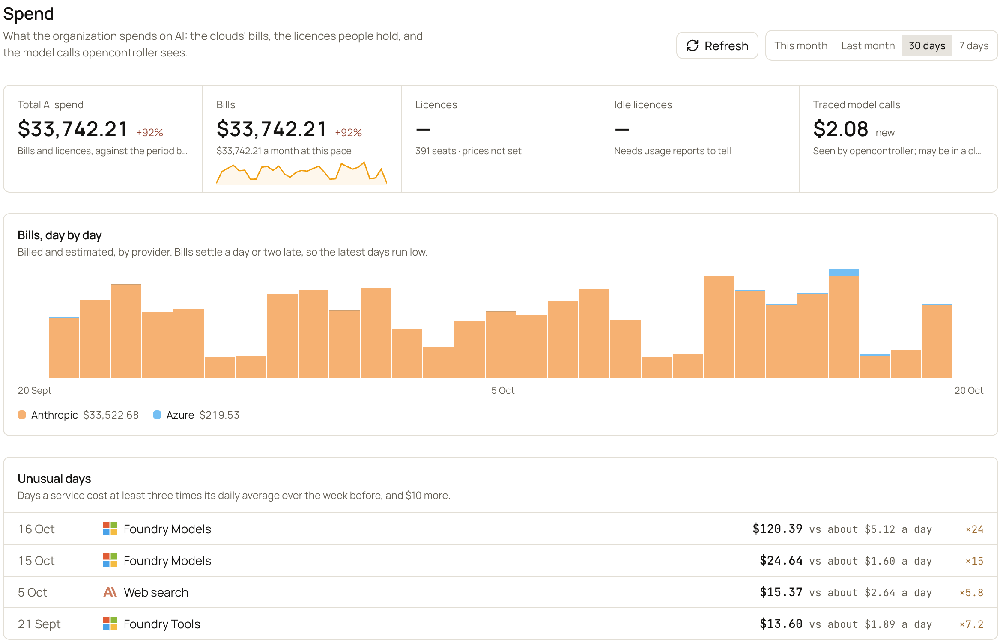
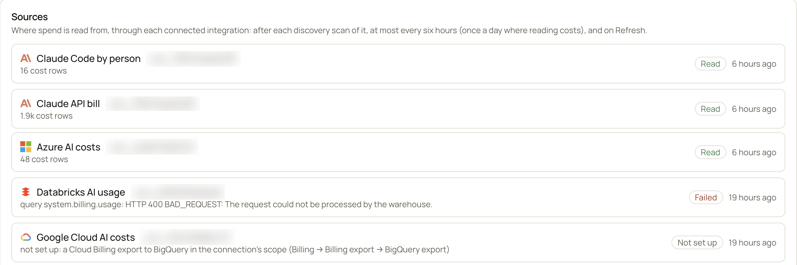
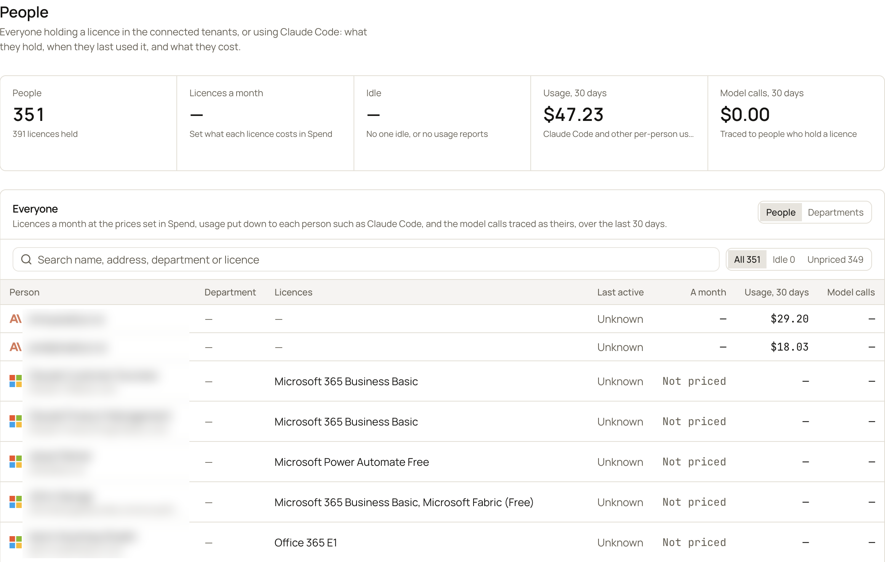

Two pages show what your organization spends on AI:

- **Spend**, in the sidebar after **Overview**: the money, where it goes and which sources it is read from.
- **Discover** > **People**: who it is spent on. Everyone in your connected tenants who holds an AI licence or has usage billed to them, such as Claude Code.

## What the organization spends

{/* SCREENSHOT: spend-hero | full | The Spend page with Period set to 30 days: the figures on top, "Bills, day by day", and the top of "Where the bills go" and "Licences". Account IDs blurred. */}
<Frame caption="The Spend page, 30 days">
  
</Frame>

- **Total AI spend** is bills plus licences. Model calls stay out of it: a call through Bedrock or Azure is already in that cloud's bill.
- Bills settle a day or two late, so the latest days run low.
- **Unusual days** lists days a service cost at least three times its daily average over the week before, and $10 more. It shows only when there is one.
- In **Top agents and models**, an agent that costs money and is not registered is the one to look at. **not in inventory** means a bill names it but discovery has not found it. Azure and Databricks bills do not name agents yet.
- **One provider's spend:** pick it in **Provider**. Anthropic, OpenAI and Snowflake have a page of their own: select **Anthropic's own page**, **OpenAI's own page** or **Snowflake's own page**. Anthropic's breaks the bill down by workspace, API key, person and model, and OpenAI's by project, API key and model, with every API key's share of it. Snowflake's breaks the AI credits down by account, user, person and object, and shows each Cortex Agent's cost against its use. Each workspace, project and key is listed by its name and told apart by its id: two keys of one name are two lines.
- **A key's spend is the key's.** Spend through an API key, a service account or a Snowflake service user shows under the key on its provider's page, never on the person who made it. Only use a person runs up themselves is theirs on **People**.
- **Licences:** licence APIs carry no prices, so an Admin sets each seat's monthly price with **Set prices**. **People** uses the same prices. Over a period, licence costs are prorated by calendar month: a month's seats cost that month's price, and a part of a month its share of the days.

### Sources

**Sources** shows whether each source of spend is read. A source that lacks a permission says **Needs a permission** and names it, instead of showing nothing spent. Grant it, then select **Refresh**.

Spend is read after each discovery scan, at most every six hours (once a day where reading costs money), and on **Refresh**. Snowflake's rows are **billed** where the read role reads the organization's bill, and **estimated** otherwise: credits priced at the connection's credit price or the organization's rate sheet, as [its guide](/integrations/snowflake#read-usage-and-spend-optional) explains. GitHub Copilot and Salesforce Agentforce are not read yet.

### Each cost counted once

Several integrations can read the same money. Spend keeps each cost once:

- **One bill per billing account.** When two integrations read one billing account, such as an AWS payer and one of
  its member accounts, one of them holds the bill. The other's source says how many rows it left out, so the bill
  counts once.
- **An estimate gives way to the bill.** A day's estimated cost, such as AgentCore's, is left out once the bill covers
  that day.
- **A share is not added to the bill.** What a key or a person used is a share of a bill already counted: it shows on
  their row and on the asset's page, never on top of the bill. An asset costs its bill, or, with none, its share of
  one.
- **Each currency is its own total.** A provider billed in euros shows its figure in euros, beside the dollars, never
  added to them.
- **What a source cannot place is kept on nothing.** A row that names an asset discovery would not name is kept,
  on no asset, and its source says so. A bill or an estimate that names no currency is left out, as what it cost
  cannot be told, and its source says that too.

When the books do not balance anyway, Spend says so in a banner, **The books do not balance**, one line per
provider: a bill two integrations both hold, shares that add up to more than their bill, rows left by an integration
since removed, or one provider's rows in two currencies. Nothing shows when the books balance.

### Export the bills

**Export bills** downloads each day's billed cost by integration, account and service, as CSV, to check against the
provider's own billing. Its columns follow the FinOps Foundation's FOCUS specification, so FinOps tools read it:

| Column | What it holds | FOCUS column |
|---|---|---|
| `day` | The day, in UTC. | `ChargePeriodStart` |
| `provider` | The cloud or service. | `ProviderName` |
| `connection`, `connection_name` | The integration that read it. | |
| `account`, `account_name` | The account, workspace or project, by its id and its name. | `SubAccountId`, `SubAccountName` |
| `service` | The service billed. | `ServiceName` |
| `cost`, `currency` | What it cost, in the currency billed. | `BilledCost`, `BillingCurrency` |

{/* SCREENSHOT: spend-sources | crop | The Sources panel, stitched: Claude Code, Claude API bill and Azure AI costs Read, Databricks Failed, Google Cloud Not set up. The AWS rows (account ID in the error) left out; connection IDs blurred. */}
<Frame caption="The Sources panel">
  
</Frame>

## Who it is spent on

**People** lists people the costliest first, over the last 30 days, 50 at a time.

{/* SCREENSHOT: people-hero | full | The People page: the figures on top, then the Everyone panel with the search box, the Show chips (All, Idle, Unpriced) and the first rows. Names and emails blurred. */}
<Frame caption="The People page">
  
</Frame>

- **Idle** licences have not been used for 30 days, each counted on its own: a Microsoft 365 Copilot licence nobody uses is idle beside an E5 in daily use. A seat given less than 30 days ago is never idle. A person is idle when any licence they hold is, other than one priced at nothing, and the **Idle** figure adds up only the idle licences' cost. **Last active** says **Unknown** when the source cannot tell; for Microsoft 365, that needs permission to read usage reports (see **Sources**). {/* TODO verify: which Microsoft permission gives People its activity data (usage reports). */}
- **Unpriced** people hold a licence with no price yet. Set it on **Spend** > **Licences** > **Set prices**.
- **Departments** (under **View**) totals by the department the directory gives each person; people without one show under **None set**.
- **One person, many accounts.** A person's accounts across providers are joined only on evidence, and each account says what joined it: the same address, an address their provider lists for the same mailbox, or your identity provider listing both addresses as theirs (their login and primary email, never a second email they set themselves). GitHub Copilot seats join by the address your identity provider signs people in with (see [GitHub](/integrations/github#read-the-bill)).
- **Never joined.** An address two people are known by, such as a team's mailbox, joins nobody, and its account says so. Someone your identity provider says left, or no longer lists, keeps their accounts apart, each marked, so their seats stay in sight to reclaim. An identity that left never joins two accounts, as its addresses may be someone else's by now.
- **No one read yet** means Microsoft 365 or Anthropic is not connected under [Integrations](/discover/connect-accounts), or Spend has not read it yet.

## Who can use it

Who holds which licence is personal data, so the person-by-person views (**People**, **Top spenders**, **Spend by department**) need `spend:people`, an Admin's by default.

| Role | What they can do |
|---|---|
| **Viewer** | Read **Spend**, except the person-by-person panels. |
| **Operator** | Also select **Refresh**. |
| **Admin** | Also set prices, and see **People**, **Top spenders** and **Spend by department**. |
| **Owner** | The same as Admin. |

## Next steps

<CardGroup cols={2}>
  <Card title="Find shadow AI" icon="eye" href="/discover/shadow-ai">
    The AI in use that nobody has registered.
  </Card>
  <Card title="Track cost" icon="chart-line" href="/monitor/cost">
    The cost of traced model calls.
  </Card>
</CardGroup>
