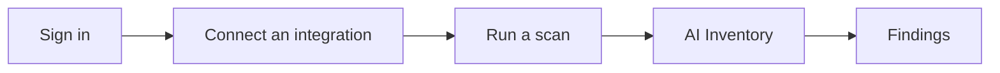

Start with whichever platform your organization uses most: **AWS**, **Microsoft**, **Google Cloud**,
**Databricks**, **Snowflake** or **Anthropic**. The steps are the same for all of them; only the connection
form changes.

**What you need:**
- **Roles:** **Admin** to connect the integration. **Operator** is enough to run scans after that.
- An OpenController workspace and an account in it.
- Admin access in the platform you connect, enough to create the read-only identity OpenController reads as
  (step 3 says which one).

## Step 1: Sign in

Open your workspace's address in a browser. You see **Sign in to opencontroller**.

{/* SCREENSHOT: qs-signin | crop | The sign-in card: Email, Password, Sign in, the "or" divider, and API credential with Use credential (plus Sign in with … when single sign-on is set up). Crop to the card and the opencontroller mark above it. */}

Sign in in one of these ways, whichever your workspace shows:
- **Email** and **Password**, then **Sign in**.
- **Sign in with** your identity provider, for example **Sign in with Okta**, when your workspace has single sign-on.
- **API credential**: paste a service account key (`cpk_…`) and select **Use credential**.

If you created the workspace yourself, you are already signed in as its first admin, the **Owner**.

<Tip>If you see **No access yet**, you are signed in but have no role. Ask an administrator to give you the **Viewer**, **Operator** or **Admin** role, then sign in again.</Tip>

## Step 2: Open Integrations

Select **Integrations** at the foot of the console sidebar. With nothing connected, the page says **Nothing connected**.

{/* SCREENSHOT: qs-integrations-empty | crop | The Integrations page header and the empty state "Nothing connected", with the Connect button at the top right. Crop to the page header and the empty state; no sidebar. */}
<Frame caption="Integrations, before anything is connected">
  
</Frame>

Select **Connect**. The dialog asks **What are you connecting?** and offers one card per platform, with a link to each one's setup guide at the bottom.

{/* SCREENSHOT: qs-connect-choose | crop | The "What are you connecting?" dialog with its six cards (AWS account, Microsoft tenant, Databricks workspace, Google Cloud project or organization, Anthropic organization, Snowflake account) and the Setup guides links. Crop to the dialog. */}

<Note>Discovery only reads. Nothing in the account you connect is changed.</Note>

## Step 3: Connect your first account

Every platform follows the same pattern:

1. **In the platform**, create a read-only identity for OpenController.
2. **In OpenController**, fill in the connection form and select **Connect**.
3. **Verify** that OpenController can reach it.

Only the identity differs. Choose your platform:

<Tabs>
  <Tab title="AWS">
    OpenController reads the account by assuming a **read-only IAM role** with an external ID. No AWS keys are stored.

    1. Select **AWS account**. The dialog shows **Trusts** (the identity OpenController reads as) and an **External ID**.
    2. Create the role in the account: download the template and create a CloudFormation stack with those two
       values. The other tabs (**AWS CLI**, **Terraform** and more) create the same role in other ways.
    3. Back in the dialog, enter a **Name** and the 12-digit **AWS account ID**, then select **Connect**.

    Full steps and permissions: [AWS](/integrations/aws).
  </Tab>
  <Tab title="Microsoft">
    OpenController reads the tenant as an **Entra app registration**. Its secret is kept in your secrets manager
    and never shown again.

    1. In Microsoft Entra ID, register the read app and create a client secret.
    2. Select **Microsoft tenant**, enter the tenant, the app's ID and the secret, then select **Connect**.
    3. Grant the read app the access discovery needs, as the form lists.

    Full steps and permissions: [Microsoft](/integrations/microsoft).
  </Tab>
  <Tab title="Google Cloud">
    OpenController reads a project, folder or organization as a **read-only service account**.

    1. In Google Cloud, create the read-only role and the service account.
    2. Let OpenController act as the service account: with workload identity federation (no secret), or with a
       service account key.
    3. Select **Google Cloud project or organization**, enter the scope and the service account, then select **Connect**.

    Full steps and permissions: [Google Cloud](/integrations/gcp).
  </Tab>
  <Tab title="Databricks">
    OpenController reads the workspace as a **service principal**. Its OAuth secret is kept in your secrets manager.

    1. In Databricks, create the service principal and an OAuth secret.
    2. Select **Databricks workspace**, enter the **Workspace URL**, the application ID and the secret, then select **Connect**.
    3. Grant the service principal the access discovery needs, as the form lists.

    Full steps and permissions: [Databricks](/integrations/databricks).
  </Tab>
  <Tab title="Snowflake">
    OpenController reads the account as a **service user that reads no data**, signing in with a key pair or with
    workload identity federation.

    1. Select **Snowflake account** and fill in the account.
    2. Run the setup script the form gives you in Snowflake. It creates the read user and its role.
    3. Select **Connect**.

    Full steps and permissions: [Snowflake](/integrations/snowflake).
  </Tab>
  <Tab title="Anthropic">
    OpenController reads a Claude Platform organization with an **Admin API key**. The key is kept in your secrets
    manager.

    1. In the Claude Console, create an Admin API key.
    2. Select **Anthropic organization**, enter the organization and paste the key, then select **Connect**.

    Full steps and permissions: [Anthropic](/integrations/anthropic).
  </Tab>
</Tabs>

<Tip>Leave **control** off for now. Control lets OpenController change agents in the account, for example to stop one. You can turn it on later, where the platform supports it.</Tip>

### Check that it can reach the account

The console checks the connection at once. In the Integrations table, the **Access** column shows
**Verified** with the time it was checked.

If it cannot reach the account yet, the identity you created may still be getting ready. Wait a minute, then
select **Verify** on the row. Verify lists each check and says which one failed.

{/* SCREENSHOT: qs-verified | crop | The Integrations page with connected accounts listed (name, platform, control and guardrails per row; Account and Signs in as columns blurred). Crop to the page header and the table; no sidebar. */}
<Frame caption="Connected accounts on Integrations">
  
</Frame>

## Step 4: Run a scan

On **Integrations**, under **Discovery scans**, select **Run scan**. The **Overview** page has the same button.

While it runs, the sidebar shows **Scanning** with the number of sources read. Each scan is listed under
**Discovery scans** with its status, provider, duration, **Sources read** and **Failed**. Select a scan to open its page.

{/* SCREENSHOT: qs-scan-result | crop | The Discovery scans section on Integrations: the schedule line, Run scan, and a list of finished scans with Succeeded badges, provider, started, duration, sources read and failed. No sidebar. */}
<Frame caption="Discovery scans, after the first scans finished">
  
</Frame>

The status badge reads **Running**, then **Succeeded**, **Partial** (some sources failed) or **Failed**.
**Failed** above zero usually means a missing permission or a part of the platform that is turned off.
The list of sources under the figures says why each one failed.

<Tip>You do not have to start every scan. By default each enabled integration is also scanned on a schedule. Admins set it in **Settings** > **Scan schedule**.</Tip>
{/* TODO verify: the default scan interval on hosted workspaces (DISCOVERY_SCAN_INTERVAL, 5m by default). */}

See [Run and schedule scans](/discover/scans) for more.

## Step 5: See your AI inventory

Select **AI Inventory** in the sidebar, under **Discover**.

{/* SCREENSHOT: qs-first-inventory | full | AI Inventory after the first scan of the account: the Agents / All assets switch on Agents, the filter bar, and rows such as support-bot and billing-agent with Kind, Source, Status, Registry and Last synced. */}
<Frame caption="AI Inventory after the first scan">
  
</Frame>

- **Agents** shows only agents. **All assets** adds what they use: models, MCP servers, tools and identities.
- The **Registry** column says where each agent stands. New agents are shadow AI until someone registers them.
- Select a row to open its details in a side panel: what it uses, what uses it, and its owner.

See [Explore your AI inventory](/discover/ai-inventory) for the filters.

## Step 6: Read your findings

Select **Findings** in the sidebar, under **Posture**. Findings are evaluated after each scan.
If the page shows **Evaluating the posture**, wait a moment.

Each finding is a problem on an asset, with a severity, why it matters, and the fix. **Assets most at risk** lists the assets to look at first.

See [Review findings](/posture/findings) for severities and frameworks.

## What you built

- A first platform connected through a read-only identity.
- A first scan, and an inventory of the AI in that account.
- A list of posture findings to work through.

Connect your other platforms the same way: each one adds its agents to the same inventory.

## Next steps

<CardGroup cols={2}>
  <Card title="Register an agent" icon="clipboard-check" href="/govern/registry#register-an-agent">
    Take an agent out of Shadow AI and send it for approval.
  </Card>
  <Card title="Give apps virtual keys" icon="key" href="/secure/virtual-keys">
    Give an agent its own key, and point it at the gateway.
  </Card>
  <Card title="Block prompt injection and personal data" icon="shield-half" href="/secure/guardrails/block-prompt-injection">
    Make a guardrail and use it in the gateway's content rules.
  </Card>
  <Card title="Members, roles and teams" icon="users" href="/administer/members-roles-teams">
    Add members and give each a role.
  </Card>
</CardGroup>
