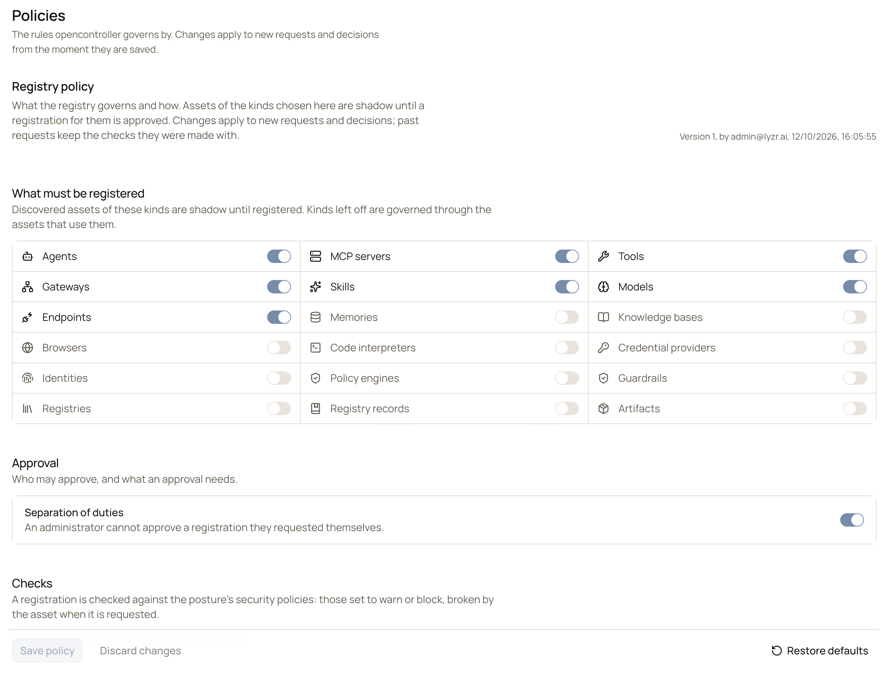

<Badge>Admin</Badge>

**Policies**, under Govern in the sidebar, has two pages: **Registry**, for what must be registered and what an
approval needs, and **Spend**, for when spend needs a look and what each connection may spend a month.

## Registry policy

Changes apply to new requests and decisions from the moment you save them.

{/* SCREENSHOT: policies-hero | full | Policies: the Registry policy header with its version, the "What must be registered" grid of kind switches, the Approval block with Separation of duties, and the save bar. */}
<Frame caption="The Policies page">
  
</Frame>

### What must be registered

Switching a kind on puts its unregistered assets in [Shadow AI](/discover/shadow-ai); switching it off takes them out. Kinds left off show as **Not governed** and are governed through the assets that use them, for example an identity through the agent that runs as it.

### Approval

**Separation of duties** is on by default: nobody can approve a registration they requested themselves.

### Save your changes

Each save makes a new version of the policy, and the header shows who saved the one in force. If someone else saves while you edit, your save fails: select **Load the current policy**, then make your change again.

Guardrails and budgets are not set here: see [Guardrails](/secure/guardrails/list) and [virtual keys](/secure/virtual-keys).

## Spend policy

The spend policy says when spend on an asset opens a signal, and what each connection may spend a month. What each
signal means, and where signals show, is in [What needs a look](/discover/people-and-spend#what-needs-a-look). Nothing
here stops spend: signals and limits only show it.

Go to **Policies** > **Spend**. The figures on top show the policy at work: **Signals open**, by severity; **Assets
that need a look**; and **Connections with a limit**, with how many are over it, or headed over it, this month.

{/* SCREENSHOT: spend-policy | full | Policies > Spend: the three figures on top, the "When spend needs a look" panel with its five rules and their fields at the defaults, and the top of "Monthly limits". */}

### When spend needs a look

Each rule is a sentence with the numbers you can change in it. Beside each rule, **open now** counts its open signals.

| Signal | Opens when | Default |
|---|---|---|
| **Unregistered, spending** | An asset no one registered spends this much or more over 30 days. | $10 |
| **Spending after revoke** | An asset whose registration was rejected or revoked spends anything in the last week. Always on: there is nothing to set. | |
| **Spike** | A day costs this many times the average of the 7 days before it, and at least this much more. | 3×, $10 |
| **Accelerating** | Spend grows this fast or faster over 14 days, and fits the growth curve at this R² or better (0 to 1). The note under the rule says how fast spend doubles at that growth. | 10% a day, 0.8 |
| **No owner** | A governed asset spends the **Unregistered, spending** amount or more over 30 days, and no one owns it. It shares that amount. | $10 |

The amounts are read in the currency each asset is billed in most. A value out of range cannot be saved: a spike starts
at 1×, growth must be above 0%, and the fit above 0 and at most 1.

### Preview a change

When you change a number, the rule is marked **Changed**, and OpenController works out the signals the new numbers
would open, against the bills you have now, without saving anything. Each rule shows **open now → with these**. Under
the rules, the preview says how many signals would be open, and lists them under **Would open** and **Would resolve**.

### Monthly limits

**Monthly limits** lists each connection that reads spend: what it has spent this month so far, where it is headed at
the last seven days' pace, and a **Limit** field, in the currency the connection is billed in most. Leave the field
empty for no limit. A connection headed over its limit says **Over its limit by** how much at this pace, and one at its
limit says **It has reached its limit this month.** Once a month's spend reaches the limit, an **Over its limit**
signal opens, at high severity.

Most providers' APIs do not say their limit, so you enter it here. OpenController enforces nothing.

### Findings

Open signals on assets are also posture findings, **FIN-1** to **FIN-5** under Governance. Select **Security
policies** to choose whether each runs. See [Security policies](/posture/security-policies).

### Save the spend policy

A bar shows **Unsaved changes**, and with a preview, how many signals would open and resolve. Select **Save policy** to
save the rules and the limits together, or **Discard**. Saving works the signals out again at once.

## Who can use it

| Page | Who sees and changes it | Permission |
|---|---|---|
| **Registry** | **Admin** and **Owner** | `registry:govern` |
| **Spend** | **Admin** and **Owner** | `spend:limits` |

**Policies** shows in the sidebar to anyone who holds either permission, with only the pages they hold. Other roles do
not see it. Every role that reads **Spend** sees the signals the policy opens.

## Next steps

<CardGroup cols={2}>
  <Card title="Find shadow AI" icon="eye" href="/discover/shadow-ai">
    See what the policy makes shadow.
  </Card>
  <Card title="Review and approve requests" icon="stamp" href="/govern/approvals">
    Decide the requests.
  </Card>
  <Card title="See people and spend" icon="circle-dollar-sign" href="/discover/people-and-spend">
    What spend needs a look, and where it shows.
  </Card>
</CardGroup>
