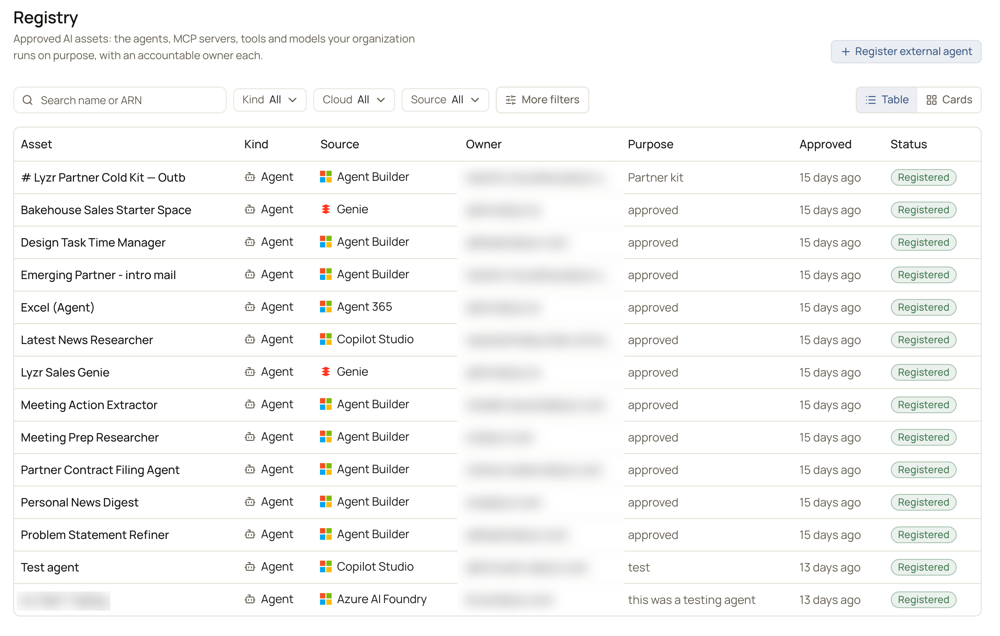

Every governed asset is in one of three places: **Shadow AI** (nobody has registered it), **Approvals** (a request is waiting) or **Registry** (approved).

{/* SCREENSHOT: registry-hero | full | Registry: Register external agent, the filter bar and the registered assets. Owners blurred. */}
<Frame caption="Registry">
  
</Frame>

## Register an agent

1. **Request it** (Operator). Select **Register** on the agent in [Shadow AI](/discover/shadow-ai), or on its **Registration** card in [Asset details](/discover/asset-details). Give an **Owner** and a **Purpose**. When the platform names an owner, it is fixed. Who created the asset is not taken as its owner: when the platform names only a creator, you give the owner.
2. **Approve it** (Admin). The request waits under [Approvals](/govern/approvals). With **Separation of duties** on, the requester cannot approve it.
3. **It is registered.** The asset is listed here with **Registered**. An Admin can **Revoke** it from its registration panel, which asks why and makes the asset shadow again.

Each step is kept in the registration's **History** and in the [audit log](/administer/audit-log).

### The owner comes from your directory

When your identity provider provisions people into OpenController (SCIM), the **Owner** field offers them as you type part of a name or an email. This works in the single, bulk and external agent forms. Pick a person: the field takes their email, or their user name when they have no email. That is how sign-ins and the ownership checks name them, so an owner who leaves shows as gone.

While SCIM is on, the registry refuses an owner your directory does not have. The message names the owner and asks for someone your identity provider provisioned, by email. An owner the platform names is taken as before. Without SCIM, you can type any owner.

An agent you register by hand (an A2A agent or an endpoint outside every connected cloud) is one asset per address. Asking again for one already pending or registered is refused, and the asset stays as the first request read it. Two agents behind one path, told apart by a query parameter such as `?agent=sales`, are two assets; a parameter that carries a secret (a token, a key, a signature) is never kept.

When registered assets are no longer reported by their cloud, a line above the list says how many ("*N* registered assets are gone from their clouds") and offers to **Show them**. They stay registered, but are not counted as part of the estate: the **Registered** figures on **Overview** and **AI Inventory** count live assets only.

## Register an external agent

**Register external agent** adds an agent no connected cloud runs. Give its A2A agent card URL, or its API endpoint (**OpenAI Chat Completions**, **OpenAI Responses** or **Other HTTP**), with an owner and a purpose. Only public `https` addresses are accepted. It enters the inventory and goes through the same approval.

This needs the **Operator** role in the organization: a role held only in a team is not enough, since no team owns an agent outside the connected clouds.

## Who can use it

| Role | What they can do |
|---|---|
| **Viewer** | Read the registry and each registration. |
| **Operator** | Also request registrations and register external agents. |
| **Admin** | Also approve, reject and revoke. |
| **Owner** | The same as Admin. |

## Next steps

<CardGroup cols={2}>
  <Card title="Review and approve requests" icon="stamp" href="/govern/approvals">
    Decide the requests that wait.
  </Card>
  <Card title="Set registry policies" icon="scale" href="/govern/policies">
    Choose what must be registered.
  </Card>
</CardGroup>
