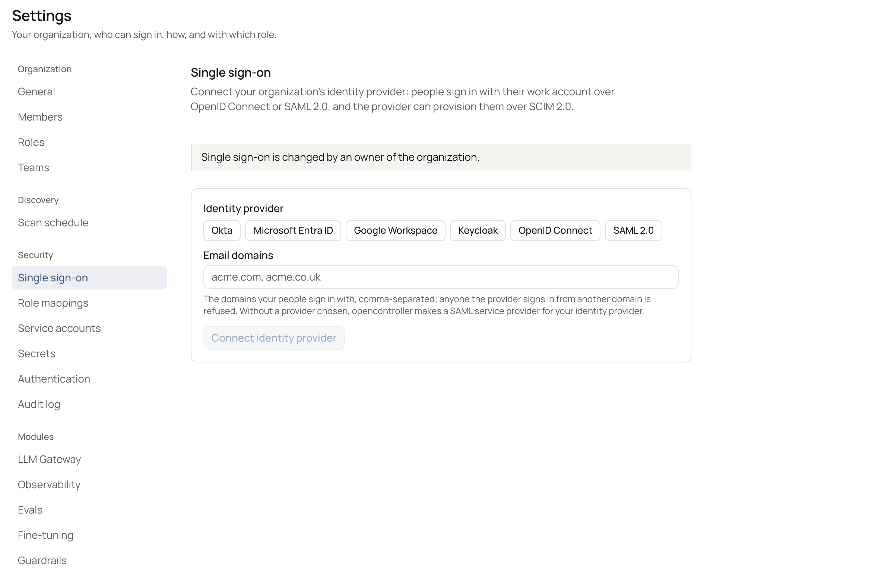

Okta signs people in to the console with **OpenID Connect**, through one of its authorization servers, or with **SAML
2.0**, through an app. It can also provision people with **SCIM 2.0**. Okta groups map to roles in OpenController. For
apps that call the LLM gateway as a person, see [Okta for gateway callers](/integrations/caller-identity/okta).

OpenController can use up to three Okta apps, each for one job:

| Okta app | Okta app type | What it is for | Needed for |
|---|---|---|---|
| Sign-in | **OIDC - OpenID Connect** > **Single-Page Application** (or **SAML 2.0**) | People sign in to the console | Single sign-on |
| Provisioning | **SAML 2.0**, used for SCIM only | Okta tells OpenController who exists and which groups they are in | The people list in **Members**, and deactivation |
| Role changes | **API Services** | OpenController moves a person between Okta groups | Changing roles from the console |

<Warning>Each app has its own **Client ID**. Most setup errors come from a value of one app entered for another.
Keep them apart.</Warning>

Changing single sign-on needs the **Owner** role; an **Admin** can only read it. Below, `<console address>` is the
address under **Settings** > **Authentication** > **Console address**: open the console at that same address, since the
redirect URIs are built from the browser's address.

## Connect Okta

<Tabs>
  <Tab title="OpenID Connect (recommended)">
    <Steps>
      <Step title="Create the app in Okta">
        In the Okta Admin Console, go to **Applications** > **Create App Integration** > **OIDC - OpenID Connect** >
        **Single-Page Application**. Set:

        - **Grant type:** Authorization Code and **Refresh Token** (the console renews sessions with `offline_access`).
        - **Sign-in redirect URI:** `<console address>/auth/callback`
        - **Sign-out redirect URI:** `<console address>/signed-out`

        Assign the groups that may use OpenController, and note the **Client ID**. The app is public (PKCE): there is
        no client secret.
      </Step>
      <Step title="Set up the authorization server">
        Go to **Security** > **API** > **Authorization Servers** > **default** (or your custom one):

        - **Access Policies:** a rule for the app that allows Authorization Code and Refresh Token, and the scopes
          `openid`, `profile`, `email` and `offline_access`.
        - **Claims:** add two claims on the **access token**:
          - `email`, value `user.email`. Okta's access token carries no email otherwise, and every sign-in is refused
            as outside your domains.
          - `groups`, filter **Matches regex** `.*`, so group names arrive.
        - Note the **Audience**.
      </Step>
      <Step title="Connect Okta in OpenController">
        Go to **Settings** > **Single sign-on**. Under **Identity provider**, select **Okta**; under **Signs in with**,
        **OpenID Connect**. Fill in:

        | Field | What to enter |
        |---|---|
        | **Okta org URL** | `https://your-org.okta.com` (https only) |
        | **Authorization server** (optional) | `default`, or the ID of a custom one. Empty means `default`. |
        | **Client id** | The app's client ID. |
        | **Audience** (optional) | The authorization server's audience. Empty means the client ID. |
        | **Email domains** | The domains your people sign in with, for example `example.com`. Anyone from another domain is refused. |

        {/* SCREENSHOT: identity-okta-form | reuse | Reuses /images/settings/sso-connect-form.png. */}
        <Frame caption="Connecting Okta under Single sign-on">
          
        </Frame>

        Select **Connect Okta**.
      </Step>
    </Steps>
  </Tab>
  <Tab title="SAML 2.0">
    SAML also needs a secrets manager: OpenController's signing key is kept there.

    <Steps>
      <Step title="Create the app in Okta">
        In the Okta Admin Console, go to **Applications** > **Create App Integration** > **SAML 2.0**. Set:

        - **Single sign-on URL:** `<console address>/saml/acs`
        - **Audience URI (SP Entity ID):** `<console address>/saml/metadata`
        - **Name ID format:** EmailAddress, with **Application username** set to the email, so the domain check passes.
        - A group attribute statement named `groups`, filter **Matches regex** `.*`.

        Copy the app ID from the app's metadata URL: `https://your-org.okta.com/app/<app id>/sso/saml/metadata`.
      </Step>
      <Step title="Connect Okta in OpenController">
        Go to **Settings** > **Single sign-on**. Under **Identity provider**, select **Okta**; under **Signs in with**,
        **SAML 2.0**. Fill in **Okta org URL**, **SAML app id** and **Email domains**, then select **Connect Okta**.

        Check that the values under **1. In your identity provider, create a SAML application with these values** match
        what you set in Okta.
      </Step>
    </Steps>
  </Tab>
</Tabs>

The **Single sign-on** page shows **IdP Connected** (or **IdP unreachable**). Open the console in a private window and
select **Sign in with Okta** as a person in a mapped group.

OpenID Connect sign-out also signs out of Okta. SAML sign-out ends only the console session; the Okta session stays.

## Map Okta groups to roles

Go to **Settings** > **Role mappings** (needs **Owner**). For each role, enter the Okta group names that grant it under
**Granted to these groups or roles**, for example `opencontroller-admins` for **Admin**. A person in several mapped
groups gets the highest role. Set **Anyone signed in whom nothing maps gets** to a default role (not **Owner**), or
**no access** to refuse everyone else. Select **Save**.

A `roles` claim is read too: a value that names a role, such as `admin`, grants it without a mapping.

## Provision people with SCIM (optional)

With SCIM, Okta tells OpenController who exists and which groups they are in. **Settings** > **Members** then lists
everyone Okta provisioned, with the role their groups give them, and deactivating someone in Okta ends their access
on their next request.

Okta offers no SCIM on the **Single-Page Application** people sign in with: its settings have no **Provisioning**
option. Provision from a second app, of type **SAML 2.0**, that no one signs in with. The sign-in app stays as it is.

<Warning>
Once a SCIM token exists, only people Okta has provisioned, and who are active, can sign in through Okta. Do the
steps below one after the other. Members with a password can still sign in meanwhile.
</Warning>

<Steps>
  <Step title="Get the SCIM address and token">
    On **Settings** > **Single sign-on**, under **3. Provisioning (SCIM 2.0, optional)**, copy the **SCIM base URL
    (Tenant URL)** (`<console address>/scim/v2`). Select **Generate token**, copy the token from the **Shown exactly
    once** dialog, then select **I stored it**. Only its hash is kept; **Replace token** makes a new one and stops the
    old one.
  </Step>
  <Step title="Create the provisioning app in Okta">
    Go to **Applications** > **Create App Integration** > **SAML 2.0**. Name it, for example, `opencontroller SCIM`.
    Okta asks for SAML values though this app is not signed in with; enter:

    - **Single sign-on URL:** `<console address>/saml/acs`
    - **Audience URI (SP Entity ID):** `<console address>/saml/metadata`

    Finish as an internal app.
  </Step>
  <Step title="Turn on SCIM">
    On the new app's **General** tab, under **App Settings**, select **Edit**. Tick **Do not display application icon
    to users**, set **Provisioning** to **SCIM**, and save. A **Provisioning** tab appears. {/* TODO verify: the exact label of the Provisioning choice in App Settings on a SAML 2.0 app. */}
  </Step>
  <Step title="Connect it to OpenController">
    **Provisioning** > **Integration** > **Edit**:

    | Field | Value |
    |---|---|
    | **SCIM connector base URL** | The **SCIM base URL** from the first step |
    | **Unique identifier field for users** | `userName` |
    | **Supported provisioning actions** | **Push New Users**, **Push Profile Updates**, **Push Groups** |
    | **Authentication Mode** | **HTTP Header**, with the token as the Bearer token |

    Select **Test Connector Configuration**, then **Save**.
  </Step>
  <Step title="Say what to push">
    1. **Provisioning** > **To App** > **Edit**: turn on **Create Users**, **Update User Attributes** and
       **Deactivate Users**.
    2. **Assignments**: assign the same people, or groups, as the sign-in app.
    3. **Push Groups**: push the groups you map to roles. Pushed groups count toward role mappings.
  </Step>
  <Step title="Check in OpenController">
    **Settings** > **Members** > **Single sign-on** lists everyone Okta provisioned: their groups, whether they are
    active, and their role with the group that gives it, for example *Admin, from oc-admins*.
  </Step>
</Steps>

People are matched by email: their Okta username or email must be the one they sign in with.

## Change roles from OpenController (optional)

A provisioned person's role comes from the Okta groups mapped to roles, so it lives in Okta. Connected to Okta's API,
an **Admin** changes it from **Settings** > **Members** > **Single sign-on** > **Change role**, and OpenController
changes it in Okta:

- It adds the person to the group mapped to the new role.
- It removes them from the mapped groups whose role would outrank the new one.
- Their other Okta groups stay as they are.

Okta then provisions the change back, and the new role shows within about a minute. Before anything changes, the
dialog shows the groups the person will join and leave; select **Change in Okta** to do it. Every change is in the
[audit log](/administer/audit-log) as `scim_user.role_changed`.

<Note>You need the sign-in and provisioning apps first, an Okta **super administrator** for one step, and **Owner** in
OpenController to connect.</Note>

<Steps>
  <Step title="Create the API Services app in Okta">
    Go to **Applications** > **Create App Integration** > **API Services**. Name it `opencontroller`. This is the third
    app: not the sign-in app, not the provisioning app.

    On its **General** tab, leave **Require Demonstrating Proof of Possession (DPoP) header in token requests** off.
    Copy its **Client ID** with the copy button: typing it risks mixing up `0` and `O`, `1` and `l`.
  </Step>
  <Step title="Grant its scopes">
    On its **Okta API Scopes** tab, grant `okta.groups.manage`, `okta.groups.read` and `okta.users.read`. Only a
    **super administrator** can grant scopes.
  </Step>
  <Step title="Give it an admin role">
    On its **Admin roles** tab, select **Edit assignments**. Choose **Group Membership Administrator**, limited to the
    groups you map to roles (for example `oc-admins`, `oc-operators`, `oc-viewers`), and save. If the app has no
    **Admin roles** tab, use **Security** > **Administrators** > **Add administrator** and choose the app.

    <Warning>Without an admin role, Okta refuses every call with 403, even with the scopes granted. Never give the app
    **Super Administrator**, and leave **Public client app admins** (**Settings** > **Account**) off: with it on, Okta
    makes the app a super administrator once scopes are granted.</Warning>
  </Step>
  <Step title="Connect it in OpenController">
    On **Settings** > **Single sign-on**, under **4. Change roles from opencontroller (Okta, optional)**, enter:

    | Field | Value |
    |---|---|
    | **Okta domain** | Your Okta org's address, `your-org.okta.com`. It is the Okta Admin Console's address without `-admin`: `your-org-admin.okta.com` becomes `your-org.okta.com`. Not your company's own domain, and no `https://`. |
    | **Client ID** | The **API Services** app's client ID, from the first step. Not the sign-in app's. |

    Select **Connect and make a key**. OpenController makes a key: the private half goes into your secrets manager and
    is never shown. The public half is shown, as JSON, with its key ID (`oc-…`).
  </Step>
  <Step title="Add the public key in Okta">
    On the API Services app's **General** tab:

    1. **Client Credentials** > **Edit**: set **Client authentication** to **Public key / Private key**, and save.
    2. **Public keys** > **Edit**: keep **Save keys in Okta**, select **Add**, paste the whole key (the JSON that starts
       `{"use":"sig","kty":"RSA"`), select **Done**, then **Save**. Check that the key ID Okta shows matches the one in
       OpenController.
  </Step>
  <Step title="Check, then change a role">
    Back in OpenController, select **Check**. The card then says *signs in and reads groups*. Go to **Settings** >
    **Members** > **Single sign-on**, select **Change role** on a test person, choose a role, review what changes in
    Okta, and select **Change in Okta**.
  </Step>
</Steps>

A role change needs:

- **Each role mapped from exactly one group** under **Settings** > **Role mappings**, so it is clear which group to
  put the person in. A role with no group can be given only when it is the default role.
- **Groups managed in Okta.** Okta lets its API change the members of its own groups only. A group imported from an
  app or a directory changes where it comes from.
- **No group rule on the group.** An Okta group rule may change the membership back. Map roles to groups whose members
  are assigned directly.
- **The groups pushed** (**Push Groups**), so the change comes back to OpenController.
- **Your own role:** an **Admin** gives no role above their own, and changes no one whose role is above it. Only an
  **Owner** makes someone an **Owner**.

To change the **Okta domain** or **Client ID**, select **Disconnect** and connect again. That makes a **new key**: add
it in Okta, and remove the old one there. **Replace key** makes a new key the same way.

## Troubleshooting

<AccordionGroup>
  <Accordion title="Everyone in Members shows “None: cannot sign in”">
    No role mapping names their groups, and there is no default role. Map each role to its group under **Settings** >
    **Role mappings**. **Settings** > **Roles** only says what each role may do.
  </Accordion>
  <Accordion title="The Okta app has no Provisioning option">
    It is the **Single-Page Application** people sign in with: Okta gives that type no SCIM. Provision from a **SAML
    2.0** app of its own, as above.
  </Accordion>
  <Accordion title="Nobody can sign in through Okta after Generate token">
    With a SCIM token, only provisioned, active people sign in through Okta. Finish provisioning and assign them to
    the provisioning app. Members with a password can still sign in.
  </Accordion>
  <Accordion title="Check says “Okta answered 405: Method Not Allowed”">
    The **Okta domain** is not your Okta org, often your company's own domain. Select **Disconnect**, and connect again
    with `your-org.okta.com`.
  </Accordion>
  <Accordion title="Check says “Okta answered 400: Invalid value for 'client_id' parameter”">
    Okta has no such app in that org. The **Client ID** is the sign-in app's instead of the **API Services** app's, or
    is mistyped, or the domain is another org's or the `-admin` address. Copy the API Services app's client ID with the
    copy button, then disconnect and connect again.
  </Accordion>
  <Accordion title="Check says the client_assertion signature is invalid">
    The API Services app has no public key, or an older one. Under **Public keys**, add the key OpenController shows
    now. After every reconnect or **Replace key**, the key is new.
  </Accordion>
  <Accordion title="Check, or a role change, says “Okta answered 403: You do not have permission to perform the requested action”">
    Signing in worked, but the API Services app has no admin role, or one that does not cover the group. Give it
    **Group Membership Administrator** on the groups you map to roles.
  </Accordion>
  <Accordion title="Check says to turn off Require DPoP">
    On the API Services app's **General** tab, turn off **Require Demonstrating Proof of Possession (DPoP) header in
    token requests**.
  </Accordion>
  <Accordion title="A role change says the role “is mapped from several groups” or “no group is mapped”">
    Map that role from exactly one group under **Settings** > **Role mappings**.
  </Accordion>
  <Accordion title="A role change says the group “is not managed in Okta”">
    The group is imported from an app or directory. Map the role to a group created in Okta.
  </Accordion>
  <Accordion title="The new role does not show after a minute">
    Check that the provisioning app pushes that group (**Push Groups**), and that no Okta group rule changes its
    members back.
  </Accordion>
</AccordionGroup>

## What it uses

| What | Value |
|---|---|
| Issuer | `https://your-org.okta.com/oauth2/default` (or `/oauth2/<custom server id>`) |
| Scopes requested | `openid profile email offline_access` |
| Claims read (access token) | Email from `preferred_username`, `email` or `upn` (an `email` with `email_verified` false is ignored); groups from `groups`; roles from `roles` |
| SAML metadata | `https://your-org.okta.com/app/<app id>/sso/saml/metadata` |
| Stored | Nothing of Okta's: the app is public (PKCE), and tokens are checked against Okta's published keys, never stored. For SAML, OpenController's own signing key, in your secrets manager. For SCIM, the token's hash. To change roles, OpenController's own key for the API Services app, in your secrets manager. |
| Okta API calls (role changes) | Find a person, find a group, add or remove a person in a group. Nothing else, and only within the groups its admin role covers. |

**Change provider** signs out everyone signed in through SSO. **Disconnect** forgets the provider, the SAML signing key
and the SCIM token; people already provisioned stay.

## Next steps

<CardGroup cols={2}>
  <Card title="Set up single sign-on with Okta" icon="list-checks" href="/administer/guide-sso-okta">
    The end-to-end guide, with role mappings and SCIM.
  </Card>
  <Card title="Single sign-on and role mappings" icon="log-in" href="/administer/sso">
    Every field on the Single sign-on and Role mappings pages.
  </Card>
</CardGroup>
