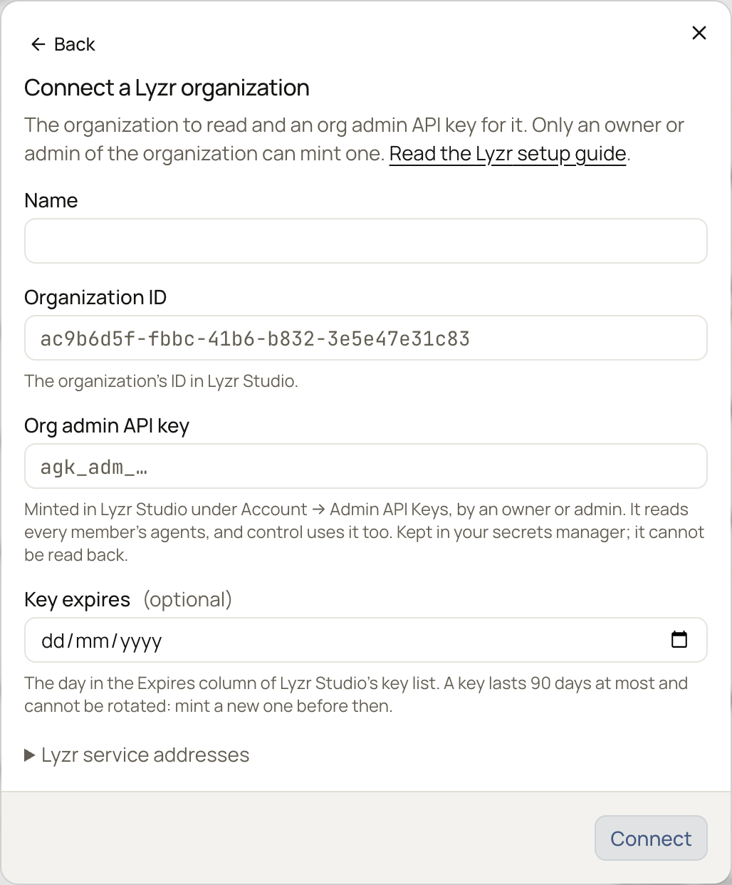
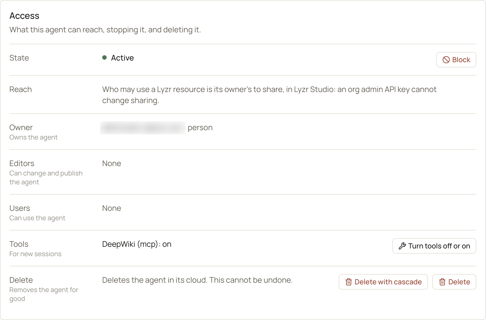
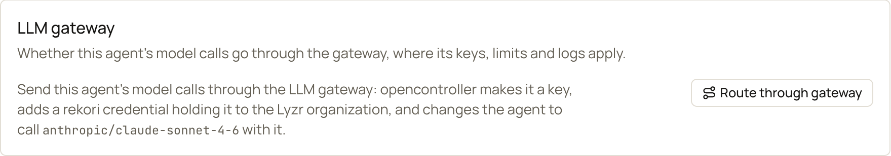

OpenController reads a **Lyzr organization** (Lyzr Studio and its Agent API) with an **org admin API key**. One
integration is one organization. The key reaches what every member of the organization has built, so one key covers
the whole organization: members do nothing.

The key reads, changes and deletes members' resources, and **never runs them**. Lyzr answers a run of a member's
agent, a knowledge base search or an MCP tool call made with it as if the resource did not exist. Lyzr blanks every
secret value for it, so OpenController never sees one.

## What it unlocks

- **[AI Inventory](/discover/ai-inventory):**
  - each **agent**, with its model and provider, whether it is active, its tools and its owner;
  - each **Agent2Agent agent**, with the address it answers at;
  - the **tools**, **MCP servers**, **knowledge bases** and **RAI policies** agents use, and the **models** they call;
  - each **credential** and **provider**, by name and type only;
  - each **member**, as the owner of what they built.
- **Control:** block and unblock an agent, turn its tools off and on, and delete agents, tools and credentials. See
  [What control can change](#what-control-can-change).
- **[LLM gateway](/secure/gateway-overview):** send an agent's model calls through the gateway with one select, where
  its virtual key, limits, guardrails and logs apply. See [Route an agent through the gateway](#route-an-agent-through-the-gateway).

## What is discovered

| In Lyzr | In AI Inventory |
|---|---|
| Each member: email, role | **Identity** (user), the owner of what they built |
| Each agent | **Agent**, shadow AI until registered. An inactive agent shows **Blocked** |
| The model an agent calls | **Model**; the agent **uses model** it |
| An agent's OpenAPI tools, MCP servers and app tools (Composio, ACI and others) | **Tool** or **MCP server**; the agent **uses tool** it |
| An agent's knowledge bases | **Knowledge base**; the agent **uses knowledge** it. Its documents are never read |
| An agent's RAI policy | **Guardrail** (RAI policy); the agent **uses guardrail** it |
| The agents a manager agent hands work to | The agent **calls agent** each |
| The credential an agent calls its model or a tool with | **Credential provider**; the agent **authenticates with** it |
| Lyzr's own model keys (`lyzr_openai`, `lyzr-default` and the like), which no member owns | **Credential provider** (Lyzr-managed key). Never changed from OpenController |
| Each Agent2Agent agent | **Agent** (Agent2Agent agent), with its address without credentials |
| Each provider or custom app a member added | **Credential provider** (Provider) |

An agent that points at something Lyzr no longer has (deleted, or its owner left the organization) names it under
`not_found`, so an agent left broken shows.

Lyzr's workflows, contexts and skills are not discovered yet.

## Connect a Lyzr organization

<Note>
Only an **owner** or **admin** of the Lyzr organization can create an org admin API key. If you see no **Admin API
Keys** under **Account** in Lyzr Studio, ask one.
</Note>

<Steps>
  <Step title="Create an org admin API key">
    In Lyzr Studio, go to **Account** > **Admin API Keys** > **Create Admin API Key**. Label it `opencontroller`, and
    choose how many days it lasts (at most 90). Copy the key: it starts with `agk_adm_`, and it is shown once.

    Note the day it expires, from the **Expires** column of the key list. Then copy the organization's ID from Lyzr
    Studio.

    An ordinary Lyzr API key is refused: the form accepts only `agk_adm_…`.
  </Step>
  <Step title="Connect it">
    Go to **Integrations** > **Connect** > **Lyzr**. Fill in **Name**, **Organization ID**, **Org admin API key** and
    **Key expires**, and select **Connect**. The key goes to your secrets manager and cannot be read back.

    Leave **Lyzr service addresses** as they are, unless your organization is served from somewhere other than Lyzr's
    cloud. Each address must be `https://` on `lyzr.ai` or `lyzr.app`, because the key is sent there.

    {/* SCREENSHOT: lyzr-connect | crop | The Connect a Lyzr organization dialog, empty: Name, Organization ID and Org admin API key with their example text, Key expires (optional), Lyzr service addresses folded, Connect. */}
    
  </Step>
  <Step title="Verify">
    On the row, select **Verify**. The **Access** badge reads **Verified** when every check passes.

    | Check | Passes when |
    |---|---|
    | **Sign in** | The key lists the organization's members: it is an org admin API key, not expired or revoked. Shows how many members, and the day the key expires. |
    | **Agents**, **Agent2Agent agents**, **Tools**, **MCP servers**, **Knowledge bases**, **Credentials**, **Providers**, **RAI policies** | The listing can be read; shows how many every member has. |
    | **Control sign in** | The control key signs in. |
    | **Control write** | The key may change agents. It tries a change to an agent that does not exist, so nothing changes. |

    Then select **Run scan**. Assets appear in [AI Inventory](/discover/ai-inventory) after the first scan.
  </Step>
</Steps>

<Info>
Lyzr has no read-only org admin API key, so control uses the same key, copied. The row shows **Control: the read key,
copied**. Replacing the key replaces both.
</Info>

### The key expires

An org admin API key lasts at most 90 days, and Lyzr cannot rotate one. Before it expires, create a new key in Lyzr
Studio and give it to the integration with **Update the key**, then revoke the old one. A sign-in refused after the day
in **Key expires** says the key expired.

## Scans

Scans run on your [scan schedule](/discover/scans), and on **Run scan**. Each listing is its own source, named
`lyzr:<organization id>:global:<listing>` (`members`, `agents`, `a2a_agents`, `tools`, `mcp_servers`,
`knowledge_bases`, `credentials`, `providers`, `rai_policies`). If one listing cannot be read, only that source fails,
and it keeps what the last good scan found.

A large organization takes a few minutes to scan: Lyzr is read four calls at a time, so the scan does not overload it.

## What control can change

Changes are made from the asset's page in [AI Inventory](/discover/ai-inventory), on the **Identity & access** tab, in
the **Access** card, once the agent is registered and approved (see [Approvals](/govern/approvals)). Each one is in the
[Audit log](/administer/audit-log), with who made it and why, and in Lyzr's own audit trail, as made with the org admin
API key.

{/* SCREENSHOT: lyzr-access-card | crop | A Lyzr agent's Access card on the Identity & access tab: State Active with Block, Reach (sharing is the owner's, in Lyzr Studio), Owner blurred, Editors and Users None, Tools "DeepWiki (mcp): on" with Turn tools off or on, and Delete with cascade and Delete. */}
<Frame caption="The Access card of a Lyzr agent">
  
</Frame>

| Asset | Actions | Undone by |
|---|---|---|
| **Agent** | **Block**: Lyzr turns the agent off and refuses every run, in Studio, through the API and in its deployments. **Turn tools off or on**, one tool at a time. **Delete**, or **Delete with cascade**: also the OpenAPI tools and credentials no other agent uses. | **Unblock**; turning the tool back on. A deleted agent cannot be brought back. |
| **Tool** (OpenAPI) | **Delete**: every agent that uses it loses it. | Nothing. |
| **Credential** | **Delete**: every agent and tool that calls with it fails until given another. | Nothing. |

Lyzr cannot turn a tool or a credential off, so their **Access** card has no **Block**. To stop a tool, turn it off on
each agent that uses it, or delete it. To stop a credential, delete it, or replace its value in Lyzr Studio.

**Tools.** Lyzr's tools have no on/off switch. Turning a tool off takes it off the agent, and turning it on puts it back
exactly as it was. OpenController keeps what it took off. Lyzr records each change as a new version of the agent.

**Proxy agents.** An agent that forwards to an inference endpoint of its own is never changed this way. Lyzr hides
that endpoint's key from the org admin API key, and sending the agent back would remove the key.

**Sharing** is not changed from OpenController. Who may use a resource is its owner's choice, in Lyzr Studio. Knowledge
bases, MCP servers, providers and RAI policies are not changed yet.

## Route an agent through the gateway

<Note>Needs the **LLM Gateway** module and the **Admin** role. See [Set up the gateway](/secure/set-up-gateway).</Note>

Routing sends an agent's model calls through the [LLM gateway](/secure/gateway-overview), so its virtual key, budgets,
guardrails and logs apply. The agent's owner changes nothing. It works the same way as for Microsoft Foundry prompt
agents ([Route through gateway](/govern/actions-by-provider#route-through-gateway)).

<Steps>
  <Step title="Check the gateway first">
    The gateway's address must be `https://` and reachable from the internet: Lyzr's cloud calls it. In **LLM
    Gateway**, add the provider of the agent's model (for example **openai** for an agent on `gpt-4o`).
  </Step>
  <Step title="Route the agent">
    On the agent's page, find the **LLM gateway** card. It names the model the agent will call through the gateway.
    Select **Route through gateway**, then confirm.

    {/* SCREENSHOT: lyzr-gateway-card | crop | A Lyzr agent's LLM gateway card before routing: what routing does, the model it will call (anthropic/claude-sonnet-4-6), and the Route through gateway button. */}
    <Frame caption="The LLM gateway card of a Lyzr agent, before routing">
      
    </Frame>

    OpenController:

    1. makes a virtual key for the agent, allowed only its model, on that model's provider;
    2. adds a credential of Lyzr's **rekori** provider to the organization, named `opencontroller-gateway-<tag>`, holding
       the key and the gateway's address. It is shared with the organization, because the agent is another member's;
    3. changes the agent to call the model through the gateway, as the gateway names it: `gpt-4o` of OpenAI becomes
       `openai/gpt-4o`.

    The card then shows **Through the LLM gateway**, with the **Key**, **Connection** and **Model**.
  </Step>
  <Step title="Check the calls">
    Have the agent's owner run it in Lyzr Studio. The org admin API key cannot run a member's agent, so there is no
    **Test run** for Lyzr agents. Each call shows in the gateway's [logs](/secure/logs) under the agent's key.
  </Step>
</Steps>

**Take off gateway** puts back the agent's provider, model and credential exactly as they were, then deletes the
credential and the key.

**Guardrails.** A [guardrail](/secure/guardrails/create) applies to the agent's calls once a content rule in the
gateway uses it, for every call or for a team (see [Use it anywhere](/secure/guardrails/use-anywhere)). Scope it
wider than the agent's key: routing the agent afresh makes a new key. A blocked call is refused with HTTP `446`.

**Observe** sends the agent's calls into an observability project of its own, to trace and evaluate them.

<Warning>
If your Lyzr organization has model fallback on, a call the gateway refuses or fails can be retried by Lyzr on its
fallback model, outside the gateway. Turn fallback off for agents that must stay behind the gateway's guardrails.
</Warning>

### When the agent is changed in Lyzr Studio

The card follows the scan. After the next scan:

| What the scan finds | The card shows |
|---|---|
| The owner moved a routed agent to another model or credential | **Changed in Lyzr Studio: no longer through the LLM gateway**, with **Route again** and **Clean up** |
| An agent set to the **rekori** provider in Lyzr Studio, with a credential OpenController did not make | **Through the LLM gateway, set in Lyzr Studio, not here**. Nothing to change from here |

- **Route again** points the agent back at the same key and credential; nothing new is made. What it calls now
  becomes what **Take off gateway** goes back to. It is refused if the agent's model changed (the key allows only the
  old one) or the credential was deleted in Lyzr: then select **Clean up**, and route the agent afresh.
- **Clean up** deletes the credential and the key, and leaves the agent as it is.

## Permissions it uses

OpenController calls only the organization's Lyzr service addresses. The key reads what its minter's role may read:
a minter whose role cannot read tools gets the tools listing refused.

| Call | What for |
|---|---|
| `GET /v3/org-admin/members` | Sign in, and the members who own each asset. |
| `GET /v3/org-admin/agents`, `/a2a-agents`, `/tools`, `/mcp-servers`, `/credentials`, `/providers` | Discovery. |
| `GET /v3/rag/org-admin/` (RAG service) | Knowledge bases. |
| `GET /v1/rai/org-admin/policies` (RAI service) | RAI policies. |
| `PATCH /v3/agents/{id}/status` | **Block** and **Unblock**. |
| `GET` and `PUT /v3/agents/{id}` | Tools off and on, and routing through the gateway. Lyzr replaces the whole agent, so it is read, changed and sent back. |
| `POST`, `GET` and `DELETE /v3/providers/credentials` | The gateway's credential, and deleting credentials. |
| `DELETE /v3/agents/{id}`, `/v3/tools/{id}` | Deleting agents and tools. |

OpenController stores members' IDs, emails and roles; each resource's name, description and owner; agents' models,
providers and references; tools' and MCP servers' addresses without credentials. It never reads agent instructions,
conversations, knowledge base documents or any credential's value.

<Warning>
An org admin API key can change and delete every member's agents, tools and credentials. Treat it as an
administrator credential.
</Warning>

## Troubleshooting

| Symptom | Cause and fix |
|---|---|
| The key is refused by the form | It is not an `agk_adm_…` key. Create one under **Account** > **Admin API Keys**. |
| Sign-in refused (HTTP 403): admin API key required | The key is an ordinary Lyzr key. Create an org admin API key. |
| Sign-in refused: the key expired | Create a new key and select **Update the key**. |
| Sign-in refused (HTTP 403): invalid API key | The key was revoked, or expired. Create a new one. |
| A listing refused with *Permission denied* | The minter's role lacks that permission. Create the key as an owner or admin whose role reads it. |
| Only the minter's own resources are found | One of Lyzr's services does not know org admin API keys yet. Ask Lyzr to update it. |
| **Control write** fails | The minter's role cannot update agents. Create the key as an owner or admin whose role can. |
| A tool cannot be turned off: the agent forwards to an inference endpoint | It is a proxy agent. See [Proxy agents](#what-control-can-change). |
| **Route through gateway**: the gateway has no provider for the agent's models | The gateway does not serve that provider. Pick another model in Lyzr Studio. |
| **Route through gateway**: no provider to call `openai/…` with | Add that provider to the gateway first. |
| **Route through gateway**: the gateway cannot be reached | Set the gateway's address in **Settings** > **LLM Gateway** to an `https://` address reachable from the internet. |

## Remove the integration

On **Integrations**, select the bin icon on the row, then confirm. The stored key is deleted and scans stop; what was
discovered stays until later scans retire it. The key still works in Lyzr: revoke it under **Account** > **Admin API
Keys**.

## Next steps

<CardGroup cols={2}>
  <Card title="Find shadow AI" icon="eye" href="/discover/shadow-ai">
    Find Lyzr agents nobody has registered.
  </Card>
  <Card title="Actions by provider" icon="list-checks" href="/govern/actions-by-provider">
    What can be changed on each kind of agent.
  </Card>
</CardGroup>
