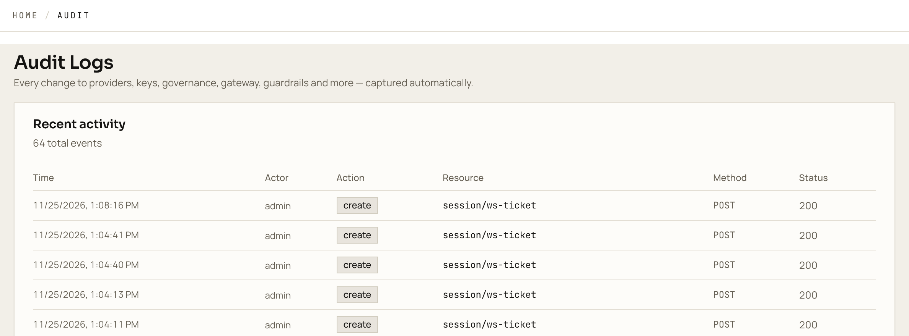

Rekori records every change made through its management API, whether from the console, a script or another tool:
creating a key, changing a provider, editing a content rule, and so on. Go to **Access** > **Audit**.

{/* SCREENSHOT: audit-log | crop | Access > Audit: Recent activity with Time, Actor, Action, Resource, Method, Status. */}
<Frame caption="Access > Audit">
  
</Frame>

| Column | Meaning |
|---|---|
| **Time** | When the change was made |
| **Actor** | Who made it: the kind of actor (for example `admin`), followed by the person's ID when a signed-in person made it |
| **Action** | `create`, `update` or `delete` |
| **Resource** | What was changed, such as `governance/virtual-keys/…` |
| **Method** | The HTTP method |
| **Status** | The answer Rekori gave. A refused change is recorded too. |

## What is recorded

- **Recorded:** every `POST`, `PUT`, `PATCH` and `DELETE` to `/api/…`.
- **Not recorded:** reading pages and lists, and model calls. Model calls are in [Logs](/llm-gateway/monitor/logs).

<Note>
The console itself creates a short-lived ticket for its live updates on each page load, so the list has many
`session/ws-ticket` rows. Filter them out with the API below.
</Note>

## Filter with the API

```bash
curl "https://rekori.example.com/api/audit-logs?resource_type=governance&since=2026-11-01T00:00:00Z&limit=200" \
  -H "Authorization: Bearer $ADMIN_TOKEN"
```

| Parameter | Filters by |
|---|---|
| `resource_type` | The first part of the path after `/api/`: `governance`, `providers`, `guardrails`, … |
| `actor_id`, `actor_type` | Who made the change |
| `action` | `create`, `update` or `delete` |
| `since`, `until` | Time range, in RFC 3339 |
| `limit`, `offset` | Paging. `limit` defaults to 100, at most 1000. |
