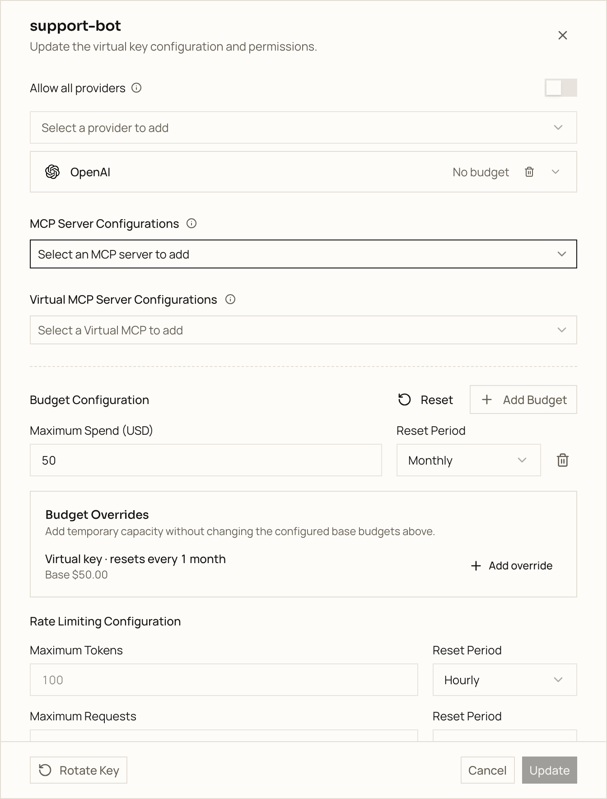
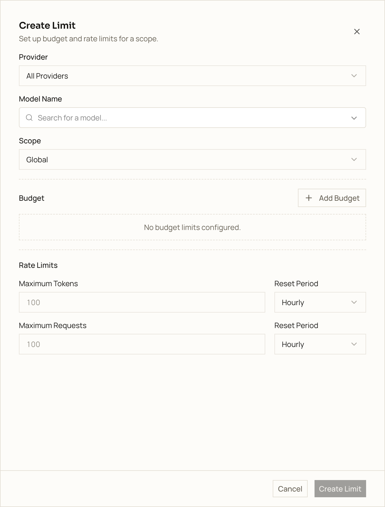

A **budget** caps spend in US dollars over a period. A **rate limit** caps tokens or requests over a period. Both
reset on their own.

## Where you can set them

| On | Where | Applies to |
|---|---|---|
| A virtual key | **Access** > **Keys**: **Budget Configuration**, **Rate Limiting Configuration** | That key's calls |
| One provider or model on a key | The provider's **Access & rate limits**, **Provider budget**, **Model budgets** on the key | That key's calls to that provider or model |
| A team | **Access** > **Teams** | All the team's keys together |
| A customer | **Access** > **Customers** | All the customer's teams and keys together |
| A model, for everyone or one scope | **Routing** > **Budgets & Limits** | Calls to that model |

{/* SCREENSHOT: vk-budget | crop | support-bot: Budget Configuration $50 Monthly, Budget Overrides, Rate Limiting Configuration. */}

## How they combine

Every limit a call falls under must have room. A call by a key in team Sales, under customer Example Corp, is checked
against the key's, the team's, the customer's, and any model limit. The first one that is used up refuses the call:

| Used up | Answer |
|---|---|
| A budget | `402` `budget_exceeded` |
| A token limit | `429` `token_limited` |
| A request limit | `429` `request_limited` |

Rate limits are checked before budgets.

## Reset periods

| For | Choices |
|---|---|
| Rate limits | **Every Minute**, **Every 5 Minutes**, **Every 15 Minutes**, **Every 30 Minutes**, **Hourly**, **Every 6 Hours**, **Daily**, **Weekly**, **Monthly** |
| Budgets | The same, plus **Quarterly** |

By default a period rolls from when the limit was created: a monthly budget set on the 14th resets on the 14th. Turn
on **Align to calendar cycle** to reset at the start of each day, week (Monday), month, quarter or year instead, in
UTC.

## More than one budget

A key, team or customer can have several budgets with different periods, for example $20 a day **and** $300 a month.
Each must have room.

**Budget Overrides** add temporary capacity on top of a budget, for a number of cycles or until removed, without
changing the budget itself.

## A limit per model

**Routing** > **Budgets & Limits** sets a budget or rate limit on one model, for example $1,000 a month on
`gpt-4o` across the whole gateway. Select **Add Limit**, then choose the **Provider**, **Model Name**, **Scope** and the
limits.

{/* SCREENSHOT: model-limit-form | crop | Create Limit: Provider All Providers, Model Name search, Scope Global, Budget, Rate Limits. */}

## Limits to know

<Warning>
- **Counts are kept on each Rekori node.** With several nodes behind one address, each node counts its own calls, so
  the gateway as a whole can allow up to the limit times the number of nodes.
- **One call can overshoot.** Room is checked before a call and cost is added after it, so the last call before a
  limit can take spend past it.
</Warning>
