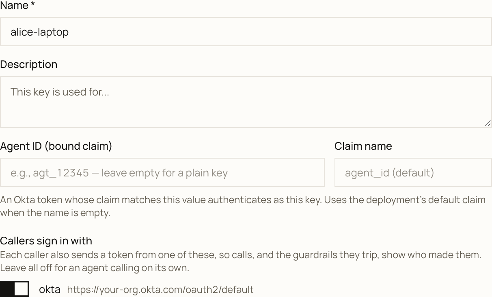

A plain virtual key works for whoever holds it. Caller sign-in adds a second proof: each call must also carry a token
from your identity provider. Rekori checks the token, records the person on the call, and refuses calls without a
valid one.

| You get | Because |
|---|---|
| A leaked key alone is useless | It only works with a valid token |
| Leavers lose access by themselves | The identity provider stops issuing them tokens |
| Every call and every blocked prompt shows a person | The person is recorded from the token |
| One key can serve a whole group | Each person signs in as themselves |

## Set it up

<Steps>
  <Step title="Add the identity provider">
    Under **Routing** > **API Gateway** > **Identity Providers (OIDC)**, add your provider with its **issuer url** and
    **audiences**. It does not need console sign-in turned on. See [Console sign-in](/llm-gateway/access-and-spend/console-sign-in).
  </Step>
  <Step title="Turn it on for a key">
    Open the key in **Access** > **Keys**. Under **Callers sign in with**, switch on the identity providers whose
    tokens the key accepts, and save.

    {/* SCREENSHOT: vk-callers-sign-in | crop | Create Virtual Key: Agent ID (bound claim), Claim name, Callers sign in with: okta switched on. */}
    <Frame caption="Callers sign in with, on a virtual key">
      
    </Frame>
  </Step>
  <Step title="Send both on each call">
    The caller sends the key in `x-bf-vk` and the token in `Authorization: Bearer`. See
    [Authentication](/llm-gateway/call-the-gateway/authenticate).
  </Step>
</Steps>

## Bind a key to one identity (Agent ID)

**Agent ID (bound claim)** ties a key to one identity, such as one agent or one person. Rekori reads a claim from
the token (**Claim name**, `agent_id` when empty) and accepts the token only when that claim equals the Agent ID.
Two things follow:

- A token from someone else is refused with `403` `identity_token_mismatch`, even if it is valid.
- The token **alone** reaches the key: the caller does not need to send the key at all.

Use the claim your identity provider puts the identity in, for example `sub` or `email` for people.

<Tip>
To give every person their own key and budget, create one key per person with **Agent ID** set to their email and
**Claim name** `email`, all in one [team](/llm-gateway/access-and-spend/teams-and-customers). Each person then calls with only their
token.
</Tip>

## What callers see when it goes wrong

| Status and `type` | Cause |
|---|---|
| `401` `identity_token_required` | The key requires a token and none was sent |
| `401` `identity_token_invalid` | The token did not verify against any provider the key trusts (wrong issuer, expired, bad signature) |
| `403` `identity_token_mismatch` | The token is valid but its claim does not match the key's Agent ID |
| `401` `identity_claim_unbound` | A token was sent alone and no key has its Agent ID |
