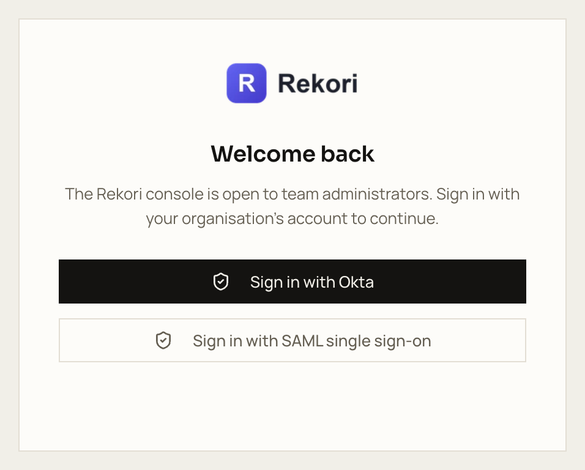
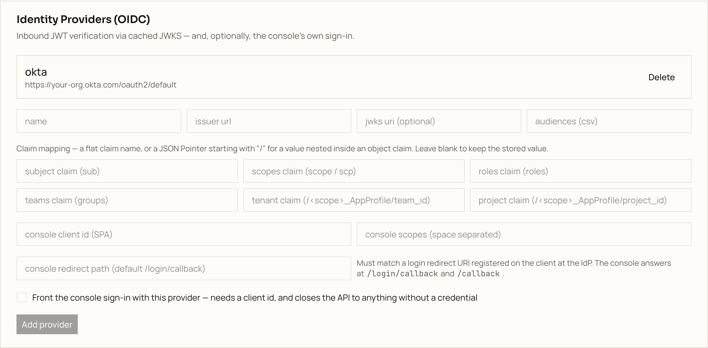

People sign in to the Rekori console in one of three ways:

| Sign-in | For | Set up |
|---|---|---|
| **Sign in with Okta** (or your OIDC provider) | Everyone, with your company identity | An identity provider with console sign-in turned on |
| **Sign in with SAML single sign-on** | Companies that use SAML | **Console sign-in (SAML 2.0)** |
| Username and password | The first admin, before single sign-on is set up | Created with the gateway's setup token |

{/* SCREENSHOT: login-okta | crop | The Rekori sign-in card: Welcome back, Sign in with Okta, Sign in with SAML single sign-on. */}

With single sign-on on, the sign-in page shows only its buttons, not the password form.

## Sign in with an OIDC provider (Okta, Entra ID, Keycloak)

<Steps>
  <Step title="Register the console with your identity provider">
    Create a single-page application (OIDC, authorization code with PKCE) for the console. Add the sign-in redirect
    URI `https://rekori.example.com/login/callback`, and assign the people or groups who may use Rekori.
  </Step>
  <Step title="Add the provider in Rekori">
    Go to **Routing** > **API Gateway** and find **Identity Providers (OIDC)**. Fill in:

    | Field | What to enter |
    |---|---|
    | name | A short name, for example `okta` |
    | issuer url | Your provider's issuer, for example `https://your-org.okta.com/oauth2/default` |
    | jwks uri (optional) | Only if it cannot be found from the issuer |
    | audiences (csv) | The audience your tokens carry |
    | console client id (SPA) | The client ID from step 1 |
    | console scopes (space separated) | Usually `openid profile email groups` |
    | Claim mapping | Only if your tokens use other claim names for the subject, scopes, roles or groups |

    Tick **Front the console sign-in with this provider** and select **Add provider**.

    {/* SCREENSHOT: idp-provider-card | crop | API Gateway > Identity Providers (OIDC) with the okta provider listed and the empty add form. */}
    <Frame caption="Identity Providers (OIDC) under Routing > API Gateway">
      
    </Frame>
  </Step>
  <Step title="Give people a role">
    A person who signs in must hold a role, or they see "You are signed in, but you have no role here yet." Map their
    identity-provider groups to roles, or assign roles to them. See [Members and roles](/llm-gateway/access-and-spend/scim-and-roles).
  </Step>
</Steps>

<Warning>
Turning on console sign-in closes the management API to anything without a credential. Scripts that call `/api/…`
must then send a token from the identity provider, or the password admin's credentials.
</Warning>

## Sign in with SAML

On the same page, under **Console sign-in (SAML 2.0)**, enter the **Console address**, your identity provider's
metadata (**Identity provider metadata URL**, or paste it under **Or paste the metadata XML**), and which attributes
carry the person's email, name and groups (**Email attribute**, **Name attribute**, **Groups attribute**).

In your identity provider, set the assertion consumer service URL to
`https://rekori.example.com/api/auth/saml/acs`.

## The first admin

A new gateway has no admin. Until one exists, every `/api` call needs the gateway's setup token (`setup_token` in
`config.json`, or the `BIFROST_SETUP_TOKEN` environment variable). The sign-in page asks for it, then lets you create
the first admin user under **System** > **Security**.

<Note>
The password admin is not subject to roles: it can do everything. Keep it for setup and emergencies, and give everyone
else single sign-on and a role.
</Note>
