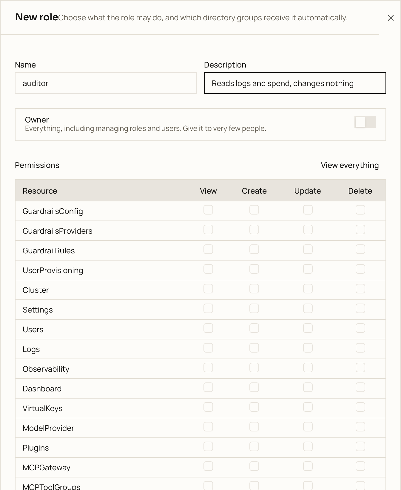
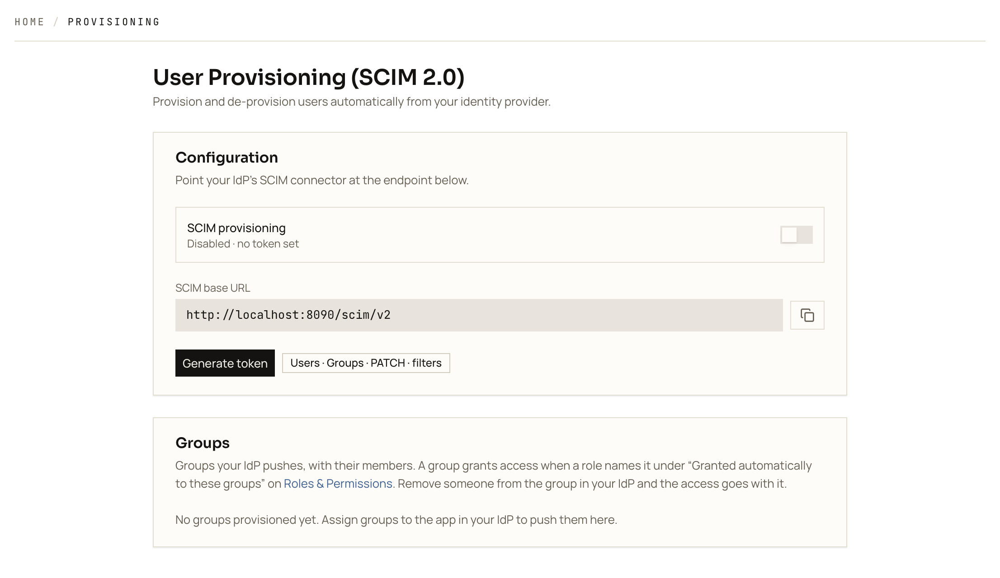

These control who may use the **console** and what they may change there. Calling models is controlled by
[virtual keys](/llm-gateway/access-and-spend/virtual-keys), not by roles.

## Roles

A role is a set of permissions. Each permission is a **resource** (an area of the console such as **VirtualKeys**,
**Logs** or **Settings**) and an operation: **View**, **Create**, **Update** or **Delete**.

Go to **Access** > **Roles** and select **New role**:

| Field | What it does |
|---|---|
| **Name**, **Description** | For example `auditor`, "Reads logs and spend, changes nothing" |
| **Owner** | Everything, including managing roles and users. Give it to very few people. |
| **Permissions** | Tick operations per resource. **View everything** ticks every **View**. |
| **Granted automatically to these groups** | Identity-provider groups whose members get this role |

Select **Save role**.

{/* SCREENSHOT: role-editor | crop | New role: Name auditor, Description, Owner off, Permissions table with View / Create / Update / Delete. */}

A person can hold several roles; their permissions add up. Someone with no role at all cannot sign in.

## Give people roles

There are two ways:

- **By group (recommended).** Put the group's name under **Granted automatically to these groups** on the role. Anyone
  in that group in your identity provider gets the role at sign-in. Remove them from the group, and the role goes too.
- **By person.** Under **Access** > **Members**, add the person's **Email** and the role's ID under **Role IDs (csv)**,
  then select **Add / update**.

Groups come from the token's groups claim at sign-in, or from SCIM below.

## Sync people with SCIM

SCIM lets your identity provider create, update and deactivate people in Rekori, and push their groups, without anyone
signing in first.

Go to **Access** > **Provisioning**:

1. Copy the **SCIM base URL** (it ends in `/scim/v2`).
2. Select **Generate token**. Copy the token now: it is not shown again.
3. Turn on **SCIM provisioning**.
4. In your identity provider's SCIM app, enter the base URL and the token as a bearer token, and assign the people and
   groups to push.

{/* SCREENSHOT: scim-provisioning | crop | Access > Provisioning: SCIM provisioning off, SCIM base URL, Generate token, Groups empty. */}
<Frame caption="Access > Provisioning">
  
</Frame>

Pushed groups appear under **Groups**. A group grants a role only when a role names it under **Granted automatically to
these groups**. A person your identity provider deactivates is deactivated in Rekori, and their sign-in and per-user
tool connections stop working.
