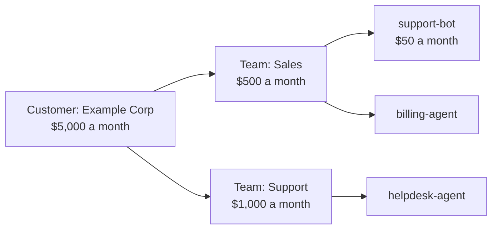
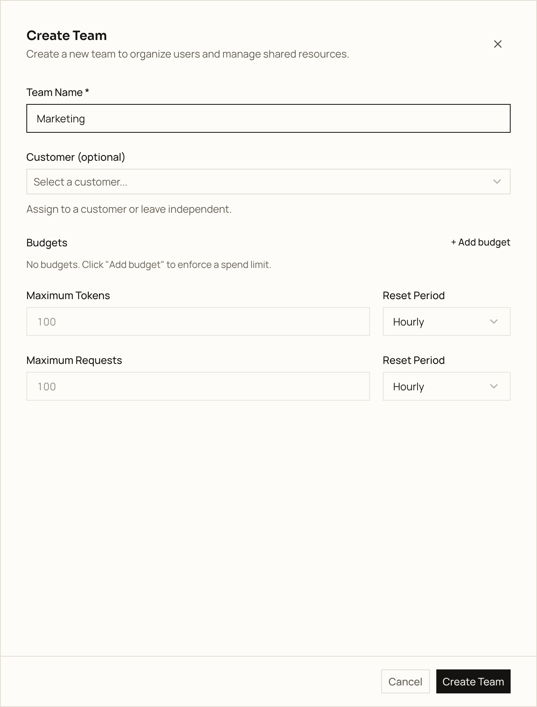

Teams and customers do not grant access: [virtual keys](/llm-gateway/access-and-spend/virtual-keys) do. A team is a group of keys
that share one budget and rate limit. A customer is a bigger group above teams.

A call must have room at every level it belongs to: its key, the key's team, and the customer. When Sales has spent
its $500, both Sales keys stop, even if `support-bot` has some of its own $50 left.

## When you need a team

| Situation | Use |
|---|---|
| One key per group | A budget on the key is enough. No team. |
| Several keys must share one total (a department, a line of business, a project) | A **team** with the budget |
| Several teams must share a bigger total (a business, a tenant) | A **customer** above the teams |

A team also gives you one place to read the group's spend: the **Team Rankings** tab in **Traffic** > **Overview**.

## Create a team

Go to **Access** > **Teams** and select **Add Team**:

| Field | What to enter |
|---|---|
| **Team Name \*** | For example `Marketing` |
| **Customer (optional)** | The customer the team belongs to, or none |
| **Budgets** | **+ Add budget**, then an amount in US dollars and how often it resets. You can add several, such as a daily and a monthly cap. |
| **Maximum Tokens**, **Maximum Requests** | The team's rate limits, each with a **Reset Period** |

Select **Create Team**.

{/* SCREENSHOT: team-form | crop | Create Team with Team Name Marketing, no customer, no budgets yet, rate limit fields empty. */}

Then put keys in the team: open each key and set **Entity Assignment** to the team.

## Create a customer

Go to **Access** > **Customers** and select **Add Customer**: a **Customer Name \*** and its **Budget Limits**. Then
choose the customer on its teams, or directly on keys.

<Note>
A key belongs to a team **or** a customer, not both. A key in a team that belongs to a customer counts against both.
</Note>
