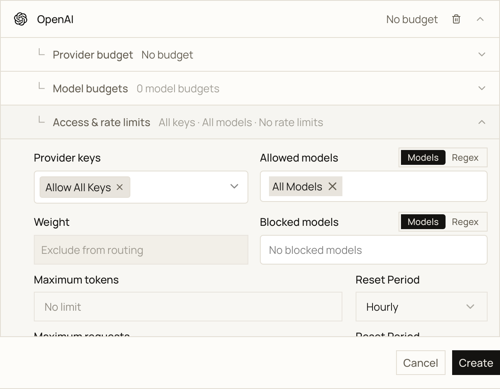
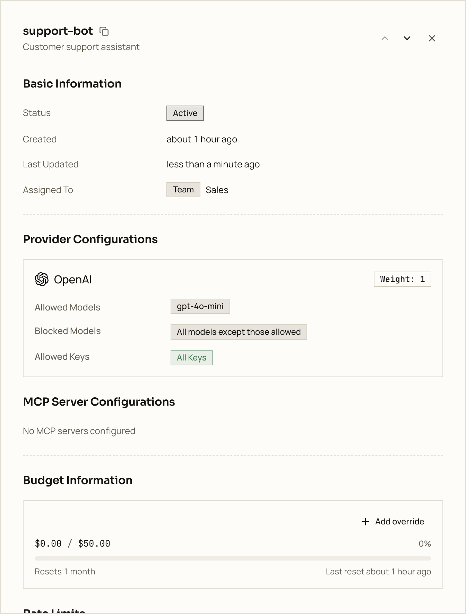
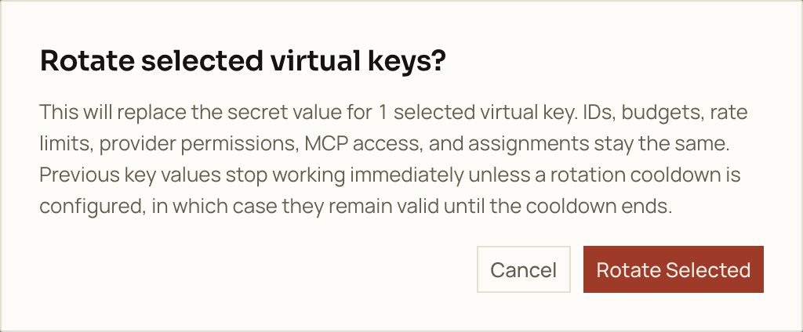

A virtual key is what a caller sends to Rekori. It starts with `sk-bf-` and decides what the caller may do: which
providers and models, which MCP tools, how much it may spend, and until when it works. Give each app, agent or person
their own key, so you can see and limit each one separately.

## Create a key

Go to **Access** > **Keys** and select **Add Virtual Key**.

| Section | What to set |
|---|---|
| **Name \***, **Description** | Who or what uses the key |
| **Agent ID (bound claim)**, **Callers sign in with** | Whether callers also send a sign-in token. See [Caller sign-in](/llm-gateway/access-and-spend/callers-sign-in). |
| **Is this key active?** | Off stops the key at once without deleting it |
| **Expiry** | **Never**, **30 min**, **1 hour**, **24 hours**, **7 days**, or a date |
| **Skip content rules** | Calls with this key skip [content rules](/llm-gateway/protect/content-rules). Use it only for a guardrail that itself calls a model through Rekori. |
| **Provider Configurations** | Which providers and models the key may use (below) |
| **MCP Server Configurations**, **Virtual MCP Server Configurations** | Which tools the key may use. See [Tools per key](/llm-gateway/mcp/tools-per-key). |
| **Budget Configuration**, **Rate Limiting Configuration** | Spend and rate caps. See [Budgets and limits](/llm-gateway/access-and-spend/budgets-and-limits). |
| **Entity Assignment** | The [team or customer](/llm-gateway/access-and-spend/teams-and-customers) the key belongs to |

Select **Create**.

### Providers and models

A key allows nothing until you add a provider. Under **Provider Configurations**, choose **Select a provider to
add**. The provider is added with **All keys** and **All models**; expand **Access & rate limits** to narrow it:

{/* SCREENSHOT: vk-providers-models | crop | Create Virtual Key: OpenAI added, Access & rate limits expanded: Provider keys Allow All Keys, Allowed models All Models. */}

| Field | What it does |
|---|---|
| **Provider keys** | Which of the provider's keys may serve this key. **Allow All Keys** by default. |
| **Allowed models** | Which models. **All Models** by default; remove it and pick models to narrow. |
| **Blocked models** | Models refused even if allowed |
| **Weight** | When the key allows several providers for a model, how to split calls between them |
| **Provider budget**, **Model budgets**, **Maximum tokens**, **Maximum requests** | Caps for this provider or model on this key only |

**Allow all providers** allows every provider you have configured, now and later.

<Warning>
A provider with no **Provider keys** selected can serve nothing: calls fail with `no_key_supports_model`. Keys made
through the API must set `key_ids` (`["*"]` for all), because the API does not default them.
</Warning>

## See a key

Select a key's name in the list to see its details: status, team, providers, tools, and how much of each budget is
used.

{/* SCREENSHOT: vk-details | crop | support-bot details: Active, Team Sales, OpenAI with gpt-4o-mini and All Keys, Budget $0.00 / $50.00. */}

The key's value is hidden in the list. Show or copy it with the icons next to it; each time, Rekori records who did.

## Rotate a key

Rotating gives the key a new value and keeps everything else: its ID, limits, providers, tools and team. Open the key
and select **Rotate Key**, or tick several keys in the list and select **Rotate**.

{/* SCREENSHOT: vk-rotate | crop | The "Rotate selected virtual keys?" confirmation for 1 key. */}

The old value stops working at once, unless the gateway has a rotation grace period: `vk_rotation_cooldown` in the
client settings (for example `"5m"`). During it, both values work, so callers can switch without failing calls. Only
the most recent previous value is kept.

## Other actions

| Action | Where | What it does |
|---|---|---|
| Reset usage | **Reset** in **Budget Configuration** | Sets the key's spent budget and used rate limits back to zero |
| Export | **Export CSV** in the list | Downloads the list of keys as a CSV file |
| Disable | The switch in the key's row | Same as **Is this key active?** off; takes effect at once |
| Delete | The key's **⋯** menu | Removes the key; calls with it fail with `access_not_found` |
