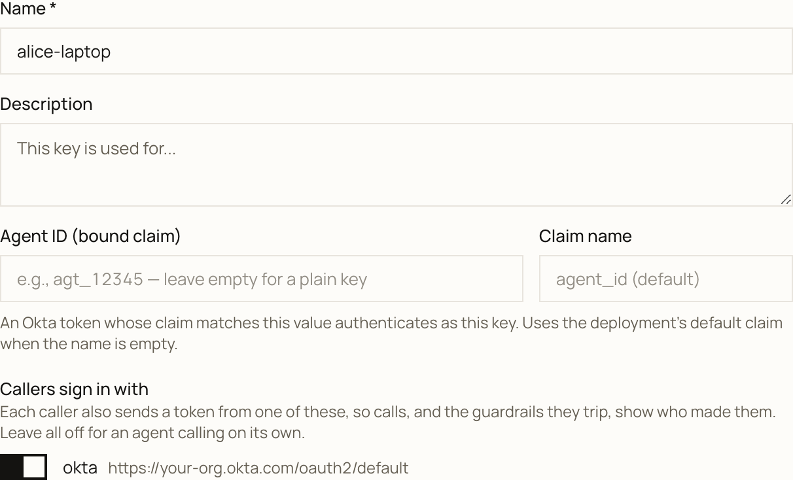

Every call to Rekori must say who is calling. There are three ways, and the key decides which ones it accepts.

| Caller sends | When to use it | Set up on the key |
|---|---|---|
| A virtual key | Apps, services and agents with no person behind them | Nothing more |
| A virtual key **and** a person's sign-in token | People and their tools, so every call shows who made it and a leaked key alone is useless | **Callers sign in with** |
| A sign-in token alone | An agent or person whose token identifies exactly one key | **Agent ID (bound claim)** |

<Note>
Calls without any of these are refused with `401` `virtual_key_required`. An admin can change this with
**Enforce Virtual Keys on Inference** under **System** > **Security**; it is on by default.
</Note>

## A virtual key

Send the key in any of these headers. Rekori treats a value that starts with `sk-bf-` as a virtual key:

| Header | Sent by |
|---|---|
| `x-bf-vk: sk-bf-…` | Any client |
| `Authorization: Bearer sk-bf-…` | The OpenAI SDK, LangChain, most HTTP clients |
| `x-api-key: sk-bf-…` | The Anthropic SDK |
| `x-goog-api-key: sk-bf-…` | The Google Gen AI SDK |

```bash
curl https://rekori.example.com/v1/chat/completions \
  -H "x-bf-vk: $REKORI_KEY" -H "Content-Type: application/json" \
  -d '{"model": "openai/gpt-4o-mini", "messages": [{"role": "user", "content": "Hello"}]}'
```

## A key and a person's sign-in token

When a key has **Callers sign in with** turned on for an identity provider, each call must also carry a token from
that provider. Rekori checks the token's signature and issuer, records the person on the call, and refuses the call
if the token is missing or not valid.

{/* SCREENSHOT: vk-callers-sign-in | crop | Create Virtual Key sheet: Agent ID (bound claim), Claim name, and Callers sign in with with the okta provider switched on. */}
<Frame caption="Agent ID and Callers sign in with on a virtual key">
  
</Frame>

Send the key in `x-bf-vk` and the token in `Authorization`:

```bash
curl https://rekori.example.com/v1/chat/completions \
  -H "x-bf-vk: $REKORI_KEY" \
  -H "Authorization: Bearer $OKTA_ACCESS_TOKEN" \
  -H "Content-Type: application/json" \
  -d '{"model": "openai/gpt-4o-mini", "messages": [{"role": "user", "content": "Hello"}]}'
```

Your app gets the token the usual way, by signing the person in to your identity provider. When someone leaves your
organization, the identity provider stops issuing them tokens, and their calls stop, even if they kept the key.

To add identity providers and choose them on a key, see [Caller sign-in](/llm-gateway/access-and-spend/callers-sign-in).

## A sign-in token alone

A key with an **Agent ID (bound claim)** can be reached by its token alone. Rekori verifies the token, reads one
claim from it, and uses the key whose Agent ID matches that claim's value. **Claim name** says which claim; empty means
the gateway default, `agent_id`.

```bash
curl https://rekori.example.com/v1/chat/completions \
  -H "Authorization: Bearer $AGENT_TOKEN" -H "Content-Type: application/json" \
  -d '{"model": "openai/gpt-4o-mini", "messages": [{"role": "user", "content": "Hello"}]}'
```

A token that verifies but matches no key is refused with `401` `identity_claim_unbound`.

### When a call carries both a key and a token

The key in the header is always the one used. If that key has **Callers sign in with** turned on, the token must
verify against one of its identity providers and, when the key has an **Agent ID**, carry that identity; otherwise
the call is refused (`401` `identity_token_invalid` or `403` `identity_token_mismatch`). A key without identity
providers ignores the token.

## The provider's own key

When **Allow Direct API Keys** is on under **System** > **Security**, a caller can send their own provider key instead
of a virtual key, with the header `x-bf-direct-key: true`. Rekori passes that key to the provider. It is off by
default. Such calls carry no virtual key, so no key's provider list, budget or rate limit applies to them, and they
are accepted even when **Enforce Virtual Keys on Inference** is on.

<Warning>
Turning on **Allow Direct API Keys** lets anyone who holds a provider key use Rekori without a virtual key, budget or
limit. Keep it off unless a team must bring its own provider account.
</Warning>

## Errors

| Status and `type` | Cause |
|---|---|
| `401` `virtual_key_required` | No key and no token |
| `401` `access_not_found` | The key does not exist, or was deleted |
| `403` `access_blocked` | The key is inactive or has expired |
| `401` `identity_token_required` | The key requires a sign-in token and none was sent |
| `401` `identity_token_invalid` | The token did not verify against any identity provider the key trusts |
| `403` `identity_token_mismatch` | The token is valid but belongs to someone other than the key's Agent ID |
| `401` `identity_claim_unbound` | The token is valid but no key has its Agent ID |

