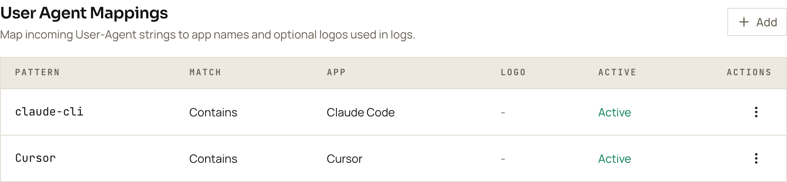

Coding tools call models like any app, so they point at Rekori the same way: a base URL and a
[virtual key](/llm-gateway/access-and-spend/virtual-keys). Give each person their own key, or one key with
[caller sign-in](/llm-gateway/access-and-spend/callers-sign-in), so usage shows per person.

<Tabs>
  <Tab title="Claude Code">
    Set these in your shell, or under `env` in `~/.claude/settings.json`:

    ```bash
    export ANTHROPIC_BASE_URL="https://rekori.example.com/anthropic"
    export ANTHROPIC_AUTH_TOKEN="sk-bf-…"        # your virtual key
    ```

    Claude Code sends the key as `Authorization: Bearer`, which Rekori reads as a virtual key, so no Anthropic
    account sign-in is needed.

    To use models from other providers, name them with their prefix:

    ```bash
    export ANTHROPIC_DEFAULT_SONNET_MODEL="anthropic/claude-sonnet-4-5"
    export ANTHROPIC_DEFAULT_HAIKU_MODEL="bedrock/anthropic.claude-haiku-4-5"
    ```

    To also use Rekori's MCP tools from Claude Code, see
    [Use from your editor](/llm-gateway/mcp/connect-claude-code).
  </Tab>

  <Tab title="Cursor">
    1. In Cursor, open **Settings** > **Models**.
    2. Turn on **Override OpenAI Base URL** and enter `https://rekori.example.com/cursor`.
    3. Enter your virtual key as the **OpenAI API Key**.
    4. Add the models you want as custom models, by their Rekori name, for example `anthropic/claude-sonnet-4-5`.

    <Note>
    Cursor calls the base URL from Cursor's own servers, not from your laptop, so Rekori must be reachable from the
    internet for Cursor's model calls.
    </Note>
  </Tab>

  <Tab title="Codex CLI">
    Add a provider for Rekori to `~/.codex/config.toml` and put your virtual key in `OPENAI_API_KEY`:

    ```toml
    model_provider = "rekori"

    [model_providers.rekori]
    name = "Rekori"
    base_url = "https://rekori.example.com/openai/v1"
    env_key = "OPENAI_API_KEY"
    ```

    Use a named provider rather than `openai_base_url`: with a named provider, Codex sends its hosted web search tool
    in a form every provider behind Rekori accepts.
  </Tab>
</Tabs>

## See each tool in the logs

Rekori reads each call's User-Agent. Map it to a tool's name under **System** > **Client Settings** >
**User Agent Mappings**, and the **App** column in **Traffic** > **Requests** shows "Claude Code" or "Cursor" instead
of the raw string.

{/* SCREENSHOT: user-agent-mappings | crop | System > Client Settings > User Agent Mappings with claude-cli → Claude Code and Cursor → Cursor, both Active. */}
<Frame caption="User Agent Mappings under System > Client Settings">
  
</Frame>

Select **Add**, enter a **Pattern** (the text to look for), its **Match** (**Contains**, **Exact match** or
**Regex**), and the **App** name to show.

## One conversation, one provider key

Coding tools send a session ID with each call. Rekori uses it to keep a conversation on the same provider key while
that key keeps working, which helps the provider's prompt cache. You can also set it yourself with
`x-bf-session-id`.
