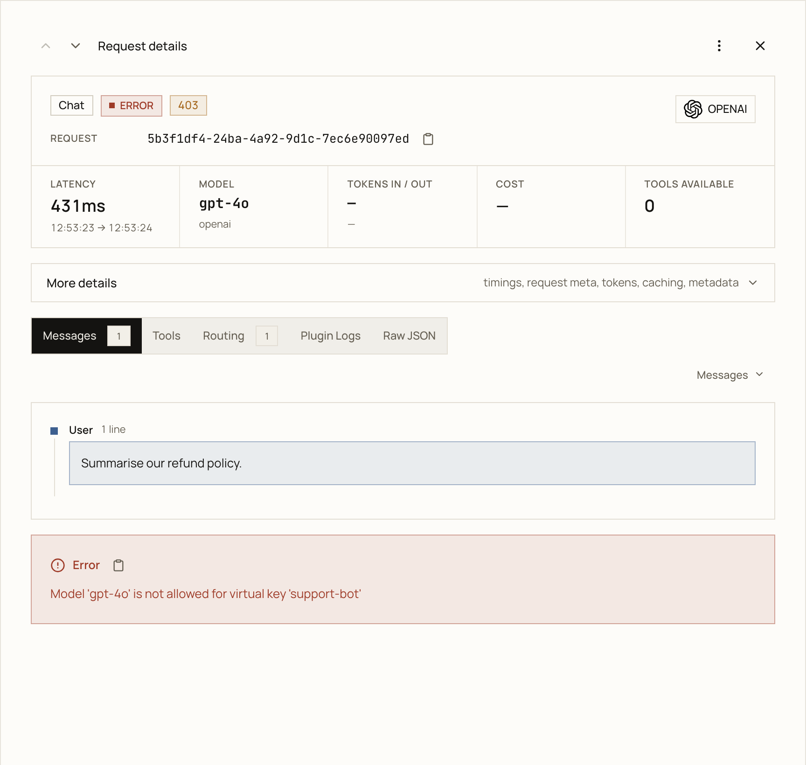

When Rekori refuses a call, it says why in the `type` field of the error, next to the HTTP status:

```json
{
  "type": "model_blocked",
  "status_code": 403,
  "error": { "message": "Model 'gpt-4o' is not allowed for virtual key 'support-bot'" }
}
```

A block by a [content rule](/llm-gateway/protect/content-rules) (status `446`) carries its reason in `error.type` instead, so read
`type` first, then `error.type`.

The same refusal is in **Traffic** > **Requests**: select the call to see its status and message.

{/* SCREENSHOT: request-detail-error | crop | Request details of a call refused with 403: model gpt-4o, message "Model 'gpt-4o' is not allowed for virtual key 'support-bot'". */}
<Frame caption="A refused call in Traffic > Requests">
  
</Frame>

## The errors you will meet most

| Status and `type` | What happened | What to do |
|---|---|---|
| `401` `virtual_key_required` | No key reached Rekori | Send the key in `x-bf-vk`, or as a `sk-bf-…` API key. See [Authentication](/llm-gateway/call-the-gateway/authenticate). |
| `401` `access_not_found` | The key does not exist or was deleted | Check the key in **Access** > **Keys** |
| `403` `access_blocked` | The key is inactive or has expired | Ask an admin to activate it or change its expiry |
| `403` `provider_blocked`, `model_blocked` | The key does not allow this provider or model | Use an allowed model, or ask for it to be added. See [Models](/llm-gateway/call-the-gateway/choose-a-model). |
| `429` `rate_limited`, `token_limited`, `request_limited` | A rate limit on the key, its team or its customer is used up | Wait for the limit to reset, or slow down |
| `402` `budget_exceeded` | A budget on the key, its team or its customer is spent | Wait for the budget to reset, or ask for more |
| `446` `content_policy_blocked` | A [content rule](/llm-gateway/protect/content-rules) blocked the prompt or the answer | Remove the content the rule names |
| `403` `llm_policy_denied` | An [LLM policy](/llm-gateway/protect/llm-policies) does not allow this call | Ask an admin which policy applies |
| `401` `identity_token_required` | The key requires a sign-in token | Send it as `Authorization: Bearer <token>` |


## Retry or not

| Errors | Retry? |
|---|---|
| `401`, `402`, `403`, `446` | No. The same call fails again until something changes. |
| `429` | Yes, after a pause. |
| `500`, `502`, `503`, `504` | Yes, with backoff. Rekori may already have retried; see [Retries and fallbacks](/llm-gateway/connect-models/keys-retries-fallbacks). |
