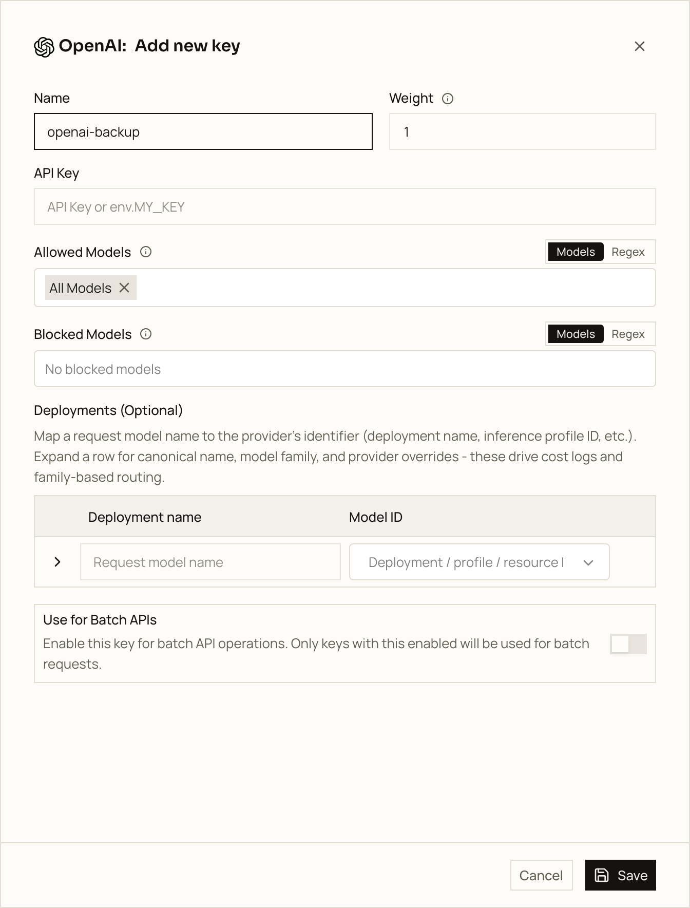
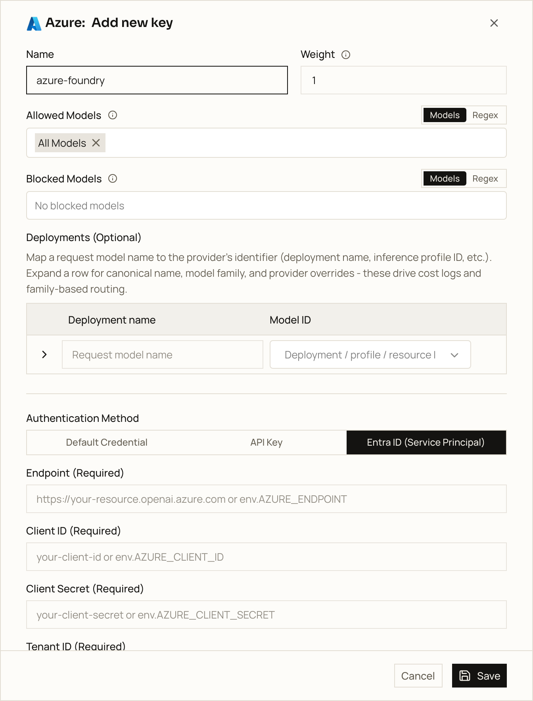

A provider is a model service Rekori calls on your callers' behalf. You add it once, with one or more of its keys;
callers never see those keys.

<Note>You need a console role with **ModelProvider** permissions. See [Members and roles](/llm-gateway/access-and-spend/scim-and-roles).</Note>

<Steps>
  <Step title="Add the provider">
    Go to **Routing** > **Providers**, select **Add New Provider**, and choose the provider. Choosing it adds the
    provider at once, with no keys yet. For an OpenAI- or Anthropic-compatible service that is not in the list,
    choose **Custom provider…** and give it a name, a base provider type and a base URL.
  </Step>

  <Step title="Add a key">
    With the provider selected, select **Add Key**:

    | Field | What to enter |
    |---|---|
    | **Name** | A name you will recognise in logs, for example `openai-primary` |
    | **API Key** | The provider's key, or `env.VARIABLE_NAME` to read it from an environment variable on the server |
    | **Weight** | How much traffic this key gets compared with the provider's other keys |
    | **Allowed Models** | Which models this key may serve. **All Models** by default. |
    | **Blocked Models** | Models this key must never serve |
    | **Deployments (Optional)** | Map a model name callers use to the provider's own identifier, such as an Azure deployment name or a Bedrock inference profile |
    | **Use for Batch APIs** | Only keys with this on serve batch and file requests |

    Select **Save**.

    {/* SCREENSHOT: provider-key-form | crop | OpenAI: Add new key, Name openai-backup, API Key empty, Allowed Models All Models. */}
    
  </Step>
</Steps>

## Provider-specific sign-in

Most providers take one API key. These offer other ways to sign in, chosen under **Authentication Method** on the
key:

<Tabs>
  <Tab title="Azure and AI Foundry">
    | Method | Use it when |
    |---|---|
    | **API Key** | You have the resource's key. Enter the **Endpoint** too. |
    | **Entra ID (Service Principal)** | You sign in with an app registration: **Endpoint**, **Client ID**, **Client Secret**, **Tenant ID**, optional **Scopes** |
    | **Default Credential** | Rekori runs in Azure with a managed or workload identity, so no secret is stored |

    Claude models deployed in Azure AI Foundry are called through Anthropic's API automatically. Use
    **Deployments** to map the model names callers use to your deployment names.

    {/* SCREENSHOT: provider-azure | crop | Azure: Add new key with Entra ID (Service Principal) selected, showing Endpoint, Client ID, Client Secret. */}
    
  </Tab>

  <Tab title="Bedrock">
    | Method | Use it when |
    |---|---|
    | **IAM Role (Inherited)** | Rekori runs in AWS (EC2, ECS, EKS, Lambda) with a role that may call Bedrock. No secret is stored. |
    | **Explicit Credentials** | You have an **Access Key** and **Secret Key**, optionally a **Session Token** |
    | **API Key** | You use a Bedrock API key |

    Every method takes a **Region**. **Assume Role ARN**, with an optional **External ID** and **Session Name**,
    makes Rekori assume another role first, for example in a different AWS account.
  </Tab>

  <Tab title="Vertex AI">
    Choose a service account (fields or pasted JSON), an API key, or leave the credentials empty to use the server's
    Google default credentials. Every method takes a **Project ID** and **Region**. **Force single region** keeps
    every call in that region.
  </Tab>
</Tabs>

## Provider settings

**Edit Provider Config** on a provider opens its settings. The ones you are most likely to change:

| Tab | Setting | Default | What it does |
|---|---|---|---|
| **Network** | **Timeout (seconds)** | 300 | How long one call may take |
| **Network** | **Stream Idle Timeout (seconds)** | 120 | How long a stream may go without a new piece |
| **Network** | **Max Retries**, **Initial Backoff (ms)**, **Max Backoff (ms)** | 0, 500, 5000 | Retries. See [Retries and fallbacks](/llm-gateway/connect-models/keys-retries-fallbacks). |
| **Network** | **Base URL (Optional)** | the provider's own | Send calls to a proxy or a private endpoint |
| **Proxy** | | none | An HTTP proxy for calls to this provider |
| **Performance** | **Concurrency**, **Buffer Size** | 1000, 5000 | Calls in flight at once, and calls waiting. |

## Next steps

<CardGroup cols={2}>
  <Card title="Retries and fallbacks" icon="repeat" href="/llm-gateway/connect-models/keys-retries-fallbacks">
    Keep calls working when a key or a provider fails.
  </Card>
  <Card title="Virtual keys" icon="key" href="/llm-gateway/access-and-spend/virtual-keys">
    Let callers use the provider.
  </Card>
</CardGroup>
