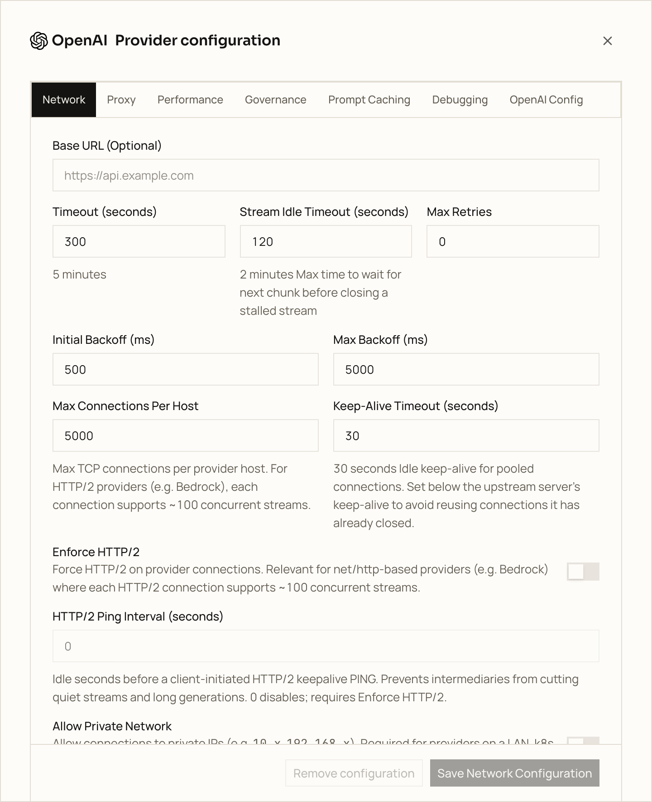

## Several keys for one provider

Give a provider more than one key to spread load across accounts or quotas. For each call, Rekori picks one of the
provider's keys:

1. It keeps only keys that are enabled, allowed on the caller's [virtual key](/llm-gateway/access-and-spend/virtual-keys), and
   whose **Allowed Models** include the model (and whose **Blocked Models** do not).
2. If the call belongs to a session that already used one of these keys, it stays on that key.
3. Otherwise it picks at random, in proportion to each key's **Weight**. Keys of weight 2 and 1 get about two thirds
   and one third of the calls.

## Retries

Retries are **off by default**: **Max Retries** is `0`, so a failed call fails at once. Set it under **Edit Provider
Config** > **Network**.

{/* SCREENSHOT: provider-network | crop | OpenAI Provider configuration, Network tab: Timeout 300, Stream Idle Timeout 120, Max Retries 0, backoff 500 / 5000. */}


With retries on, what Rekori does depends on the error:

| The provider answers | Rekori retries | With |
|---|---|---|
| `429`, or a rate-limit message | Yes | **Another key**. The key is skipped for the rest of this call. When every key has hit a limit, it starts over. |
| `401`, `402`, `403` | Yes | **Another key**. The key is never tried again in this call. |
| `500`, `502`, `503`, `504`, `529`, or a network error | Yes | **The same key**. The fault is the provider's, not the key's. |
| Any other error | No | |

Rekori waits between tries, starting at **Initial Backoff (ms)** and doubling up to **Max Backoff (ms)**, with
some jitter. When every key was refused for its credentials, the call ends with `502`
`upstream_credentials_exhausted`.

<Note>
Key rotation on failure only happens with **Max Retries** above `0`. With the default, one failing key fails the call.
</Note>

## Fallbacks

A fallback is another provider or model Rekori tries when a call still fails after its retries. Fallbacks are tried in
order; if they all fail, the caller gets the first error.

Set fallbacks per call, in the request:

```json
{
  "model": "openai/gpt-4o-mini",
  "fallbacks": ["anthropic/claude-haiku-4-5", "bedrock/anthropic.claude-3-5-haiku-20241022-v1:0"],
  "messages": [{"role": "user", "content": "Hello"}]
}
```

or for everyone, in a [routing rule](/llm-gateway/routing/routing-rules) under **If that model fails, try**.

Fallbacks are not tried when the caller cancelled the call, or when the error says fallbacks would not help, such as
a refusal by a [content rule](/llm-gateway/protect/content-rules) or an [LLM policy](/llm-gateway/protect/llm-policies).

## Streams

A stream that fails before its first piece is retried and falls back like any call. Once pieces have reached the
caller, it cannot be. See [Streaming](/llm-gateway/call-the-gateway/streaming).
