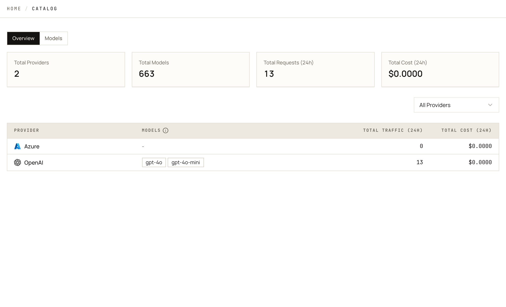
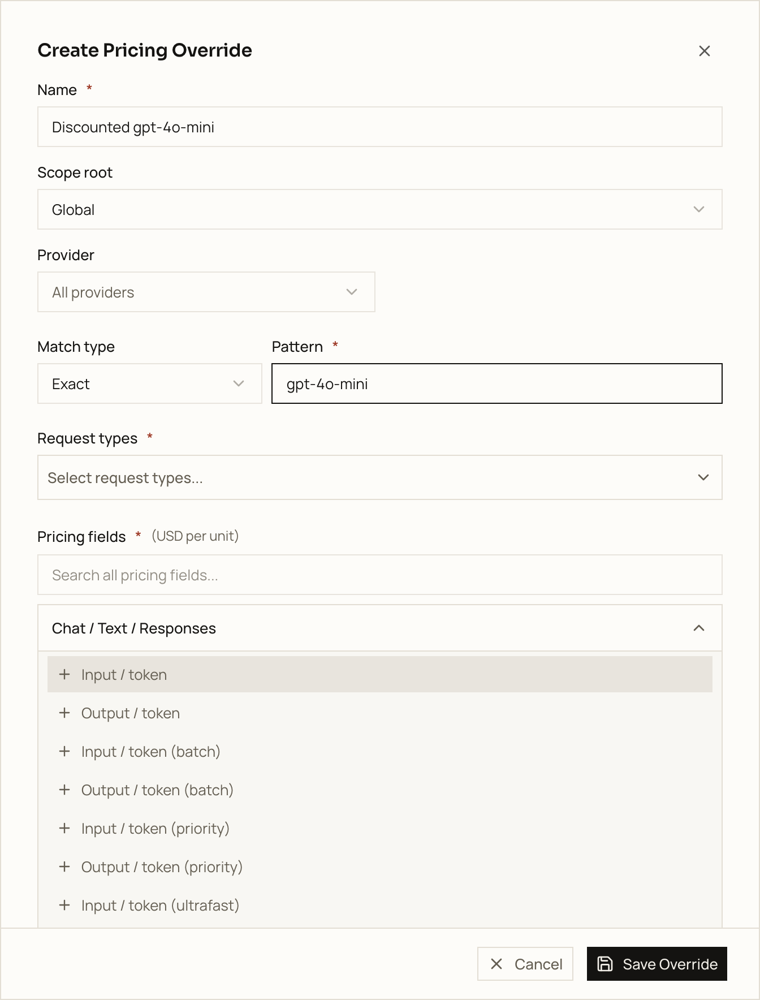

Rekori prices every call from its model catalog, so logs, dashboards and [budgets](/llm-gateway/access-and-spend/budgets-and-limits)
show cost in US dollars without extra work.

## See the catalog

**Routing** > **Catalog** lists your providers, the models each serves, and their traffic and cost in the last 24
hours. The **Models** tab lists every model with its input, output and cache prices.

{/* SCREENSHOT: model-catalog | crop | Routing > Catalog, Overview tab: Total Providers, Total Models, the Azure and OpenAI rows. */}
<Frame caption="Routing > Catalog">
  
</Frame>

## Change what a model costs

When your contract prices differ from list prices, add a pricing override. Go to **Routing** > **Pricing Overrides**
and select **New pricing override**:

| Field | What to enter |
|---|---|
| **Name** | For example `Negotiated gpt-4o-mini` |
| **Scope root** | **Global**, or a narrower scope such as one virtual key, provider key or user |
| **Provider** | One provider, or all |
| **Match type** and **Pattern** | **Exact** for one model name, **Wildcard** for a family such as `gpt-4o*` |
| **Request types** | Chat, embeddings, audio, images and so on |
| **Pricing fields** | The prices to replace, in US dollars per unit (per token, per image, …) |

{/* SCREENSHOT: pricing-override | crop | Create Pricing Override: Name "Discounted gpt-4o-mini", Scope root Global, Match type Exact, Pattern gpt-4o-mini. */}

Overrides apply to new calls. To re-price calls already logged, use **Recalculate costs** in **Traffic** >
**Requests**.

## Keep the catalog current

**Routing** > **Model Settings** controls where prices come from:

| Setting | What it does |
|---|---|
| **Pricing Datasheet URL** | Where Rekori downloads list prices |
| **Pricing Sync Interval (hours)** | How often it downloads them |
| **Model Parameters URL**, **Model Discovery Interval (minutes)** | Where and how often it learns each provider's models |
| **Force Sync Now** | Download prices now |
| **Routing Chain Max Depth** | How many [routing rules](/llm-gateway/routing/routing-rules) may apply to one call in a row |
