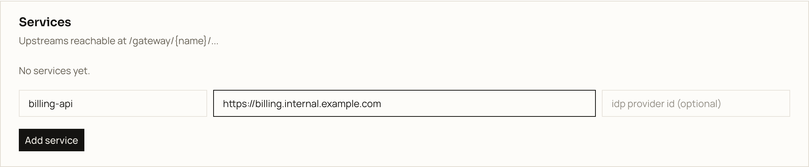
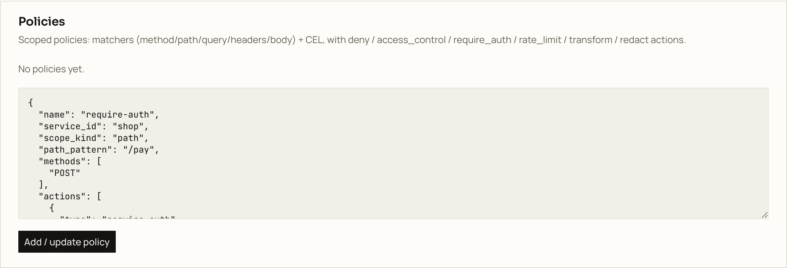

The API gateway lets Rekori stand in front of your own HTTP APIs, not only model providers. You add a **service** (an
upstream base URL), and Rekori serves it at `/gateway/<service>/…`. **Policies** then decide who may call it, how
often, and what is changed on the way in and out. It is useful when an agent needs an internal API (billing, orders,
tickets) and you want one place to sign callers in and see what they do.

<Note>
Everything here is on **Routing** > **API Gateway**. Signing callers in with their identity needs an identity provider
under **Identity Providers (OIDC)** on the same page; see [Caller sign-in](/llm-gateway/access-and-spend/callers-sign-in).
</Note>

<Warning>
Rekori does not check who calls `/gateway/…` on its own. A service with no policy is open to anyone who can reach
Rekori. Always add a `require_auth` policy in `oidc_jwt` mode (below) to a service.
</Warning>

## Add a service

{/* SCREENSHOT: gateway-service | crop | Services card: billing-api, https://billing.internal.example.com, idp provider id (optional), Add service. */}
<Frame caption="Routing > API Gateway > Services">
  
</Frame>

| Field | What to enter |
|---|---|
| **name (slug)** | Lowercase letters, digits and hyphens, for example `billing-api`. This is the path callers use. A few names are reserved (`api`, `v1`, `mcp`, `gateway`, `openai`, `anthropic` and other provider names). |
| **upstream base url** | Where Rekori forwards calls, for example `https://billing.internal.example.com` |
| **idp provider id (optional)** | The identity provider that signs callers in. Needed for `oidc_jwt` sign-in, scopes and claims. |

Select **Add service**. A call to `https://rekori.example.com/gateway/billing-api/invoices/42?full=1` is forwarded to
`https://billing.internal.example.com/invoices/42?full=1`.

On the way, Rekori:

- **Removes** the caller's `Authorization`, `X-Api-Key` and `Cookie` headers, so a caller's token never reaches the
  upstream.
- **Adds** `X-Forwarded-For`, `X-Forwarded-Proto`, `X-Forwarded-Host`, `Forwarded` and `Via: 1.1 rekori`.
- **Waits** up to 30 seconds for the upstream, and accepts request bodies up to 32 MiB.
- **Buffers** the response and sends it whole. Streaming responses are not passed through as a stream.

<Note>
If the upstream needs its own credential, set it with the management API (`POST /api/gateway/services`, field
`auth`: `{"type": "bearer", "value_ref": "env.BILLING_TOKEN"}`). The form does not have this field.
</Note>

## Add a policy

A policy is JSON. Paste it into **Policies** and select **Add / update policy**. Rekori checks it when you save and
refuses a policy that is not valid.

{/* SCREENSHOT: gateway-policy | crop | Policies card with the default JSON template and Add / update policy. */}
<Frame caption="Routing > API Gateway > Policies">
  
</Frame>

This policy lets only signed-in people with the `billing.read` scope read invoices, at most 600 calls a minute, and
hides card numbers in the answer:

```json
{
  "name": "invoices-read",
  "service_id": "billing-api",
  "scope_kind": "path",
  "path_pattern": "/invoices/{id}",
  "methods": ["GET"],
  "actions": [
    {"type": "require_auth", "modes": ["oidc_jwt"], "required_scopes": ["billing.read"]},
    {"type": "rate_limit", "request_max": 600, "request_window_sec": 60},
    {"type": "redact_response", "redact_pointers": ["/payment/card_number"]}
  ]
}
```

### Which calls a policy applies to

| Field | Meaning |
|---|---|
| `service_id` | The service name. Required. |
| `scope_kind` | `service` (every call), `path` or `param`. A narrower policy wins over a broader one when both set the same value. |
| `path_pattern` | The path after `/gateway/<service>`. `/invoices` matches exactly; `{id}` matches one segment; a trailing `*` matches the rest. Empty matches every path. |
| `methods` | For example `["GET", "POST"]`. Empty means every method. |
| `header_matchers`, `query_matchers` | `[{"key": "x-tenant", "op": "equals", "values": ["acme"]}]`. `op` is `exists`, `equals`, `in` or `regex`. |
| `body_matchers` | The same, with `pointer` (a JSON Pointer such as `/order/total`) instead of `key`. Only for JSON bodies. |
| `cel` | A condition; the policy applies only when it is true. |
| `priority` | Order among policies of the same scope; lower first. |
| `enabled` | `false` turns the policy off. |

### Actions

| `type` | Fields | What it does |
|---|---|---|
| `require_auth` | `modes`, `required_scopes`, `required_claims` | Requires a signed-in caller. Use `"modes": ["oidc_jwt"]`: the caller sends `Authorization: Bearer <token>` from the service's identity provider. Missing token: `401`. Missing scope or claim: `403`. |
| `access_control` | `cel` | Lets the call through only when the condition is true; otherwise `403`. |
| `rate_limit` | `request_max`, `request_window_sec` | Allows `request_max` calls per window; then `429`. |
| `deny` | `status`, `message` | Always refuses, by default with `403`. |
| `transform_request` | `set_headers`, `strip_headers`, `set_query`, `strip_query`, `rewrite_path` | Changes the request before it is forwarded. |
| `transform_response` | `set_headers`, `strip_headers` | Changes the response headers. |
| `redact_response` | `redact_pointers`, `redact_headers`, `mask` | Replaces the listed JSON fields and headers with `***` (or `mask`). JSON bodies only. |

<Warning>
- **`rate_limit` counts all callers together.** `600` per minute is shared by everyone the policy applies to, not
  600 for each caller.
- **Use `oidc_jwt` for `require_auth`.** In `virtual_key` and `api_key` modes, and when `modes` is empty, Rekori only
  checks that the header is present, not that the key is valid.
</Warning>

### Conditions (CEL)

`cel` in a policy and in `access_control` is a [CEL](https://cel.dev) expression. It can use:

| Variable | Holds |
|---|---|
| `method`, `path` | The HTTP method and the path after `/gateway/<service>` |
| `headers`, `query` | Request headers and query values. Use lowercase names: `headers["x-tenant"]`. |
| `path_params` | Values captured by `{name}` in `path_pattern` |
| `user_id`, `user_scopes`, `user_roles`, `user_teams`, `user_tenant`, `claims` | The signed-in caller, from their token |

For example, `"user_tenant == headers[\"x-tenant\"]"` lets people reach only their own tenant. A key that is not
there counts as false.

### Order

1. Every policy that matches the call is collected.
2. All `require_auth` actions run first, then `deny`, then `access_control`. A caller who is not signed in gets `401`
   whatever the policy order.
3. Then `rate_limit`.
4. Then the transforms, and the call is forwarded.

[Tool policies](/llm-gateway/protect/tool-policies), further up the same page, also apply to calls through the API gateway.

## What a refused caller sees

```json
{
  "error": {
    "message": "missing required scope(s): billing.read",
    "type": "policy_blocked",
    "reason": "insufficient_scope"
  }
}
```

| Status | Means |
|---|---|
| `401` | Not signed in (`require_auth`) |
| `403` | Refused by `deny`, `access_control`, a missing scope or claim, or a tool policy |
| `429` | Over a `rate_limit` |
| `404` | No such service, or it is turned off |
| `502`, `504` | The upstream failed, or took longer than 30 seconds |
