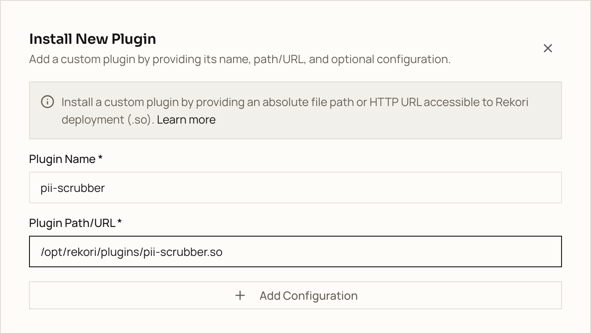

A custom plugin is your own Go code that Rekori runs on every request: before it reaches the provider, after the
answer comes back, or both. Use one when no setting does what you need, for example to add a header your network
needs, check calls against an internal system, or change answers before the app sees them.

<Note>
- Plugins are Go plugins (`.so` files). They run on **Linux and macOS** only.
- Only an admin can install one, and only when console sign-in is turned on.
- A plugin runs inside Rekori with full access to every request. Install only code your team has reviewed.
</Note>

## Build a plugin

A plugin must export two functions. The rest are optional; export the ones you need.

| Function | When Rekori calls it |
|---|---|
| `GetName() string` | Required. The plugin's name. |
| `Cleanup() error` | Required. When the plugin is removed or Rekori stops. |
| `Init(config any) error` | Once, when the plugin loads, with its **Configuration (JSON)** as a map |
| `PreLLMHook(ctx, req)` | Before the call goes to the provider. Can change the request, or answer it without calling the provider. |
| `PostLLMHook(ctx, resp, err)` | After the provider answers. Can change the answer or the error. |
| `HTTPTransportPreHook`, `HTTPTransportPostHook` | On the raw HTTP request and response |
| `PreMCPHook`, `PostMCPHook` | Around MCP tool calls |

A minimal plugin:

```go
package main

import "github.com/maximhq/bifrost/core/schemas"

var team string

func Init(config any) error {
	if m, ok := config.(map[string]any); ok {
		team, _ = m["team"].(string)
	}
	return nil
}

func GetName() string { return "add-team-tag" }

func PreLLMHook(ctx *schemas.BifrostContext, req *schemas.BifrostRequest) (*schemas.BifrostRequest, *schemas.LLMPluginShortCircuit, error) {
	// Change req here. Return a short circuit to answer without calling the provider.
	return req, nil, nil
}

func Cleanup() error { return nil }
```

Build it:

```bash
CGO_ENABLED=1 go build -buildmode=plugin -o add-team-tag.so .
```

<Warning>
A plugin loads only if it is built with **the same Go version**, **the same version of the Rekori core module**, and
**the same C library** (glibc or musl) as the Rekori it runs in. Build it in the same image or base image as Rekori.
A mismatch fails at install with a "different version of package" error.
</Warning>

Working examples are in the Rekori repository under `examples/plugins/`: `hello-world` uses every hook, and
`llm-only`, `http-transport-only` and `mcp-only` use one kind each.

## Install it

<Steps>
  <Step title="Put the file where Rekori can reach it">
    Copy the `.so` to the Rekori server (for example `/opt/rekori/plugins/`), or publish it at an HTTPS URL.
  </Step>
  <Step title="Add it">
    Go to **Policies** > **Plugins** and select **Install New Plugin**.

    {/* SCREENSHOT: plugin-install | crop | Install New Plugin: Plugin Name pii-scrubber, Plugin Path/URL /opt/rekori/plugins/pii-scrubber.so, Add Configuration. */}
    <Frame caption="Policies > Plugins > Install New Plugin">
      
    </Frame>

    | Field | What to enter |
    |---|---|
    | **Plugin Name** | Letters, digits, `-` and `_`. Can't be changed later. |
    | **Plugin Path/URL** | An absolute path such as `/opt/rekori/plugins/add-team-tag.so`, or an `https://` URL. Can't be changed later. |
    | **Configuration (JSON)** | Optional. Select **Add Configuration**. Passed to `Init`, for example `{"team": "sales"}`. |
  </Step>
  <Step title="Install">
    Select **Install Plugin**. Rekori loads it at once, with no restart, and turns it on. If it can't load, nothing
    is saved and the error is shown.
  </Step>
</Steps>

To turn a plugin off or change its configuration, open it, use **Enabled** or edit **Configuration (JSON)**, and
select **Save Changes**. When a plugin fails to load, its view shows the reason under **Logs**.

### From a URL

Rekori downloads the file once when it loads the plugin: up to 200 MB, 120 seconds, and 5 redirects. It refuses
private and local addresses. To allow a host inside your network, an admin adds it to
`server.plugin_download_private_allowlist` in `config.json`.

<Warning>
Rekori does not check a checksum or signature on downloaded plugins. Serve them only from a location your team
controls.
</Warning>

## Choose the order

Rekori has its own plugins (governance, logging, content rules and others). Select **Edit Plugin Sequence** and drag
your plugin above or below the **Built-in Plugins** block, then select **Save Sequence**.

- **Above**: your plugin sees the request before Rekori's own checks, for example to add a header that a routing rule
  reads.
- **Below** (the default): it sees the request after them, for example after content rules have removed personal
  data.

Before the call, plugins run from top to bottom. After the call, they run from bottom to top.

<Note>
If `config.json` sets a plugin order, that order wins after Rekori restarts.
</Note>
