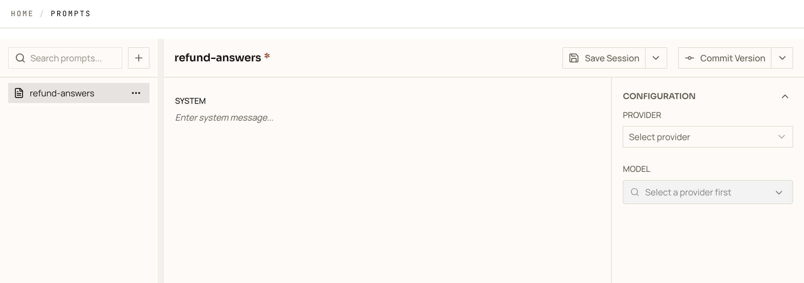

The prompt repository keeps your system prompts and model settings in Rekori instead of in each app. You write and
test a prompt in the console, commit it as a numbered version, and apps call it with two headers. To change a prompt,
you commit a new version; the apps do not change.

<Note>
**Prompts** appears in the sidebar only when Rekori has a database. Prompts apply to chat completions and the
Responses API.
</Note>

## Write and test a prompt

<Steps>
  <Step title="Create the prompt">
    Go to **Prompts**. Select **+** > **New Prompt** (or **Create Prompt** on an empty page), enter a **Name**, for
    example `refund-answers`, and select **Create**. Use **+** > **New Folder** to group prompts.
  </Step>
  <Step title="Write the messages">
    The editor opens. Write the **SYSTEM** message, and add example **USER** messages with **Add**. Change a
    message's role from its role menu.

    {/* SCREENSHOT: prompt-editor | crop | The prompt editor for refund-answers: prompt list, SYSTEM message, Configuration with Provider and Model, Save Session and Commit Version. */}
    <Frame caption="Prompts, with a new prompt open">
      
    </Frame>
  </Step>
  <Step title="Choose the model and test">
    Under **Configuration**, choose the **Provider** and **Model**, and set any model parameters. Select **Run** to
    send the prompt from the console and see the answer.
  </Step>
  <Step title="Save your work">
    **Save Session** (or Cmd/Ctrl+S) saves the editor as it is: messages, settings and test values. Sessions are
    drafts. Keep several and switch between them from the **Save Session** menu.
  </Step>
  <Step title="Commit a version">
    Select **Commit Version**. Choose which messages to include, write a **Commit Message**, and select
    **Commit Version**. Versions are numbered 1, 2, 3… and never change once committed.
  </Step>
</Steps>

## Call a prompt from an app

Send the prompt's ID, and optionally a version number, as headers:

```bash
curl https://rekori.example.com/v1/chat/completions \
  -H "x-bf-vk: $REKORI_KEY" -H "Content-Type: application/json" \
  -H "x-bf-prompt-id: 3f2c9a6e-…" \
  -H "x-bf-prompt-version: 2" \
  -d '{"model": "openai/gpt-4o-mini",
       "messages": [{"role": "user", "content": "Can I return shoes after 40 days?"}]}'
```

| Header | Value |
|---|---|
| `x-bf-prompt-id` | The prompt's ID. Open the prompt in the console; the ID is the `promptId` value in the page address. |
| `x-bf-prompt-version` | A version number, for example `2`. Leave it out to use the latest version. |

Rekori then:

1. **Puts the version's messages before the app's messages.** The app sends only the user's question.
2. **Uses the version's model parameters as defaults.** A parameter the app sends wins.

## Check it worked

Open the call in [Logs](/llm-gateway/monitor/logs). Its messages start with the prompt's system message.

<Warning>
- **A wrong ID or version does not fail the call.** If Rekori can't find the prompt or the version, it sends the
  request as it is, without the prompt. `latest` is not a valid version: leave the header out instead. Check every
  new integration in Logs.
- **`{{variables}}` are filled in only when you select Run in the console.** Rekori does not replace them in app
  calls, so a version that contains `{{name}}` reaches the model with the text `{{name}}`. Keep variables out of
  prompts that apps call, or have the app send that text in its own messages.
</Warning>
