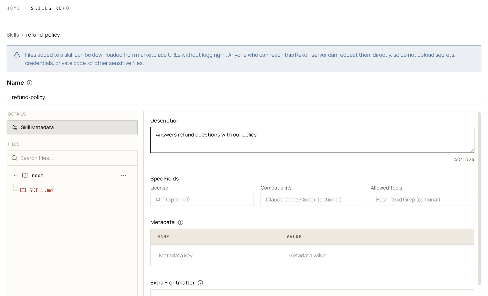

A skill is a set of instructions (a `SKILL.md` file) and optional supporting files that a coding agent such as Claude
Code or Codex loads when a task needs it. The skills repository keeps your company's skills in Rekori, versions them,
and publishes them as a plugin marketplace that people add to their coding tool once. After that, everyone installs
the version you choose to serve.

<Note>
**Skills** is in beta. It appears in the sidebar only when Rekori has a database. Publishing to Claude Code and Codex
needs `git` installed on the Rekori server.
</Note>

<Warning>
Files in a skill can be downloaded by anyone who can reach your Rekori server, without signing in. Never put secrets,
credentials, private code or other sensitive files in a skill.
</Warning>

## Create a skill

<Steps>
  <Step title="Start a skill">
    Go to **Skills** and select **New Skill** (or **Create Skill** on an empty page).
  </Step>
  <Step title="Describe it">
    {/* SCREENSHOT: skills-list | crop | The new skill form: Name refund-policy, Description, Spec Fields License, Compatibility, Allowed Tools, Metadata. */}
    <Frame caption="A new skill">
      
    </Frame>

    | Field | What to enter |
    |---|---|
    | **Name** | Lowercase words joined by hyphens, for example `refund-policy`. Up to 64 characters. It can't be changed later. |
    | **Description** | What the skill does and when to use it. Agents read this to decide whether to load the skill. Required, up to 1024 characters. |
    | **License**, **Compatibility**, **Allowed Tools** | Optional. For example `MIT`, `Claude Code, Codex`, `Bash Read Grep`. |
    | **Metadata** | Optional key-value pairs. |
    | **Extra Frontmatter** | Optional JSON added to the top of `SKILL.md`. |
  </Step>
  <Step title="Write the instructions and add files">
    Under **Files**, open `SKILL.md` and write the instructions. Add supporting files (scripts, templates, examples)
    as text, from a URL, or by upload; each file can be up to 50 MB. Select **Preview Raw SKILL.md** to see the file
    agents receive.
  </Step>
  <Step title="Create it">
    Select **Create Skill**, enter the first **Version** (for example `1.0.0`) and select **Create**. A new skill is
    served at once.
  </Step>
</Steps>

## Publish a new version

Edit the skill, then choose:

- **Save**: saves a new version but keeps serving the current one. Use it to prepare a change.
- **Save & Serve**: saves a new version and serves it.

Versions use `major.minor.patch`. Open the skill's versions to see which one is marked **Serving**, and select
**Shift to this version** to serve another one, for example to go back.

## Install skills in a coding tool

Select **Register as Marketplace** on the **Skills** page and copy the line for your tool:

| Tool | What to run or enter |
|---|---|
| **Claude Code** | `claude plugin marketplace add https://rekori.example.com/api/skills/serve/claude-code/.claude-plugin/marketplace.json` |
| **Codex** | `codex plugin marketplace add https://rekori.example.com/api/skills/serve/codex` |
| **Claude Desktop / Cowork** | Add the marketplace URL `https://rekori.example.com/api/skills/serve/claude-code.git` |

Each skill appears in the marketplace as a plugin named `bifrost-<skill name>`, for example `bifrost-refund-policy`.
`bifrost-all-skills` installs them all.

To get the files without a coding tool, select **Download All Skills**, or download one skill from
`https://rekori.example.com/api/skills/serve/<skill name>/download.zip`.

<Note>
If **Register as Marketplace** is greyed out, `git` is not installed on the Rekori server. Install it and restart
Rekori. Zip downloads work without it.
</Note>
