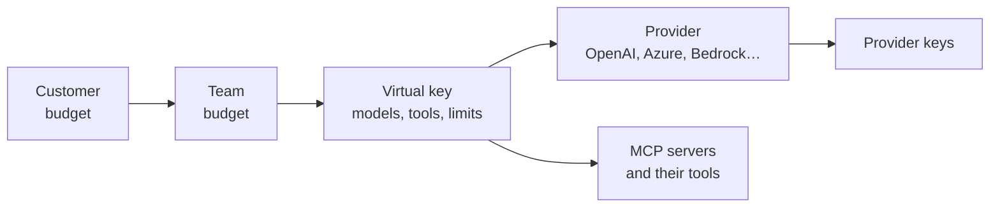

These are the parts of Rekori you meet on almost every page. Each section says what the thing is for and where to
read more.

## Provider and provider key

A **provider** is a model service Rekori calls: OpenAI, Anthropic, Azure AI Foundry, Bedrock, Vertex and others. A
**provider key** is the credential Rekori uses to call it. A provider can have several keys, and Rekori spreads calls
across them. Callers never see provider keys.

Read more: [Providers](/llm-gateway/connect-models/add-a-provider), [Retries and fallbacks](/llm-gateway/connect-models/keys-retries-fallbacks).

## Virtual key

A **virtual key** is what an app, an agent or a person sends to Rekori. It starts with `sk-bf-`. It decides:

- which providers and models the caller may use (nothing, until you allow it),
- which MCP tools it may use,
- its own budget, rate limit and expiry.

Read more: [Virtual keys](/llm-gateway/access-and-spend/virtual-keys).

## Team and customer

A **team** groups virtual keys so they share one budget and rate limit, for example one team per department or
line of business. A **customer** groups teams, or keys, under a larger budget. A key belongs to a team or to a
customer, not both. Every level a call passes through must have room.

Read more: [Teams and customers](/llm-gateway/access-and-spend/teams-and-customers), [Budgets and limits](/llm-gateway/access-and-spend/budgets-and-limits).

## Identity provider

An **identity provider** is your sign-in service, such as Okta or Microsoft Entra ID. Rekori uses it in two ways:
people sign in to the console with it, and a key can require callers to send their own sign-in token, so every call
shows which person made it.

Read more: [Console sign-in](/llm-gateway/access-and-spend/console-sign-in), [Caller sign-in](/llm-gateway/access-and-spend/callers-sign-in).

## Content rule

A **content rule** checks prompts and answers, and blocks or redacts what it finds: personal data, keywords,
patterns, or the verdict of an external guardrail service.

Read more: [Content rules](/llm-gateway/protect/content-rules), [External guardrails](/llm-gateway/protect/external-guardrails).

## Routing rule

A **routing rule** sends a call to a different provider or model than the one it asked for, based on what the call
contains. Smart routing does the same by a prompt's complexity, meaning or classification.

Read more: [Routing rules](/llm-gateway/routing/routing-rules).

## MCP server and virtual MCP

An **MCP server** offers tools (search an issue tracker, query a database) that models can call. Rekori connects to
MCP servers, signs in to them, and decides which keys may use which tools. A **virtual MCP** is a named set of tools,
picked from one or more servers, that you give to keys as one unit.

Read more: [MCP servers](/llm-gateway/mcp/add-an-mcp-server), [Tools per key](/llm-gateway/mcp/tools-per-key).

## Logs

Every call is logged: who made it, the model, tokens, cost, latency, and (unless you turn content logging off) the
prompt and answer.

Read more: [Logs](/llm-gateway/monitor/logs).
