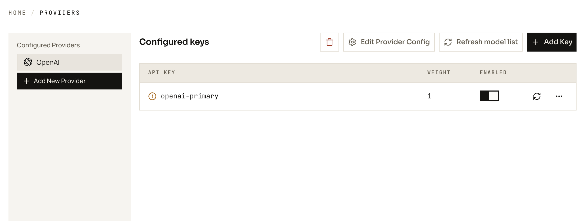
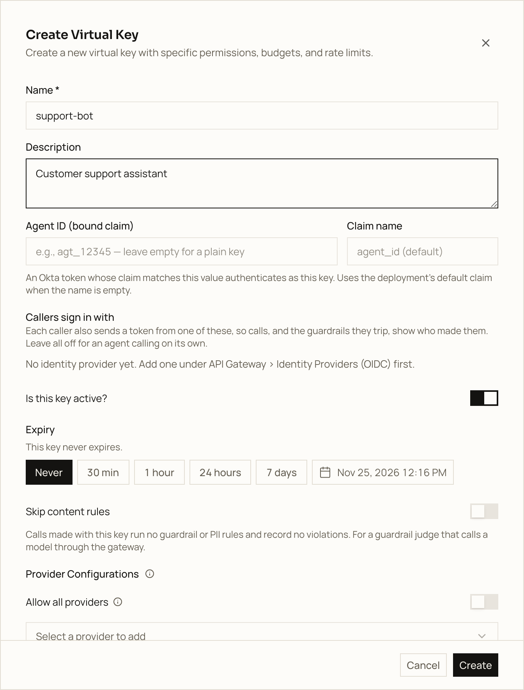
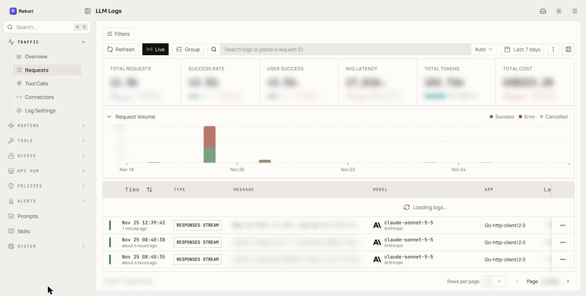

At the end of this page an app calls a model through Rekori with its own key, and you can see the call in the
console.

<Note>
You need: the address of your Rekori console (in these docs, `https://rekori.example.com`), a console role that can
manage providers and keys, and an API key for one provider, for example OpenAI.
</Note>

<Steps>
  <Step title="Add a provider">
    Go to **Routing** > **Providers** and select **Add New Provider**, then choose the provider, for example
    **OpenAI**. Choosing it adds the provider straight away.

    Select **Add Key**, give the key a **Name** such as `openai-primary`, paste the provider's key into **API Key**,
    and select **Save**.

    {/* SCREENSHOT: providers-add | crop | Routing > Providers with OpenAI selected and its key openai-primary in Configured keys. */}
    <Frame caption="A provider and its key under Routing > Providers">
      
    </Frame>

    <Tip>
    Instead of pasting the key, you can enter `env.OPENAI_API_KEY`. Rekori then reads the key from that environment
    variable on the server.
    </Tip>
  </Step>

  <Step title="Create a virtual key">
    A virtual key is what your app sends to Rekori instead of the provider's key. It decides which providers and
    models the app may use.

    Go to **Access** > **Keys** and select **Add Virtual Key**. In **Create Virtual Key**:

    1. Enter a **Name**, for example `support-bot`.
    2. Under **Provider Configurations**, choose **Select a provider to add** and pick the provider you added. It is
       added with all its keys and all models; to narrow the models, expand it and edit **Allowed models**.
    3. Select **Create**.

    {/* SCREENSHOT: vk-form | crop | The Create Virtual Key sheet with Name support-bot and Description filled in. */}
    

    In the **Keys** table, copy the new key. It starts with `sk-bf-`.

    <Warning>
    A key with no provider under **Provider Configurations** can call nothing: access is denied unless you allow it.
    </Warning>
  </Step>

  <Step title="Make a call">
    Send a chat request to Rekori with the virtual key in the `x-bf-vk` header. Name the model as
    `provider/model`.

    <CodeGroup>
    ```bash curl
    curl https://rekori.example.com/v1/chat/completions \
      -H "Content-Type: application/json" \
      -H "x-bf-vk: $REKORI_KEY" \
      -d '{
        "model": "openai/gpt-4o-mini",
        "messages": [{"role": "user", "content": "Say hello in five words."}]
      }'
    ```

    ```python Python (OpenAI SDK)
    import os
    from openai import OpenAI

    client = OpenAI(base_url="https://rekori.example.com/v1", api_key=os.environ["REKORI_KEY"])
    reply = client.chat.completions.create(
        model="openai/gpt-4o-mini",
        messages=[{"role": "user", "content": "Say hello in five words."}],
    )
    print(reply.choices[0].message.content)
    ```

    ```typescript TypeScript (OpenAI SDK)
    import OpenAI from "openai";

    const client = new OpenAI({ baseURL: "https://rekori.example.com/v1", apiKey: process.env.REKORI_KEY });
    const reply = await client.chat.completions.create({
      model: "openai/gpt-4o-mini",
      messages: [{ role: "user", content: "Say hello in five words." }],
    });
    console.log(reply.choices[0].message.content);
    ```
    </CodeGroup>

    The SDKs send the key as `Authorization: Bearer sk-bf-…`. Rekori treats any key that starts with `sk-bf-` as a
    virtual key, so you do not need the `x-bf-vk` header there.
  </Step>

  <Step title="See the call">
    Go to **Traffic** > **Requests**. The call is at the top of the list, with its model, app, latency, tokens and
    cost. Select it to see the full request and answer.

    {/* SCREENSHOT: requests-list | crop | Traffic > Requests, last 7 days, with stat cards and the Message column blurred. */}
    <Frame caption="Calls in Traffic > Requests">
      
    </Frame>
  </Step>
</Steps>

## If the call fails

The reason is in the `type` field of the error Rekori returns:

```json
{
  "type": "virtual_key_required",
  "status_code": 401,
  "error": { "message": "virtual key is required. Provide a virtual key via the x-bf-vk header." }
}
```

| Status and `type` | Why | Fix |
|---|---|---|
| `401` `virtual_key_required` | No key reached Rekori | Check the header name, and that the key starts with `sk-bf-` |
| `401` `access_not_found` | Rekori does not know this key | Copy the key again from **Access** > **Keys** |
| `403` `provider_blocked` or `model_blocked` | The key does not allow this provider or model | Edit the key's **Provider Configurations** |


## Next steps

<CardGroup cols={2}>
  <Card title="Endpoints and SDKs" icon="plug" href="/llm-gateway/call-the-gateway/endpoints-and-sdks">
    Use the Anthropic SDK, Bedrock, Gemini, LangChain and more.
  </Card>
  <Card title="Virtual keys" icon="key" href="/llm-gateway/access-and-spend/virtual-keys">
    Add budgets, rate limits, expiry and tools to a key.
  </Card>
</CardGroup>
