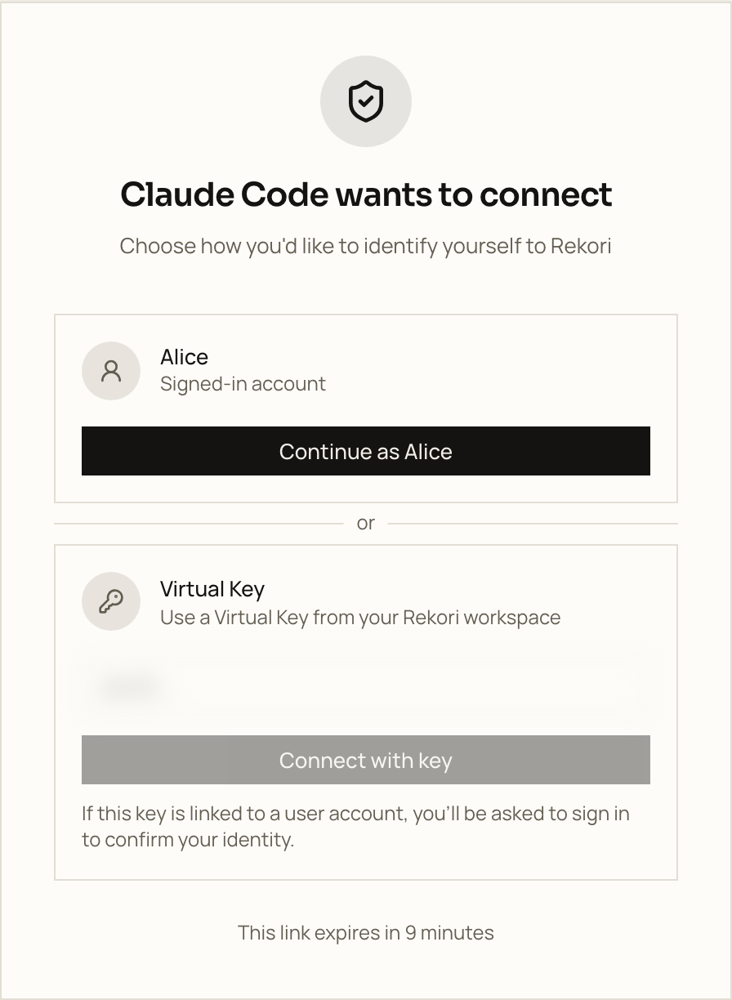

This guide sets up a developer's editor to use Rekori for two things: the **model calls** the editor makes, and the
**MCP tools** Rekori hosts, such as Linear. At the end, every call and tool use shows the developer's name and counts
against their budget, and tools act with their own Linear account.

<Note>
You need, as an admin:

- a provider in Rekori ([Add a provider](/llm-gateway/connect-models/add-a-provider));
- [console sign-in](/llm-gateway/access-and-spend/console-sign-in) with your identity provider, so people can sign in as
  themselves;
- for each developer, their own virtual key with **Agent ID (bound claim)** set to their email and **Claim name**
  `email`, for example in a team `engineering` with a monthly budget. This is how Rekori finds "their" key when they
  sign in ([Caller sign-in](/llm-gateway/access-and-spend/callers-sign-in#bind-a-key-to-one-identity-agent-id)).
</Note>

<Warning>
Leave **Callers sign in with** off on these keys. Editors send the key alone for model calls, and a key that requires
caller sign-in refuses a call without a token (`401` `identity_token_required`).
</Warning>

## As an admin: add Linear with per-user sign-in

<Steps>
  <Step title="Add the server">
    Go to **Tools** > **Catalog** > **New MCP Server**: **Name** `linear`, **Connection Type** **HTTP (Streamable)**,
    the server's **Connection URL**, **Authentication Type** **OAuth 2.0**, **Auth Scope** **Per-User**. Select
    **Create**. See [MCP servers](/llm-gateway/mcp/add-an-mcp-server) and [Per-user sign-in](/llm-gateway/mcp/per-user-sign-in).
  </Step>
  <Step title="Give the developers' keys access">
    On each key (or once, with a [Virtual MCP](/llm-gateway/mcp/tools-per-key#with-a-virtual-mcp) assigned to all of them), add
    `linear` under **MCP Server Configurations**.
  </Step>
  <Step title="Turn on OAuth for editors">
    Under **Tools** > **Settings** > **Advanced Settings**, set **MCP Server Authentication Mode** to **Both** and
    **Issuer URL** to `https://rekori.example.com`. Select **Save Changes**. See
    [Use from your editor](/llm-gateway/mcp/connect-claude-code#turn-on-oauth).
  </Step>
</Steps>

## As a developer: connect your editor

<Tabs>
  <Tab title="Claude Code">
    **Model calls.** Add to `~/.claude/settings.json` under `env`, or to your shell:

    ```bash
    export ANTHROPIC_BASE_URL="https://rekori.example.com/anthropic"
    export ANTHROPIC_AUTH_TOKEN="sk-bf-…"   # your virtual key
    ```

    **Tools.** Add Rekori as an MCP server:

    ```bash
    claude mcp add --transport http rekori --scope user https://rekori.example.com/mcp
    ```

    Run `/mcp` in Claude Code and choose `rekori` to sign in. A browser opens on Rekori's consent page.
  </Tab>
  <Tab title="Cursor">
    **Model calls.** In **Settings** > **Models**, turn on **Override OpenAI Base URL** with
    `https://rekori.example.com/cursor`, and enter your virtual key as the **OpenAI API Key**.

    **Tools.** In **Tools** > **Catalog**, select **Connect agent**, choose **Cursor** and **OAuth**, and add the
    configuration it shows to Cursor's MCP settings. Cursor opens Rekori's consent page the first time.
  </Tab>
</Tabs>

On the consent page, select **Continue as** with your name:

{/* SCREENSHOT: reuse mcp/oauth-consent */}


The first time you use a Linear tool, the editor shows a link: open it, select **Authenticate**, and sign in to
Linear. From then on, Linear tools act as you.

## Test it

1. Ask the editor something simple. The call appears in **Traffic** > **Requests** with your key.
2. Ask it to list your open Linear issues. The first time, follow the sign-in link; then ask again.
3. **Traffic** > **Tool Calls** shows the tool call with your name; **Tools** > **Sessions** shows your Linear
   credential, **Bound to** you.

## The result

| Admins see | Where |
|---|---|
| Each developer's model spend | **Traffic** > **Overview** > **Virtual Key Rankings** or **User Rankings** |
| Each tool call, by person | **Traffic** > **Tool Calls** |
| Connected editors | **Tools** > **OAuth Grants**, with **Revoke** |

When someone leaves, removing them in your identity provider stops their console sign-in, their editor's OAuth grant
can't renew, and their Linear credential stops working.
