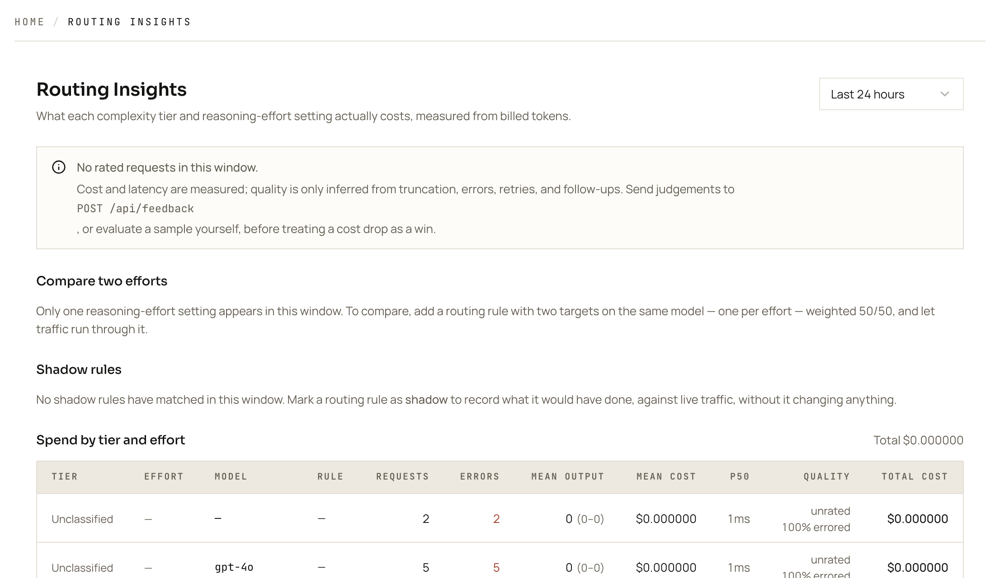

Most apps send every prompt to one strong model, even "thanks!" and "what time is it in Tokyo?". This guide lowers
the bill in four steps, none of which changes app code:

1. see where the money goes;
2. send easy prompts to a cheaper model, tested first in shadow mode;
3. answer repeated questions from the cache;
4. cap spend so a mistake can't run away.

<Note>
You need: Rekori carrying real traffic for a few days, at least two models from your providers (a strong one and a
cheap one, for example `anthropic/claude-sonnet-4-5` and `openai/gpt-4o-mini`), and an embedding model for
complexity routing.
</Note>

<Steps>
  <Step title="See where the money goes">
    Open **Traffic** > **Overview** with **Last 7 days**. **Model Rankings** shows which models cost the most;
    **Virtual Key Rankings** and **App Rankings** show who is calling them. Pick the most expensive app or key to start
    with. See [Dashboard](/llm-gateway/monitor/dashboard).
  </Step>
  <Step title="Set up complexity routing">
    Under **Routing** > **Complexity Router**, select **Configure embedding** and choose the embedding provider and
    model. Add a few real prompts from your users to the reference phrases of each tier. See
    [Complexity routing](/llm-gateway/routing/complexity-router).
  </Step>
  <Step title="Add a rule in shadow mode">
    Under **Routing** > **Routing Rules**, add a rule: **By prompt difficulty**, tier **Simple**, send it to
    `openai/gpt-4o-mini`. Limit it to the key or team you chose, and turn on **Try it first (shadow mode)**. Calls are
    not changed yet. See [Routing rules](/llm-gateway/routing/routing-rules).
  </Step>
  <Step title="Compare">
    After a few days, open **Routing** > **Routing Insights**. **Shadow rules** shows how many calls the rule would
    have moved and what they would have cost; **Spend by tier and effort** shows cost per tier.

    {/* SCREENSHOT: reuse routing/routing-insights */}
    <Frame caption="Routing > Routing Insights">
      
    </Frame>

    Read a sample of the moved prompts in **Traffic** > **Requests** (filter by **Complexity Tier**) to check the cheap
    model would have answered them well. When it looks right, turn shadow mode off.
  </Step>
  <Step title="Cache repeated questions">
    For apps that see the same questions often (FAQ bots, fixed prompts), turn on **System** > **Caching** >
    **Enable Caching**. Set a **Default Cache Key**, or caching applies only to calls that send `x-bf-cache-key`.
    Cached answers cost nothing. See [Caching](/llm-gateway/routing/semantic-cache).
  </Step>
  <Step title="Cap spend">
    Put a monthly budget on each team, and on any key used by a script or agent that could loop. Under **Routing** >
    **Budgets & Limits**, add a gateway-wide budget on the most expensive model. See
    [Budgets and limits](/llm-gateway/access-and-spend/budgets-and-limits).
  </Step>
</Steps>

## Check the result

After a week with the rule live, compare **Traffic** > **Overview** > **Cost** with the week before, and
**Model Rankings**: more calls should go to the cheap model, at a lower total.

<Warning>
**Routing Insights** measures cost exactly but only infers quality. Before rolling a rule out to every team, check
answers yourself or send your own ratings to `POST /api/feedback`.
</Warning>

## Next steps

- Add a **Medium** tier rule once **Simple** works.
- With several Rekori replicas, budgets and rate limits are counted on each replica separately. Read
  [Limits to know](/llm-gateway/access-and-spend/budgets-and-limits#limits-to-know) before relying on budgets.
