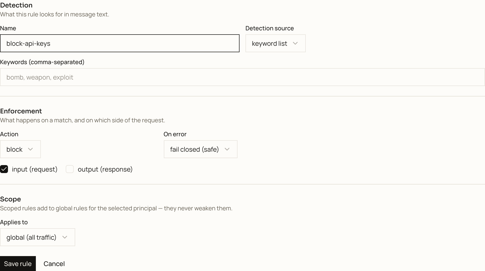
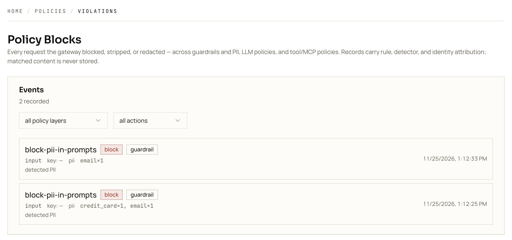

This guide puts four layers between your users' data and the model providers:

| Layer | Stops |
|---|---|
| A content rule | Personal data (emails, card numbers, social security numbers, API keys) in prompts |
| An LLM policy | Calls to models or providers your company hasn't approved |
| Model trust | Sensitive prompts going to a model or region that isn't approved for them |
| Content logging off | Prompts and answers being kept in Rekori's logs |

And alerts tell your security team when something is blocked.

<Note>
You need a console role that can manage policies and settings. Model trust also needs
[classifier routing](/llm-gateway/routing/classifier-routing) on for the keys whose data should be checked.
</Note>

<Steps>
  <Step title="Block personal data in prompts">
    Under **Policies** > **Content Rules**, select **Add rule**:

    - **Detection source** **PII detectors**;
    - **Action** **block** (or **redact** to remove the data and let the call go on);
    - **input (request)**, **On error** **fail closed (safe)**;
    - **Applies to** **global (all traffic)**.

    Select **Save rule**. See [Content rules](/llm-gateway/protect/content-rules).

    {/* SCREENSHOT: reuse protect/content-rule-form */}
    <Frame caption="Policies > Content Rules > Add rule">
      
    </Frame>
  </Step>
  <Step title="Allow only approved models">
    Under **Policies** > **LLM Policies**, select **New policy**: **Action** **deny**, **Scope** **global
    (company-wide)**, **Mandatory** on, and **Providers** the ones you haven't approved, for example `groq, xai`. Add a
    **Deny reason** such as "Not an approved provider; see the AI policy". See [LLM policies](/llm-gateway/protect/llm-policies).
  </Step>
  <Step title="Keep sensitive prompts on trusted models">
    Under **Routing** > **Model Trust Registry**, **Register deployment** for each model you use, with its **Region**,
    **Approved data classes** and **Allowed flags** (`PII`, `PHI`, `PCI`, `SECRETS`). Turn on the policy router in
    **Advisory** mode, check **Simulate a change**, then switch to **Enforce**. See [Model trust](/llm-gateway/routing/model-trust).
  </Step>
  <Step title="Keep content out of the logs">
    If prompts may hold personal data that a block doesn't catch, turn on **Disable Content Logging** under
    **Traffic** > **Log Settings**. Logs then keep cost, tokens and status only. If you also send traces, turn on
    **Disable Content Logging** in each OpenTelemetry profile too. See [Logs](/llm-gateway/monitor/logs#log-settings) and
    [Traces](/llm-gateway/monitor/traces).
  </Step>
  <Step title="Get alerted">
    Under **Alerts** > **Channels**, add your security team's Slack or PagerDuty, with **Minimum severity**
    **warning**, and select **Test**. See [Blocks and alerts](/llm-gateway/protect/policy-blocks-and-alerts).
  </Step>
</Steps>

## Test it

```bash
curl https://rekori.example.com/v1/chat/completions \
  -H "x-bf-vk: $REKORI_KEY" -H "Content-Type: application/json" \
  -d '{"model": "openai/gpt-4o-mini",
       "messages": [{"role": "user", "content": "Refund alice@example.com, card 4111 1111 1111 1111."}]}'
```

Rekori answers `446`, and the provider never sees the prompt:

```json
{ "error": { "message": "blocked by content policy: detected PII", "type": "content_policy_blocked" } }
```

A call to a provider your LLM policy denies gets `403` `llm_policy_denied` with your deny reason.

## The result

**Policies** > **Policy Blocks** lists each block with the rule, the key and what was detected (for example
`email×1`, `credit_card×1`), never the content itself, and your alert channel gets a message.

{/* SCREENSHOT: reuse protect/policy-blocks */}
<Frame caption="Policies > Policy Blocks">
  
</Frame>

<Warning>
- Content rules on answers don't check streamed answers. Prompts are always checked.
- A virtual key with **Skip content rules** on is never checked. Review which keys have it.
</Warning>
