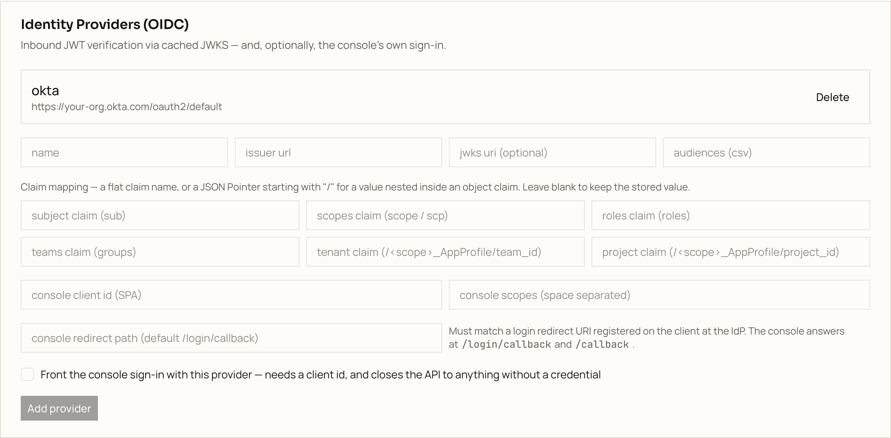
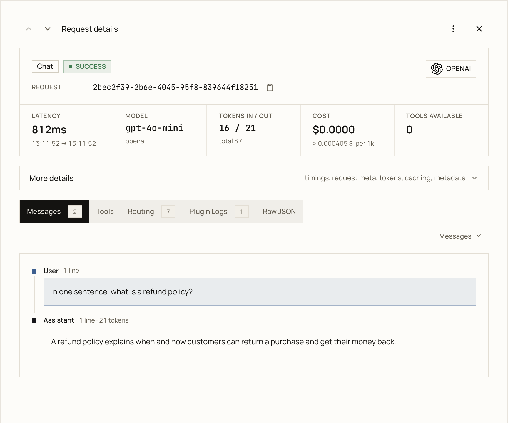

This guide takes a new Rekori from empty to ready for a department. At the end:

- people sign in to the console with your company identity, and each sees only what their role allows;
- the Sales team calls models through one key, each person signed in as themselves;
- Sales can't spend more than $500 a month;
- personal data in prompts is blocked;
- every call shows who made it.

The example uses Okta at `https://your-org.okta.com`. Other OIDC providers (Entra ID, Keycloak) work the same way.

<Note>
You need: Rekori at `https://rekori.example.com` with its setup token, an admin account in Okta, and an API key for
one model provider, for example OpenAI.
</Note>

## In Okta

1. **For the console:** create a single-page application (OIDC, authorization code with PKCE) with the sign-in
   redirect URI `https://rekori.example.com/login/callback`. Note its client ID.
2. **For groups:** make sure tokens carry a `groups` claim, and create the groups `rekori-admins` and `sales`.
3. **For SCIM (optional):** create a SCIM app so Okta creates and removes people in Rekori. You fill in its address
   and token in step 3 below.

## In Rekori

<Steps>
  <Step title="Create the first admin">
    Open `https://rekori.example.com`, enter the setup token, and create the admin username and password. Keep these
    for emergencies and scripts. See [Console sign-in](/llm-gateway/access-and-spend/console-sign-in#the-first-admin).
  </Step>
  <Step title="Add a provider">
    Go to **Routing** > **Providers**, select **Add New Provider** > **OpenAI**, then **Add Key** with the OpenAI API
    key. Set **Max Retries** to `2` on the provider's **Network** tab, so a failing key is skipped instead of failing
    the call. See [Add a provider](/llm-gateway/connect-models/add-a-provider) and
    [Retries and fallbacks](/llm-gateway/connect-models/keys-retries-fallbacks).
  </Step>
  <Step title="Turn on console sign-in with Okta">
    Under **Routing** > **API Gateway** > **Identity Providers (OIDC)**, add Okta: name `okta`, issuer url
    `https://your-org.okta.com/oauth2/default`, the console client ID, scopes `openid profile email groups`. Tick
    **Front the console sign-in with this provider** and select **Add provider**.

    {/* SCREENSHOT: reuse access-and-spend/idp-provider-card */}
    <Frame caption="The Okta provider under Identity Providers (OIDC)">
      
    </Frame>
  </Step>
  <Step title="Give people roles">
    Under **Access** > **Roles**, create:

    - `admins`: **Owner** on, **Granted automatically to these groups** `rekori-admins`;
    - `sales-viewers`: **View** on `Logs` and `Dashboard`, granted to `sales`.

    Optionally, under **Access** > **Provisioning**, copy the **SCIM base URL**, **Generate token**, turn on
    **SCIM provisioning**, and enter both in Okta's SCIM app. See [Members and roles](/llm-gateway/access-and-spend/scim-and-roles).

    Sign in once with Okta in a private window to check your role before you rely on it.
  </Step>
  <Step title="Create the Sales team">
    Under **Access** > **Teams**, select **Add Team**: **Team Name** `Sales`, **+ Add budget** $500 resetting
    **Monthly**. Select **Create Team**. See [Teams and customers](/llm-gateway/access-and-spend/teams-and-customers).
  </Step>
  <Step title="Create the key, with caller sign-in">
    Under **Access** > **Keys**, select **Add Virtual Key**: **Name** `sales-assistant`, the OpenAI provider under
    **Provider Configurations** with only the models Sales needs, **Entity Assignment** the Sales team, and under
    **Callers sign in with**, switch on `okta`. Select **Create** and copy the key.

    The key now works only together with an Okta token. See [Caller sign-in](/llm-gateway/access-and-spend/callers-sign-in).
  </Step>
  <Step title="Block personal data">
    Under **Policies** > **Content Rules**, select **Add rule**: **Detection source** **PII detectors**, **Action**
    **block**, **input (request)**, **Applies to** **global (all traffic)**. Select **Save rule**. See
    [Content rules](/llm-gateway/protect/content-rules).
  </Step>
</Steps>

## Test it

A member of Sales calls with the key and their Okta access token:

```bash
curl https://rekori.example.com/v1/chat/completions \
  -H "x-bf-vk: $SALES_KEY" -H "Authorization: Bearer $OKTA_ACCESS_TOKEN" \
  -H "Content-Type: application/json" \
  -d '{"model": "openai/gpt-4o-mini", "messages": [{"role": "user", "content": "Draft a follow-up email."}]}'
```

| Try | Expect |
|---|---|
| The call above | An answer |
| The same call without `Authorization` | `401` `identity_token_required` |
| A prompt with a card number or email address | `446` `content_policy_blocked` |
| A model not on the key | `403` `model_blocked` |

## The result

Go to **Traffic** > **Requests** and open the call: it shows the key, the team and the person from the Okta token.
**Traffic** > **Overview** > **Team Rankings** shows what Sales has spent, and **Policies** > **Policy Blocks** lists
the blocked prompt with what was detected.

{/* SCREENSHOT: reuse monitor/request-detail */}


## Next steps

- Add more teams the same way, one per department.
- Turn on [alerts](/llm-gateway/protect/policy-blocks-and-alerts#alerts) so security hears about blocks.
- Read [Cut model costs](/llm-gateway/guides/cut-model-costs) once traffic is flowing.
