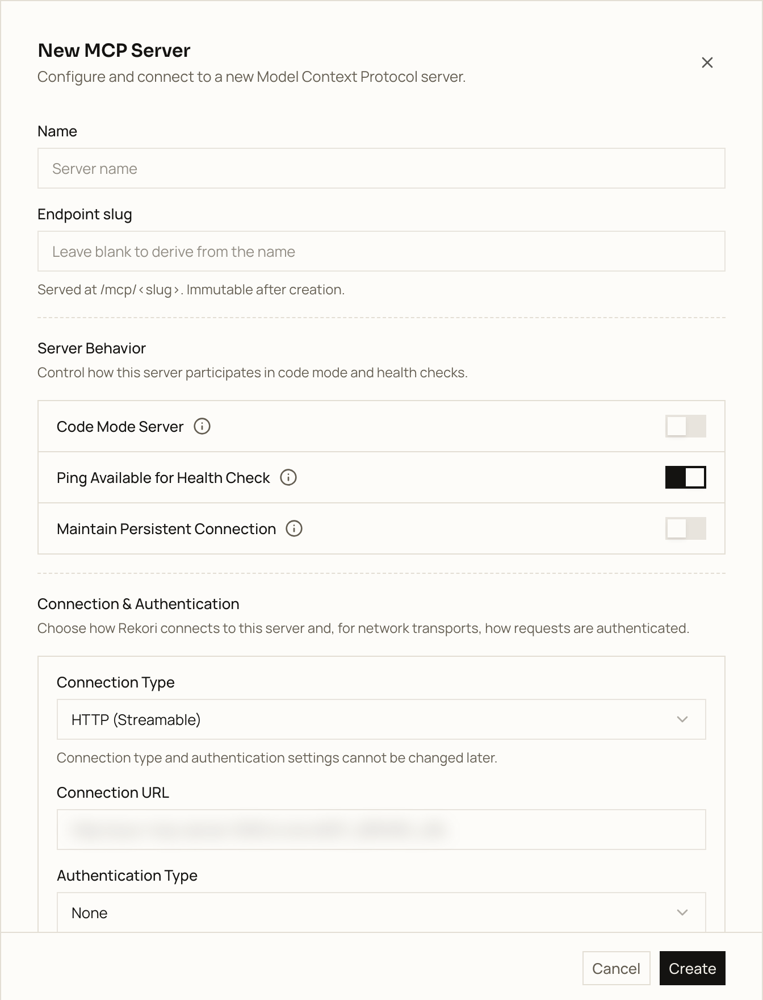
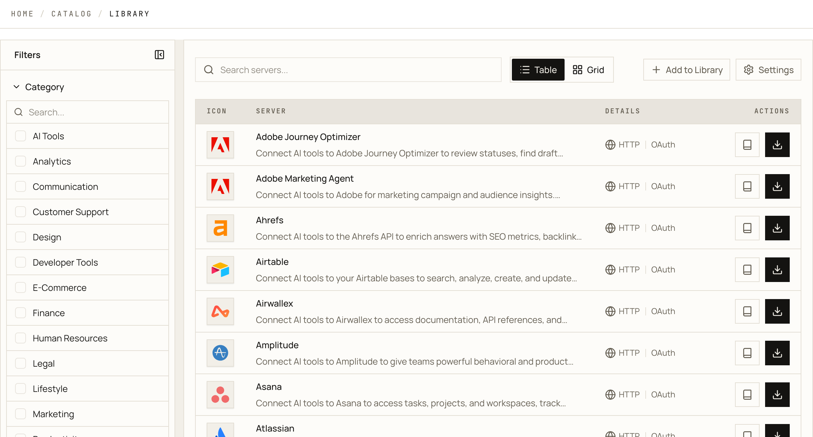

An MCP server gives models tools: search a ticket system, read a database, open a pull request. When you add one to
Rekori, Rekori connects to it, keeps its tool list up to date, and offers its tools in two ways:

- **To models**, on calls through the gateway. Rekori adds the tools a key may use to each chat request.
- **To MCP clients** such as Claude Code or Cursor, at `https://rekori.example.com/mcp/<slug>`. See
  [Use from your editor](/llm-gateway/mcp/connect-claude-code).

Either way, each person or app uses its own [virtual key](/llm-gateway/access-and-spend/virtual-keys), and
[Tools per key](/llm-gateway/mcp/tools-per-key) decides which tools that key gets.

## Add a server

<Steps>
  <Step title="Open the form">
    Go to **Tools** > **Catalog** and select **New MCP Server**.

    {/* SCREENSHOT: mcp-server-form | crop | New MCP Server sheet: Name linear, Endpoint slug, Server Behavior switches, Connection Type, Connection URL (placeholder blurred), Authentication Type. */}
    
  </Step>
  <Step title="Name it">
    | Field | What to enter |
    |---|---|
    | **Name** | Letters, digits and underscores, 3 to 50 characters, for example `linear`. Tools are named after it: the tool `create_issue` becomes `linear-create_issue`. |
    | **Endpoint slug** | Where Rekori serves this server to MCP clients: `/mcp/<slug>`. Leave it blank to use the name. It can't be changed later. |
  </Step>
  <Step title="Choose how Rekori connects">
    **Connection type and authentication can't be changed later.**

    | **Connection Type** | Use for | Fill in |
    |---|---|---|
    | **HTTP (Streamable)** | Most remote servers | **Connection URL**, for example `https://mcp.example.com/mcp` |
    | **Server-Sent Events (SSE)** | Older remote servers | **Connection URL** |
    | **STDIO** | A local program Rekori starts itself | **Command**, **Arguments (comma-separated)**, **Environment Variables** |

    A URL can be written as `env.MCP_SERVER_URL` to read it from an environment variable. For STDIO, the command
    (for example `npx` or `python`) must be installed where Rekori runs.
  </Step>
  <Step title="Choose how Rekori signs in">
    | **Authentication Type** | Use when |
    |---|---|
    | **None** | The server needs no sign-in. |
    | **Headers** | The server takes an API key or token in a header. Add it under **Headers**. |
    | **OAuth 2.0** | The server signs in with OAuth. Leave **OAuth Client ID (optional)** empty to let Rekori register itself; the URLs are discovered from the server. |

    For **Headers** and **OAuth 2.0**, choose the **Auth Scope**:

    - **Shared**: one credential, entered here by you, used for every caller.
    - **Per-User**: each person signs in with their own account the first time they use a tool. See
      [Per-user sign-in](/llm-gateway/mcp/per-user-sign-in).
  </Step>
  <Step title="Create">
    Select **Create**. For **OAuth 2.0**, a sign-in window opens; sign in to the server's account that Rekori should
    use.
  </Step>
</Steps>

New servers start with every tool turned on, no tool set to run automatically, and **Allow by Default** off, so no
key can use the server until you give it access. See [Tools per key](/llm-gateway/mcp/tools-per-key).

**Server Behavior** on the same form:

| Switch | Default | What it does |
|---|---|---|
| **Code Mode Server** | Off | Gives the model a small set of code tools instead of this server's full tool list. See [Agent mode](/llm-gateway/mcp/agent-mode#code-mode). |
| **Ping Available for Health Check** | On | Turn it off if the server doesn't answer MCP `ping`; Rekori then checks by listing tools. |
| **Maintain Persistent Connection** | | HTTP servers with shared or no sign-in only: keep one connection open instead of connecting per call. |

## Change a server

Select a server in the catalog. Its sheet has four tabs:

- **General**: per-server **Tool Sync Interval (minutes)** and **Tool Execution Timeout (seconds)**, and
  **Disable Client** to turn the server off.
- **Authentication**: credentials.
- **Tools**: each tool with **Enabled**, **Auto-execute** (see [Agent mode](/llm-gateway/mcp/agent-mode)) and **Cost (USD)** per
  call, which is added to the call's cost in Logs.
- **Access**: **Allow by Default** and **Virtual Key Assignments**.

## Add a server from the library

**Tools** > **Library** lists ready-made servers. Select **Install** on one, fill in its credentials, and select
**Install** (or **Continue** when it needs a sign-in). The connection details are filled in for you. Installed
servers show **Installed** and an **Open** link.

{/* SCREENSHOT: mcp-library | crop | Tools > Library with server cards and Install buttons. */}
<Frame caption="Tools > Library">
  
</Frame>

To share an internal server with other admins, select **Add to Library**. It adds a listing only; nothing connects
until someone installs it.

## Check it worked

The catalog's **State** column shows each server's health:

| State | Means |
|---|---|
| **Healthy** | Rekori reached the server and has its tools. Checked every 10 minutes. |
| **Unstable** | A recent check failed. Rekori checks again every 10 seconds; tool calls are still tried. |
| **Error** | Rekori can't connect. Select **Reconnect** in the row menu after fixing the cause. |
| **Pending Verification** | An OAuth sign-in is not finished. Select **Authorize** in the row menu. |
| **Needs Reauth** | The server's sign-in expired. Sign in again. |
| **Disabled** | Turned off with **Disable Client** or the **Status** switch. |
