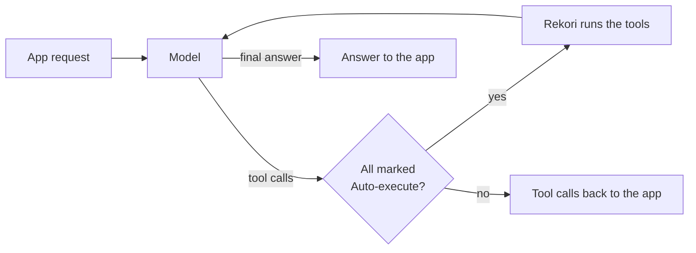
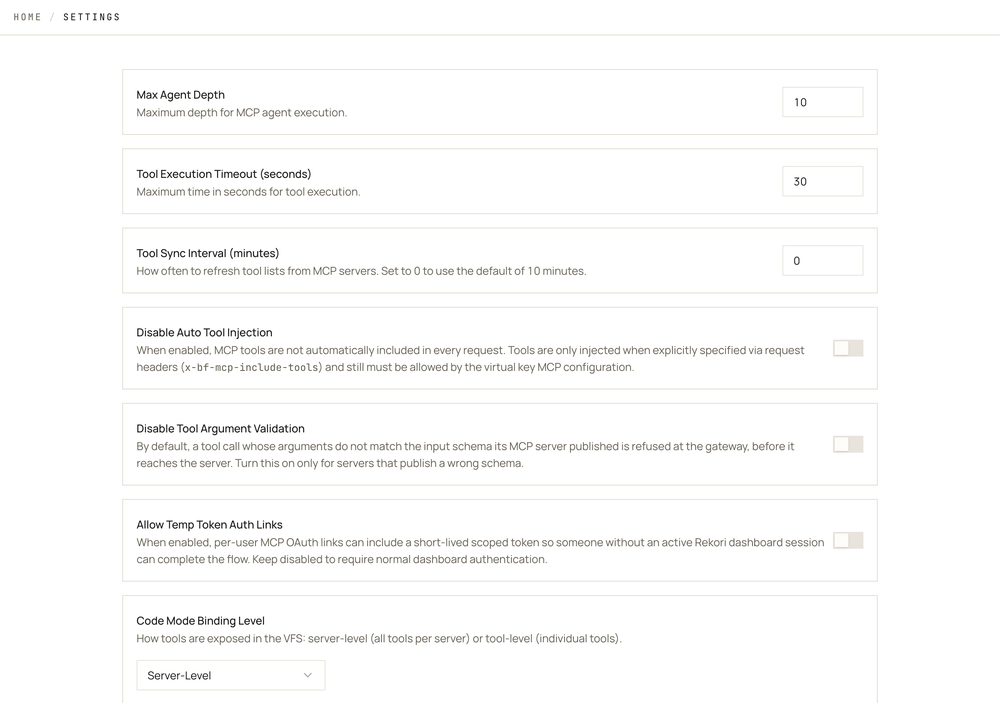

When a model answers with tool calls, someone has to run the tools and send the results back. Normally that is your
app. In agent mode, Rekori does it for the tools you mark as safe to run on their own: it calls the tools, gives the
results to the model, and repeats until the model gives a final answer. Your app makes one request and gets the
answer.

## How it works

1. The app sends a chat completion or Responses request. Rekori adds the key's MCP tools.
2. The model answers with tool calls.
3. Rekori runs the calls whose tools are marked **Auto-execute**, all at once, and sends the results to the model.
4. Steps 2 and 3 repeat until the model answers without tool calls, or up to **Max Agent Depth** rounds.
5. If the model asks for a tool that is **not** marked **Auto-execute**, Rekori stops and returns those tool calls to
   the app, with the results it already has. The app runs them (or asks a person) and continues the conversation.

Agent mode runs only on requests that are not streamed. Streamed requests always return tool calls to the app.

## Turn it on for a tool

Go to **Tools** > **Catalog**, open the server, and on the **Tools** tab turn on **Auto-execute** for each tool Rekori
may run without asking. The tool must also be **Enabled**, and allowed for the key (see
[Tools per key](/llm-gateway/mcp/tools-per-key)).

<Warning>
Mark only tools that are safe to run without a person checking: reading, searching, looking up. Leave tools that
change or delete things (send email, refund an order, delete a record) off, so they come back to your app first.
</Warning>

When a tool needs [per-user sign-in](/llm-gateway/mcp/per-user-sign-in) and the person hasn't signed in yet, the request ends
with `401` and `mcp_auth_required`, with the sign-in link in the error.

## Settings

Go to **Tools** > **Settings**.

{/* SCREENSHOT: mcp-settings | crop | MCP Settings: Max Agent Depth 10, Tool Execution Timeout 30, Tool Sync Interval 10, switches. */}
<Frame caption="Tools > Settings">
  
</Frame>

| Setting | Default | What it does |
|---|---|---|
| **Max Agent Depth** | 10 | The most rounds of tool calls in one request |
| **Tool Execution Timeout (seconds)** | 30 | How long one tool call may take |
| **Tool Sync Interval (minutes)** | 10 | How often Rekori refreshes each server's tool list. `0` means 10. |
| **Disable Auto Tool Injection** | Off | Add MCP tools only to requests that ask for them. See [Tools per key](/llm-gateway/mcp/tools-per-key). |
| **Disable Tool Argument Validation** | Off | Rekori refuses a tool call whose arguments don't match the tool's schema. Turn this on only for a server that publishes a wrong schema. |
| **Allow Temp Token Auth Links** | Off | See [Per-user sign-in](/llm-gateway/mcp/per-user-sign-in). |
| **Code Mode Binding Level** | **Server-Level** | See Code Mode below. |

A server's own **Tool Sync Interval** and **Tool Execution Timeout**, on its **General** tab, override these.

## Code Mode

A server with many tools fills the model's context with their descriptions. With **Code Mode Server** turned on for a
server, the model doesn't see that server's tools one by one. It gets four tools instead (`listToolFiles`,
`readToolFile`, `getToolDocs`, `executeToolCode`) and writes a short script that calls the tools it needs. Rekori runs
the script and returns the result.

- Turn it on per server: **Code Mode Server** on the server's form.
- **Code Mode Binding Level** decides how tools are shown to the model: one file per server (**Server-Level**) or one
  per tool (**Tool-Level**).
- `executeToolCode` runs on its own only when every tool the script calls is marked **Auto-execute**.
