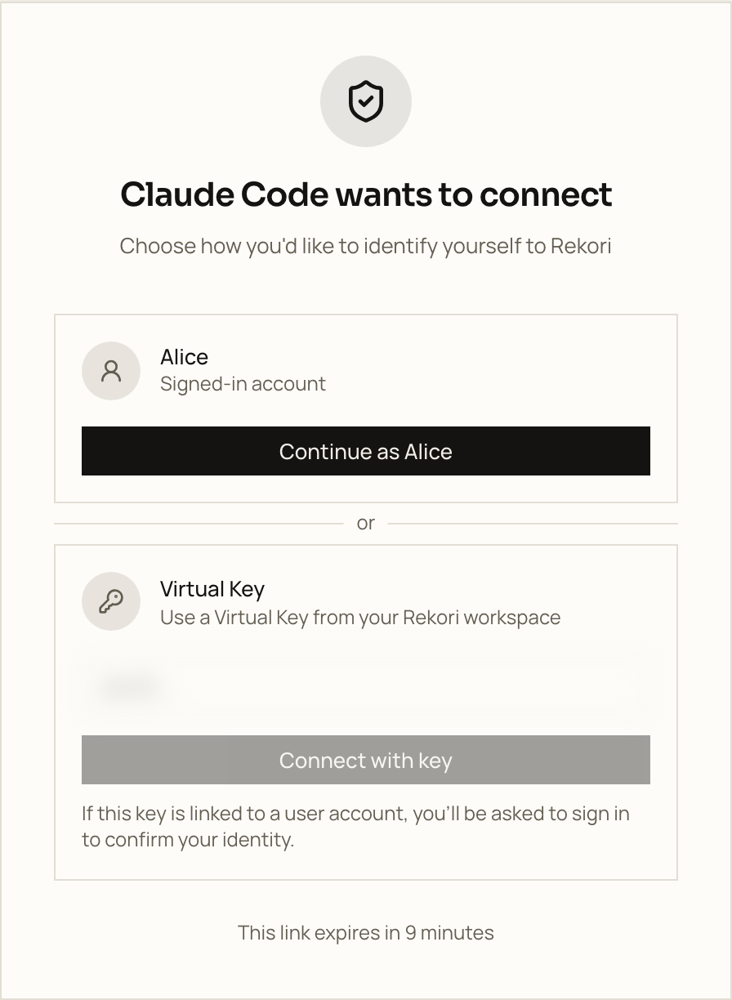
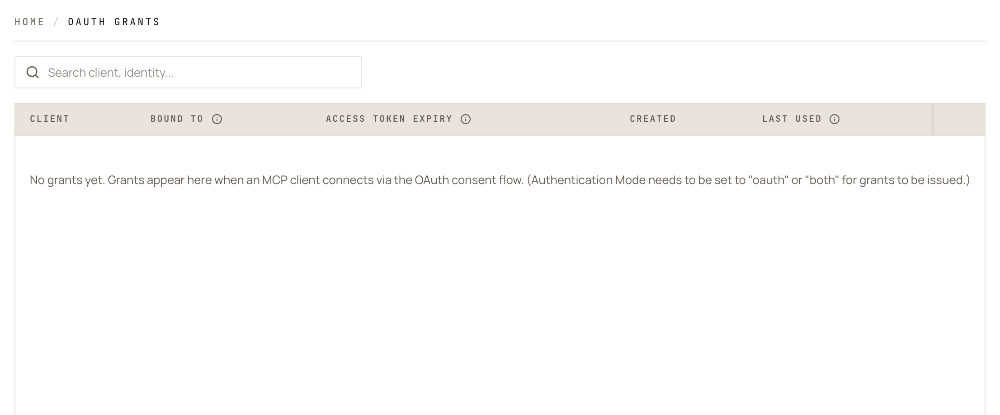

Rekori is also an MCP server. An editor or agent that speaks MCP (Claude Code, Cursor, Codex, VS Code, Windsurf and
others) connects to one address and gets every tool its key may use, from every server Rekori connects to. Admins
manage servers, credentials and access in one place; people add one entry to their editor.

| Address | Gives |
|---|---|
| `https://rekori.example.com/mcp` | Every tool the key may use |
| `https://rekori.example.com/mcp/<slug>` | One server, or one [Virtual MCP](/llm-gateway/mcp/tools-per-key#with-a-virtual-mcp) |

Tools keep their Rekori names, for example `linear-create_issue`.

## Get the command

Go to **Tools** > **Catalog** and select **Connect agent**. Choose your editor, how to sign in, and **All servers** or
**Selected servers**; the sheet builds the command or config to copy. For Claude Code with a virtual key it looks like:

```bash
claude mcp add --transport http rekori --scope user https://rekori.example.com/mcp \
  --header "x-bf-vk: sk-bf-…abcd"
```

## Choose how people sign in

| Method | How | Best for |
|---|---|---|
| **Virtual key** | The editor sends a key in `x-bf-vk` (or `Authorization: Bearer sk-bf-…`). | Automation, or when each person already has their own key |
| **OAuth** | The editor opens a browser once; the person approves it on a Rekori page. No key is copied. | People, signed in as themselves |
| **Identity provider** | The editor sends a token from your identity provider in `Authorization: Bearer`. | Companies that already issue tokens to tools |

## Turn on OAuth

<Steps>
  <Step title="Open the settings">
    Go to **Tools** > **Settings** and open **Advanced Settings**.
  </Step>
  <Step title="Choose the mode">
    Set **MCP Server Authentication Mode**:

    - **Headers** (default): keys only.
    - **Both**: keys and OAuth. Choose this to add OAuth without breaking existing setups.
    - **OAuth**: OAuth only. Keys stop working on `/mcp`.
  </Step>
  <Step title="Set the issuer">
    Under **OAuth2 Server Settings**, set **Issuer URL** to Rekori's public address, for example
    `https://rekori.example.com`. **Both** and **OAuth** can't be saved without it.
  </Step>
  <Step title="Save">
    Select **Save Changes**.
  </Step>
</Steps>

## What the person sees

The first time the editor connects, a browser opens on Rekori's consent page:

{/* SCREENSHOT: oauth-consent | crop | Claude Code wants to connect: Continue as Alice, or Virtual Key with Connect with key. Key field blurred. */}


- **Continue as Alice**: the editor acts as the signed-in person. The person needs a virtual key bound to them;
  Rekori uses that key's tools, limits and budget.
- **Virtual Key** > **Connect with key**: the editor acts as that key. If the key belongs to a person, they must sign
  in as that person.

The link expires after 5 minutes. After approval, the editor gets a token that lasts 10 minutes and renews itself.

<Note>
Signing in as the person matters for [per-user sign-in](/llm-gateway/mcp/per-user-sign-in): tools then use that person's own
account, not a shared one.
</Note>

## See and revoke access

**Tools** > **OAuth Grants** lists every editor connected through OAuth: the client, who it is **Bound to**, the
token's expiry, and when it was **Last used**.

{/* SCREENSHOT: oauth-grants | crop | Tools > OAuth Grants, empty: columns Client, Bound to, Access token expiry, Created, Last used. */}
<Frame caption="Tools > OAuth Grants">
  
</Frame>

To cut an editor off, open the row menu and select **Revoke**. It can't renew its token from then on; the token it
holds works until it expires, at most 10 minutes.
