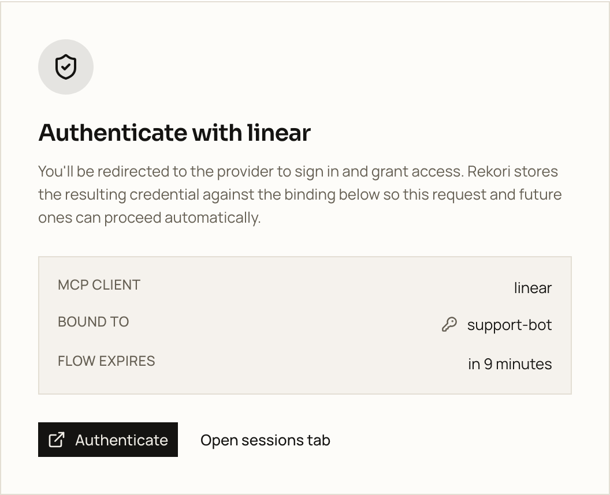
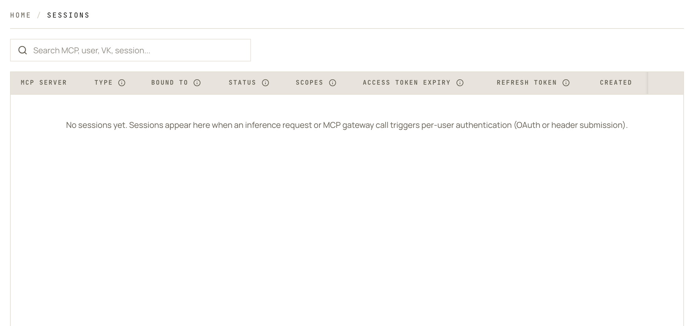

Some tools must act as the person using them: an issue filed in Linear should show who filed it, and people should
see only what their own account may see. With per-user sign-in, each person connects their own account to the MCP
server the first time they use one of its tools. Rekori keeps that credential and uses it for that person from then
on.

## Set it up

When you [add the server](/llm-gateway/mcp/add-an-mcp-server), set **Auth Scope** to **Per-User**:

| Authentication Type | Each person… |
|---|---|
| **OAuth 2.0** | Signs in on the tool's own sign-in page. |
| **Headers** | Enters their own values, for example their API key. List the header names under **Required Headers**, for example `X-API-Key`. Add fixed headers for everyone under **Static Headers**. |

## What the person sees

The first time someone uses a tool without a credential, Rekori sends them a sign-in link instead of running the tool.

- **In an editor or other MCP client**, the tool's result says *Authentication required for linear. Open this URL to
  connect your account:* followed by the link.
- **In an app call** where Rekori runs the tools ([agent mode](/llm-gateway/mcp/agent-mode)), the request fails with `401`:

  ```json
  {
    "error": {
      "type": "mcp_auth_required",
      "message": "Authentication required for linear. Open this URL to connect your account: https://rekori.example.com/workspace/mcp-sessions/auth?flow=…"
    },
    "extra_fields": {
      "mcp_auth_required": {
        "kind": "oauth",
        "mcp_client_name": "linear",
        "authorize_url": "https://rekori.example.com/workspace/mcp-sessions/auth?flow=…"
      }
    }
  }
  ```

  Show `authorize_url` (or `submit_url` for **Headers**) to the person, then retry the request after they finish.

The link opens a Rekori page that says which server and which identity the credential is for:

{/* SCREENSHOT: mcp-auth-page | crop | Authenticate with linear: MCP client linear, Bound to support-bot, Flow expires in 9 minutes, Authenticate button. */}


The person selects **Authenticate** and signs in to the tool, or enters their values and selects **Submit**. Rekori
checks the connection and stores the credential. Links expire after 15 minutes.

## Whose credential it is

**Bound to** says who the credential belongs to. Rekori uses the first that applies:

| Bound to | When |
|---|---|
| A user | The caller is signed in with SSO (console sign-in or [caller sign-in](/llm-gateway/access-and-spend/callers-sign-in)). Best: each person has their own. |
| A virtual key | The caller uses a key that is not tied to a person. **Everyone using that key shares the credential.** |
| A session | The client sends its own `x-bf-mcp-session-id`. |

<Note>
A person who is signed in to the Rekori console opens the link with one click. Someone who uses only a virtual key
has no console session. For them, turn on **Allow Temp Token Auth Links** under **Tools** > **Settings**: links then
carry a short-lived token (after `#t=` in the URL), so they must copy the whole link. Links bound to a user never
carry a token.
</Note>

## See and remove credentials

**Tools** > **Sessions** lists every stored credential and every sign-in still in progress.

{/* SCREENSHOT: mcp-sessions | crop | Tools > Sessions, empty: columns MCP server, Type, Bound to, Status, Scopes, Access token expiry, Refresh token, Created. */}
<Frame caption="Tools > Sessions">
  
</Frame>

| Status | Means |
|---|---|
| **Active** | Working |
| **Pending** | The person opened a link but hasn't finished. Use **Complete authentication**. |
| **Needs re-auth** | The tool's sign-in expired. Use **Re-authenticate**. |
| **Needs update** | Header values were refused. Use **Update values**. |
| **Orphaned** | The user or key it was bound to no longer exists |

Select **Revoke** to delete a credential. The person is asked to sign in again the next time they use the tool.
