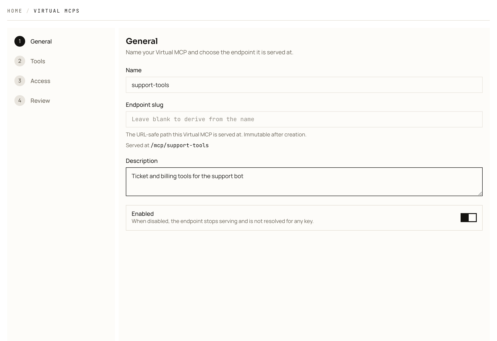

Rekori offers a key only the MCP tools it has been given. There are two ways to give them:

- **On the key**: pick servers and tools in the key's form. Best for a few keys.
- **With a Virtual MCP**: bundle tools from several servers into one named set, then assign it to many keys. Best
  when several apps or people need the same tools.

A key's tools are both sets together. [Tool policies](/llm-gateway/protect/tool-policies) can then refuse tools company-wide on
top.

## On the key

<Steps>
  <Step title="Open the key">
    Go to **Access** > **Keys** and open the key, or create one.
  </Step>
  <Step title="Add servers">
    Under **MCP Server Configurations**, choose a server in **Select an MCP server to add**.
  </Step>
  <Step title="Choose the tools">
    In **Allowed Tools**, keep **Allow All Tools** (every tool now and later), or select single tools. A key can only
    have tools that are turned on for the server.
  </Step>
  <Step title="Save the key" />
</Steps>

<Warning>
With no servers in **MCP Server Configurations**, a key gets no MCP tools, except from servers with **Allow by
Default** on. Those give all their tools to every key that doesn't list them. Turn **Allow by Default** on only for
servers everyone may use.
</Warning>

## With a Virtual MCP

A Virtual MCP is a named set of tools from one or more servers, served at its own address
`https://rekori.example.com/mcp/<slug>`.

<Steps>
  <Step title="Start">
    Go to **Tools** > **Virtual MCPs** and select **New Virtual MCP**.
  </Step>
  <Step title="General">
    Enter a **Name** (for example `support-tools`) and a **Description**. The **Endpoint slug** comes from the name
    unless you set it, and can't be changed later.

    {/* SCREENSHOT: virtual-mcp-form | crop | New Virtual MCP wizard, General step: Name support-tools, Endpoint slug, Description, Enabled. */}
    <Frame caption="Tools > Virtual MCPs > New Virtual MCP">
      
    </Frame>
  </Step>
  <Step title="Tools">
    Pick servers and the tools to include from each.
  </Step>
  <Step title="Access">
    Choose the **Virtual keys** that may use it.
  </Step>
  <Step title="Review">
    Check the details and select **Create Virtual MCP**. The review shows the **Endpoint URL** to give MCP clients.
  </Step>
</Steps>

To add or remove keys later, edit the Virtual MCP, or add it under **Virtual MCP Server Configurations** on a key. A
key that isn't assigned gets `403` at the Virtual MCP's address.

## Narrow the tools on one request

By default Rekori adds every tool a key may use to each chat request. To send fewer, add these headers. They can only
narrow what the key allows, never add to it.

| Header | Value |
|---|---|
| `x-bf-mcp-include-clients` | Server names, comma-separated, for example `linear,github`. `*` means all. |
| `x-bf-mcp-include-tools` | Tool names, for example `linear-create_issue,github-*`. `<server>-*` means every tool of that server. |

```bash
curl https://rekori.example.com/v1/chat/completions \
  -H "x-bf-vk: $REKORI_KEY" -H "Content-Type: application/json" \
  -H "x-bf-mcp-include-tools: linear-create_issue" \
  -d '{"model": "openai/gpt-4o-mini",
       "messages": [{"role": "user", "content": "File a bug: the login page is slow."}]}'
```

To add tools only when a request asks for them, turn on **Disable Auto Tool Injection** under **Tools** >
**Settings**. Requests then get MCP tools only when they send one of the headers above.
