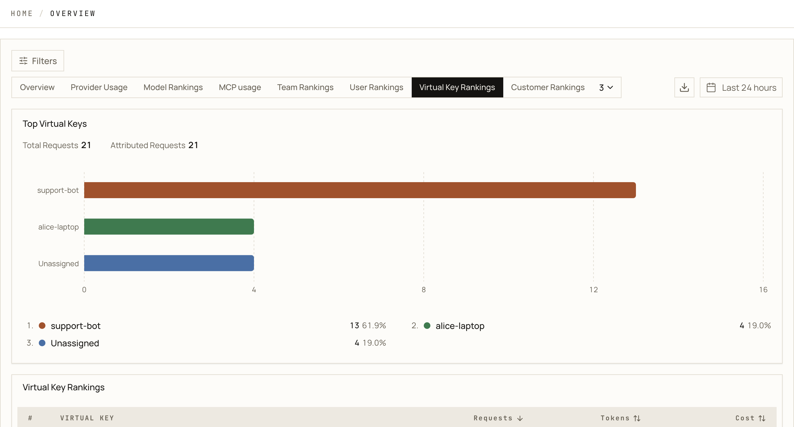

**Traffic** > **Overview** shows how Rekori is used over time: how many calls, what they cost, how fast they were,
and who made them. Use it to spot a cost jump, compare providers, and find the key, team or app behind the traffic.

{/* SCREENSHOT: dashboard-rankings | crop | Overview, Virtual Key Rankings tab: Top Virtual Keys chart (support-bot, alice-laptop, Unassigned) and the rankings table header. */}
<Frame caption="Traffic > Overview, Virtual Key Rankings">
  
</Frame>

## Tabs

| Tab | Shows |
|---|---|
| **Overview** | Cost, request volume, token usage, cache hit rates, model usage, latency, Rekori's own overhead, and throughput |
| **Provider Usage** | Cost, tokens, latency and throughput per provider |
| **Model Rankings** | Top models, with requests, success rate, tokens, cost and average latency |
| **MCP usage** | Tool calls, tool cost, and the top 10 tools. Pick a tool or server with **All Tools** and **All Servers**. |
| **Team Rankings**, **User Rankings**, **Virtual Key Rankings**, **Customer Rankings**, **App Rankings** | The top teams, users, keys, customers or apps by requests, with tokens and cost |

Tabs that don't fit the window move into a menu at the end of the tab row (for example **3 ▾**).

**Unassigned** in a ranking means calls with no key, team or user of that kind.

## Narrow it down

- **Time range**: **Last hour**, **Last 6 hours**, **Last 24 hours**, **Last 7 days**, **Last 30 days**, or a custom
  range, in your time zone.
- **Filters**: the same filters as [Logs](/llm-gateway/monitor/logs), for example one provider, one team, or only errors.
- Each chart can show bars or lines.

## Export

Select the download button next to the time range:

- **CSV** or **PDF**
- **This tab** or **All tabs**

The export uses the selected time range and filters.

<Note>
The dashboard is built from the logs. Calls made while **Enable Logs** was off, and request types listed in
**Hidden Request Types**, are not counted. See [Logs](/llm-gateway/monitor/logs#log-settings).
</Note>
