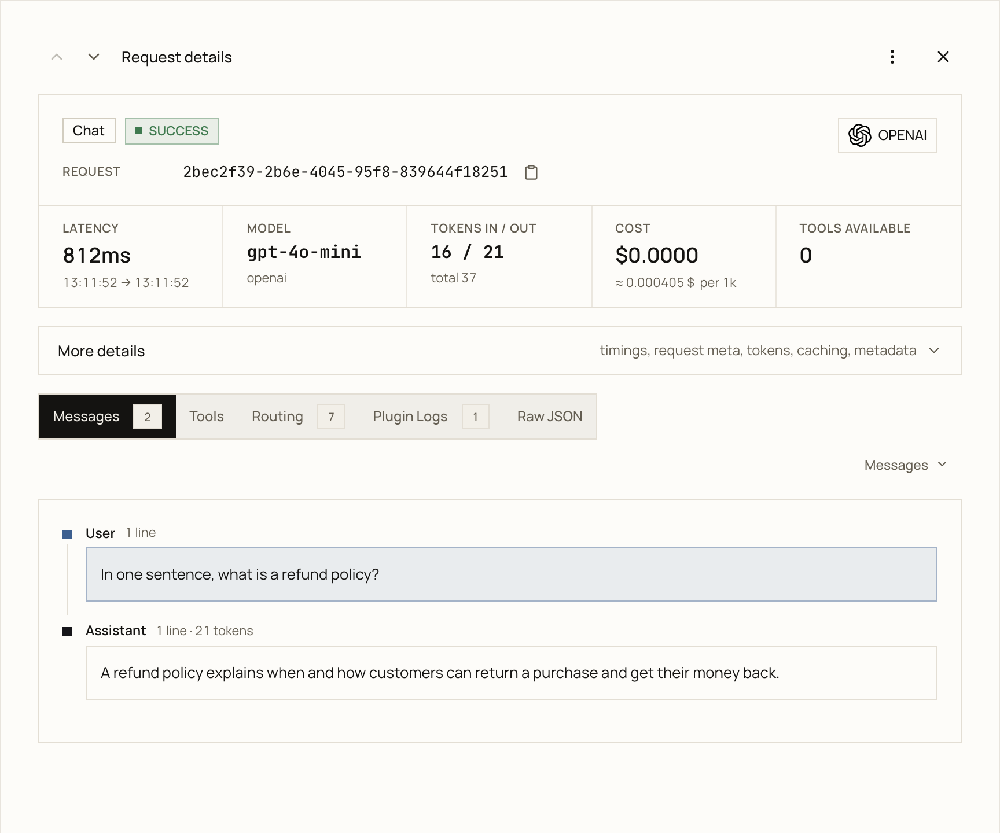
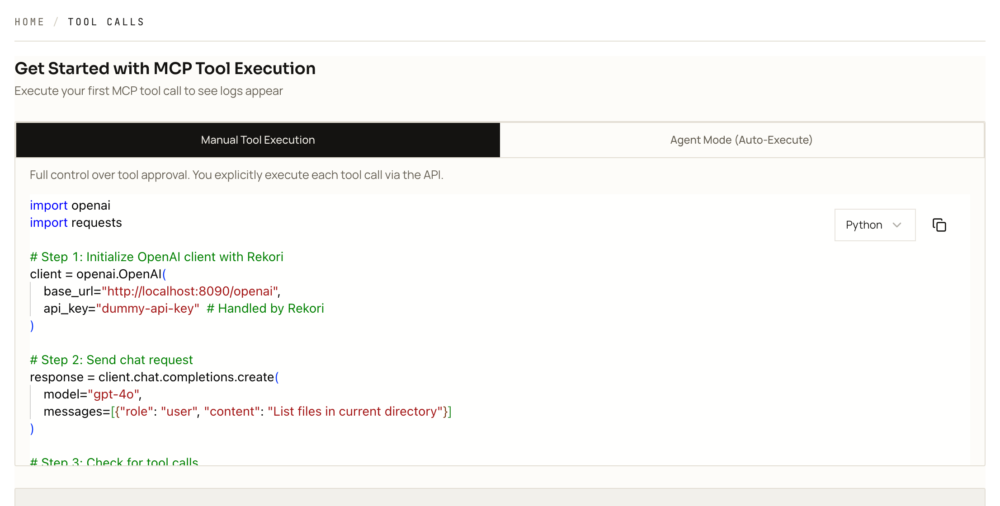
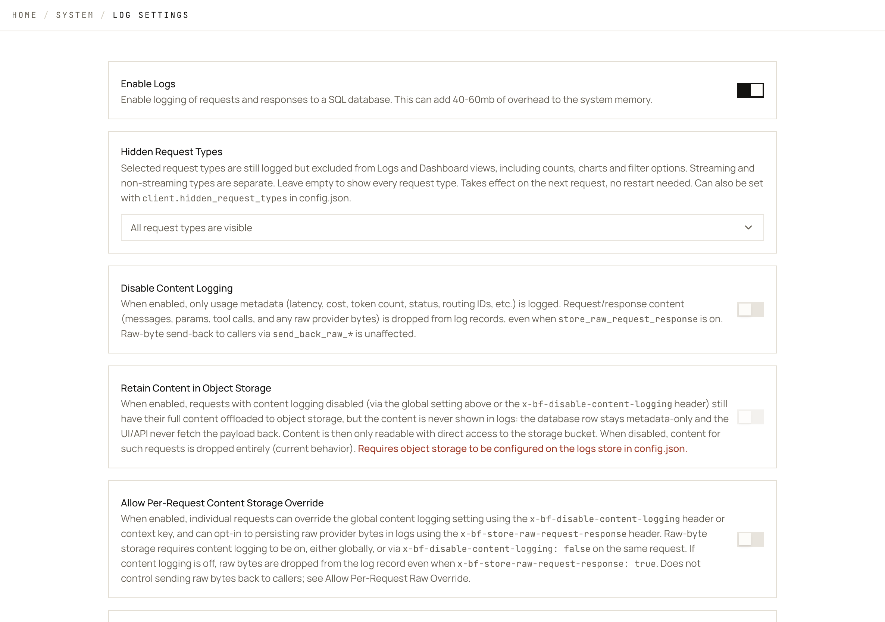

Rekori logs every call that passes through it: model calls under **Traffic** > **Requests**, and MCP tool calls under
**Traffic** > **Tool Calls**. Use the logs to answer "what happened to this call?", "who is spending the most?" and
"why was this blocked?".

## Find a call

Go to **Traffic** > **Requests**.

- **Search**: type words from the conversation, or paste a request ID. The search box guesses which one you mean
  (**Auto**); choose **Content search** or **Request ID search** to force one. A request ID is found whatever time
  range is selected.
- **Time range**: **Last hour**, **Last 6 hours**, **Last 24 hours**, **Last 7 days**, **Last 30 days**, or a custom
  range.
- **Filters**: status, model, provider, virtual key, team, customer, user, app, routing rule, cost, stop reason, tool
  calls, metadata and more. Active filters show as chips; **Reset** clears them.
- **Live** adds new calls as they arrive. **Group** shows retries and fallbacks under the call that started them.

The table shows **Time**, **Type**, **Message**, **Model**, **App**, **Latency**, **Tokens** and **Cost**. More
columns (**Virtual Key**, **Team**, **Customer**, **User**, **Routing Rule**) can be turned on from the column menu.

## Read a call

Select a row to open **Request details**.

{/* SCREENSHOT: request-detail | crop | Request details of a successful gpt-4o-mini chat call: latency, tokens 16/21, cost, Messages tab with the user question and assistant answer. */}


At the top: the status, the request ID, **Latency**, **Model**, **Tokens in / out**, **Cost** and **Tools available**.
**More details** opens timings, the key, team and user, token details, caching, routing and guardrail details, and
metadata.

| Tab | Shows |
|---|---|
| **Messages** | The conversation sent and the answer |
| **Tools** | The tools the model was offered |
| **Routing** | Each attempt (key and result) and why Rekori chose the provider, model and key |
| **Plugin Logs** | What each Rekori plugin (content rules, governance, caching…) did |
| **Raw JSON** | The exact request sent to the provider and its response, when raw storage is on (below) |

The **⋮** menu has **Copy request body**, **Export as JSON** and **Delete log**.

## Tool calls

**Traffic** > **Tool Calls** lists every MCP tool call: **Tool Name**, **Server**, **App**, **Latency**, **Cost**,
**User** and **Team**, with the arguments and result in each call's details. **Export** downloads them as **CSV (one
row per call)** or **JSON (full details)**, up to 10,000 rows.

{/* SCREENSHOT: tool-calls | crop | Traffic > Tool Calls before any tool call: Get Started with MCP Tool Execution, Manual Tool Execution and Agent Mode tabs. */}
<Frame caption="Traffic > Tool Calls, before the first tool call">
  
</Frame>

## Tag calls with your own fields

Send headers that start with `x-bf-lh-` to store your own values with a call. The prefix is removed:
`x-bf-lh-ticket: T-1042` is stored as `ticket: T-1042`.

```bash
curl https://rekori.example.com/v1/chat/completions \
  -H "x-bf-vk: $REKORI_KEY" -H "Content-Type: application/json" \
  -H "x-bf-lh-ticket: T-1042" -H "x-bf-lh-env: staging" \
  -d '{"model": "openai/gpt-4o-mini", "messages": [{"role": "user", "content": "Hello"}]}'
```

Each field gets its own column in **Requests**, a **Metadata** filter, and a line under **More details**. Headers that
start with `x-bf-dim-` are stored the same way and are also sent to Maxim and, when listed in config, used as
Prometheus labels.

To store a header your apps already send (for example `X-Request-Source`), add its name to **Logging Headers** in
Log Settings below.

## Log settings

Go to **Traffic** > **Log Settings**.

{/* SCREENSHOT: log-settings | crop | Logs Settings: Enable Logs on, Hidden Request Types, Disable Content Logging, Retain Content in Object Storage, Allow Per-Request Content Storage Override. */}
<Frame caption="Traffic > Log Settings">
  
</Frame>

| Setting | Default | What it does |
|---|---|---|
| **Enable Logs** | On | Turns logging on or off. Needs a restart. |
| **Hidden Request Types** | None | Request types still logged but left out of Logs and the dashboard |
| **Disable Content Logging** | Off | Keeps only usage data (status, latency, tokens, cost, key, routing), never prompts or answers. Use it when prompts may hold personal data. |
| **Retain Content in Object Storage** | Off | With content logging off, still keeps the content in your object storage bucket, readable only from the bucket, never in the console. Needs object storage set up for logs. |
| **Allow Per-Request Content Storage Override** | Off | Lets a request turn content logging off or on for itself with `x-bf-disable-content-logging: true` or `false`, and ask for raw storage with `x-bf-store-raw-request-response: true`. |
| **Log Retention Days** | 365 | Logs older than this are deleted |
| **Logging Headers** | None | Request headers stored with each call, for example `X-Request-Source`. `*` and wildcards allowed. |

**Raw JSON** is stored per provider: open the provider under **Routing** > **Providers**, and on the **Debugging** tab
turn on **Store Raw Request/Response**. Raw data is never stored when content logging is off.

<Note>
The logs API gives the same data to scripts: `GET /api/logs` with the same filters as query parameters (for example
`?virtual_key_ids=…&period=24h&limit=100`). One call returns at most 1000 rows.
</Note>
