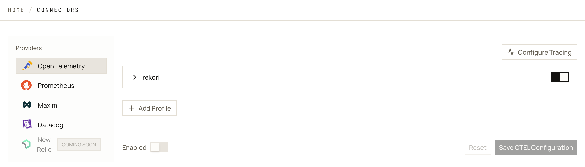

Rekori can send a trace of every call to the observability tool you already use: one span for the request, with
child spans for each step (routing, plugins, the provider call, tool calls). Traces follow OpenTelemetry's GenAI
naming (`gen_ai.*`), so tools that understand LLM traces show the model, tokens, cost and messages.

Connectors are under **Traffic** > **Connectors**.

{/* SCREENSHOT: connectors | crop | Connectors: Providers list (Open Telemetry, Prometheus, Maxim, Datadog, New Relic coming soon), one profile rekori, Add Profile, Enabled, Save OTEL Configuration. */}
<Frame caption="Traffic > Connectors">
  
</Frame>

## Send OpenTelemetry traces

Any tool that accepts OTLP works: Datadog, Grafana, New Relic, Honeycomb, Jaeger, an OpenTelemetry Collector.

<Steps>
  <Step title="Open Open Telemetry">
    Go to **Traffic** > **Connectors** and select **Open Telemetry**. Select **Add Profile** for each destination.
  </Step>
  <Step title="Fill in the profile">
    | Field | What to enter |
    |---|---|
    | **Service Name** | How Rekori appears in your tool. Default `rekori`. |
    | **Protocol** | **HTTP** or **GRPC**, as your tool expects |
    | **OTLP Collector URL** | HTTP: `https://otlp.example.com/v1/traces`. GRPC: `otlp.example.com:4317`. `env.OTLP_URL` reads it from an environment variable. |
    | **Trace Headers** | Headers your tool needs, usually an API key. Use `env.` values to keep keys out of the console. |
    | **Format** | **OTel GenAI Extension (Recommended)**, or **PepVigil** for PepVigil |
    | **Insecure (Skip TLS)** | On by default. **Turn it off** for any destination outside your own network. |
    | **Export Timeout (seconds)** | Default 5 |
  </Step>
  <Step title="Turn it on">
    Turn on **Enabled** and select **Save OTEL Configuration**.
  </Step>
</Steps>

### What is sent

- **Always**: provider, model, request parameters, tokens, cost, latency, status and errors, plus the key, team and
  customer (`bifrost.virtual_key.*`, `bifrost.team.*`, `bifrost.customer.*`).
- **Messages** (`gen_ai.input.messages`, `gen_ai.output.messages`): only when content logging is on in
  [Log Settings](/llm-gateway/monitor/logs#log-settings) and the profile's **Disable Content Logging** is off. **Disable Root Span
  Content** removes them from the top span only.
- **Request Headers (Optional)**: header names to add to spans.

<Warning>
The `x-bf-disable-content-logging` request header affects Rekori's own logs only. Traces still carry that call's
messages unless the profile's **Disable Content Logging** is on.
</Warning>

Other profile options:

- **Group Traces by Session**: puts calls with the same `x-bf-session-id` in one trace.
- **Enable Metrics Export** (beta): also pushes OTLP metrics to **Metrics Endpoint**.
- **Configure Tracing**, at the top of the page, chooses which plugin spans are sent.

<Warning>
Use an **Open Telemetry** profile for Datadog, Grafana and other OTLP tools, with the key in **Trace Headers**. The
separate **Datadog** entry in this build adds OTLP destinations that send no headers, so most hosted tools refuse
them, and a new destination is used only after Rekori restarts.
</Warning>

## Prometheus

Select **Prometheus**.

- **Pull-based** (on by default): Prometheus scrapes `https://rekori.example.com/metrics`. **User labels** adds the
  user to each metric.
- **Push-based (Push Gateway)** (beta): Rekori pushes to **Push Gateway URL** every **Push Interval (seconds)**
  (default 15), as **Job Name** (default `rekori`). **Add Basic Auth** adds a username and password.

Select **Save Prometheus Configuration**.

## Maxim

Select **Maxim**, enter the **API Key** and, optionally, the **Log Repository ID (Optional)**. Header values listed in
**Request Headers (Optional)**, and `x-bf-dim-*` headers, become trace tags. Turn on **Enabled** and select
**Save Maxim Configuration**.
