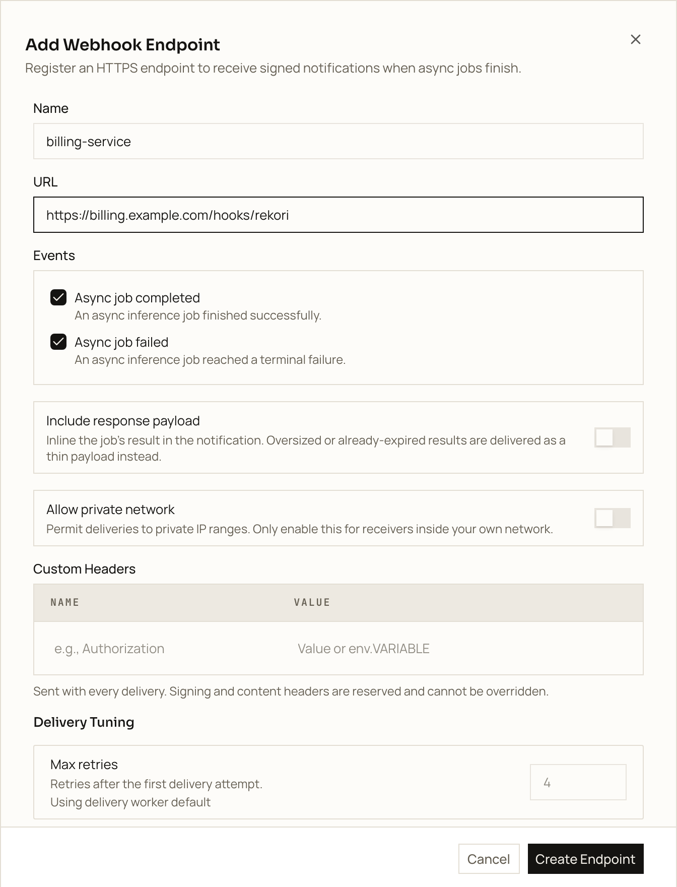

When you send a call as an [async job](/llm-gateway/call-the-gateway/async-jobs), you can ask for the result again and again
until it is ready, or have Rekori tell you. A webhook is an HTTPS address of yours that Rekori calls when a job
finishes (`async_job.completed`) or fails (`async_job.failed`). Each call is signed so you can check it came from
Rekori.

## Add an endpoint

<Steps>
  <Step title="Open the form">
    Go to **Alerts** > **Webhooks** and select **Add Endpoint**.

    {/* SCREENSHOT: webhook-endpoint | crop | Add Webhook Endpoint: Name billing-service, URL https://billing.example.com/hooks/rekori, both events, Include response payload, Allow private network, Custom Headers, Max retries 4. */}
    
  </Step>
  <Step title="Fill it in">
    | Field | What to enter |
    |---|---|
    | **Name** | For example `billing-service` |
    | **URL** | Your HTTPS address, for example `https://billing.example.com/hooks/rekori` |
    | **Events** | **Async job completed**, **Async job failed**, or both |
    | **Include response payload** | Put the job's result in the notification, so you don't have to fetch it. Results over the size limit are left out. |
    | **Allow private network** | Allow an address inside your own network, and `http://`. Leave it off for anything else. |
    | **Custom Headers** | Extra headers to send, for example an `Authorization` your receiver checks. `env.VARIABLE` reads a value from an environment variable. |
  </Step>
  <Step title="Create it and copy the secret">
    Select **Create Endpoint**. Rekori shows the signing secret (`whsec_…`) **once**. Copy it into your receiver's
    configuration now.
  </Step>
  <Step title="Test it">
    Open the endpoint and select **Send Test Event**. Rekori sends a signed sample whose `job_id` starts with `test-`.
  </Step>
</Steps>

## What Rekori sends

```http
POST /hooks/rekori HTTP/1.1
Content-Type: application/json
webhook-id: 6f1c2a1e-…
webhook-timestamp: 1764064800
webhook-signature: v1,K5oZfzN95Z9UVu1EsfQmfVNQhnkZ2pj9o9NDN/H/pI4=
```

```json
{
  "event": "async_job.completed",
  "created_at": "2026-11-25T10:00:05Z",
  "data": {
    "job_id": "6f1c2a1e-…",
    "request_type": "chat_completion",
    "status": "completed",
    "status_code": 200,
    "created_at": "2026-11-25T10:00:00Z",
    "completed_at": "2026-11-25T10:00:05Z",
    "result_url": "/v1/async/chat/completions/6f1c2a1e-…",
    "result_expires_at": "2026-11-25T11:00:05Z",
    "response": { "…": "the result, when Include response payload is on" }
  }
}
```

- Fetch the result from `result_url` with the job's virtual key, before `result_expires_at`.
- With **Include response payload** off, or when the result is too large, `response` is left out and
  `response_omitted` is `true`. A failed job carries `error` the same way.

## Check the signature

Rekori signs the way [Standard Webhooks](https://www.standardwebhooks.com) does, so any Standard Webhooks library
checks it. Without one:

1. Take the secret without `whsec_` and base64-decode it.
2. Sign `{webhook-id}.{webhook-timestamp}.{raw body}` with HMAC-SHA256 and that key, and base64-encode the result.
3. Compare it with the part after `v1,` in `webhook-signature`.
4. Refuse timestamps more than a few minutes old.

```python
import base64, hashlib, hmac, time

def verify(secret: str, headers: dict, body: bytes) -> bool:
    key = base64.b64decode(secret.removeprefix("whsec_"))
    msg = f'{headers["webhook-id"]}.{headers["webhook-timestamp"]}.'.encode() + body
    expected = base64.b64encode(hmac.new(key, msg, hashlib.sha256).digest()).decode()
    fresh = abs(time.time() - int(headers["webhook-timestamp"])) < 300
    sigs = [s.split(",", 1)[1] for s in headers["webhook-signature"].split() if s.startswith("v1,")]
    return fresh and any(hmac.compare_digest(expected, s) for s in sigs)
```

Use the raw body exactly as received, before any JSON parsing.

## Retries and deliveries

Answer with any `2xx` within 10 seconds. If your receiver answers `408`, `429` or `5xx`, or can't be reached, Rekori
tries again after about 30 seconds, 1, 2 and 4 minutes, then gives up. Any other answer, including a redirect, is not
retried.

`webhook-id` stays the same on every retry, so use it to ignore a notification you have already handled.

Open an endpoint to see **Recent Deliveries**, with each attempt's status and your receiver's response. Select
**Redeliver** to send one again. **Delivery Tuning** on the form changes **Max retries** (default 4), the backoff, the
**Attempt timeout (seconds)** (default 10), and more.

## Rotate the secret

Open the row menu and select **Rotate secret**. The new secret is shown once, and **the old one stops working at
once**, so update your receiver straight away.
