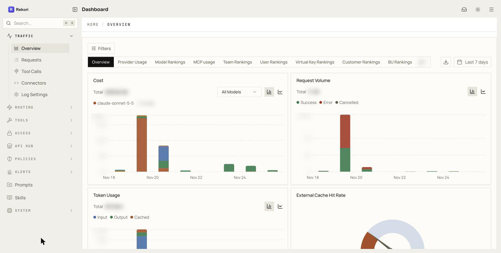

import RequestFlow from '/llm-gateway/snippets/request-flow.mdx';

Rekori is a gateway for AI traffic. Your apps, agents and coding tools send their model and tool calls to Rekori
instead of to each provider. Rekori decides who may make a call, which model answers it, what it may contain and what
it may cost, and it records every call.

{/* SCREENSHOT: console-home | full | Traffic > Overview, last 7 days, on a gateway with real traffic. Totals and axis values blurred. */}
<Frame caption="The Rekori console: Traffic > Overview">
  
</Frame>

## Who calls Rekori

| Caller | What they send | Example |
|---|---|---|
| Apps and agents | Model calls from your code, with a virtual key | A support bot calling `gpt-4o-mini` |
| Coding tools | Model calls and MCP tool calls | Claude Code, Cursor or Codex pointed at Rekori |
| Admins | Settings, keys and limits, in the console or the API | A platform team adding a provider and a team budget |

Rekori speaks the APIs your tools already use: the OpenAI API, Anthropic's Messages API, Bedrock, Gemini and others.
Most apps move to Rekori by changing their base URL and key. See [Endpoints and SDKs](/llm-gateway/call-the-gateway/endpoints-and-sdks).

## What happens on every call

<RequestFlow />

1. **Identify the caller.** The call carries a [virtual key](/llm-gateway/access-and-spend/virtual-keys), a person's sign-in
   token, or both. See [Authentication](/llm-gateway/call-the-gateway/authenticate).
2. **Check the prompt.** [Content rules](/llm-gateway/protect/content-rules) block or redact personal data, keywords and patterns.
3. **Choose the route.** [Routing rules](/llm-gateway/routing/routing-rules) and smart routing can send the call to another
   provider or model.
4. **Check access and limits.** The key must allow the provider and the model. [LLM policies](/llm-gateway/protect/llm-policies)
   apply, and [rate limits and budgets](/llm-gateway/access-and-spend/budgets-and-limits) on the key, its team and its customer
   must all have room.
5. **Answer from the cache** when [caching](/llm-gateway/routing/semantic-cache) is on and a similar question was answered before.
6. **Call the provider** with one of its stored provider keys. A failed call can be
   [retried, or fall back](/llm-gateway/connect-models/keys-retries-fallbacks) to another provider.
7. **Run tools.** When the key allows [MCP tools](/llm-gateway/mcp/tools-per-key), Rekori offers them to the model and can run them.
8. **Check the answer** against the same content rules.
9. **Record the call**: [logs](/llm-gateway/monitor/logs), cost, metrics and [traces](/llm-gateway/monitor/traces).

## How Rekori is built

- **Stateless nodes.** Settings, keys and logs live in a database (PostgreSQL in production, SQLite for a single
  node), so several Rekori nodes can run behind one address.
- **Secrets** such as provider keys are stored encrypted in that database, or in HashiCorp Vault or AWS Secrets
  Manager.
- **One address** serves the inference API, the console and `/metrics`.

<Warning>
Usage counters for budgets and rate limits are kept on each node and are not shared between nodes. With several
nodes, each one enforces its own count.
</Warning>

Rekori is built on the open-source Bifrost gateway. Some names still carry its prefix, such as the `x-bf-` headers
and `sk-bf-` keys.

## Where to go next

<CardGroup cols={2}>
  <Card title="I build apps and agents" icon="code" href="/llm-gateway/get-started/quickstart">
    Make your first call through Rekori, then read **Call the gateway**.
  </Card>
  <Card title="I run the gateway" icon="settings" href="/llm-gateway/connect-models/add-a-provider">
    Connect models, then control access, spend and content.
  </Card>
</CardGroup>
