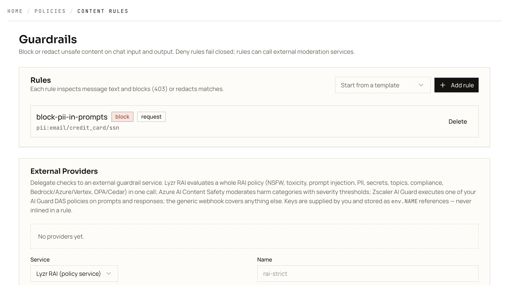
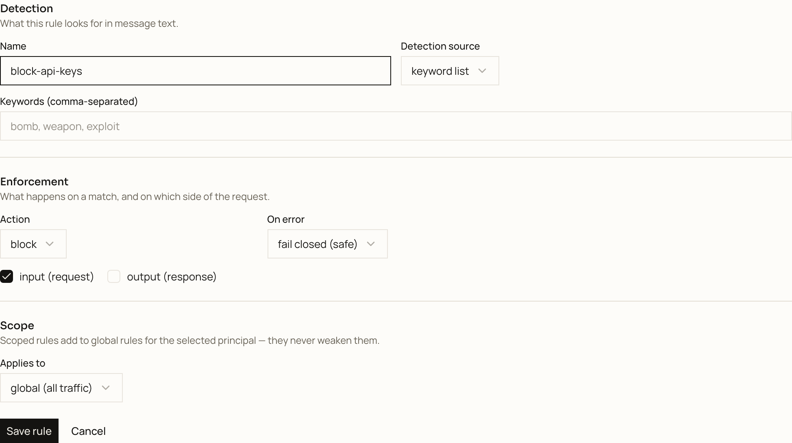

A content rule reads the text of prompts, answers or both, and acts when it finds something: it **blocks** the call,
or **redacts** what it found and lets the call continue. Use rules to stop personal data reaching a model, keep
secrets out of prompts, or keep certain topics out of answers.

Go to **Policies** > **Content Rules**.

{/* SCREENSHOT: content-rules-list | crop | Policies > Content Rules (Guardrails): Rules with block-pii-in-prompts (block, request, pii:email/credit_card/ssn), External Providers below. */}
<Frame caption="Policies > Content Rules">
  
</Frame>

## Add a rule

Select **Add rule**, or **Start from a template**:

{/* SCREENSHOT: content-rule-form | crop | The rule form: Name block-api-keys, Detection source keyword list, Action block, On error fail closed, input (request) ticked, Applies to global. */}


**Detection** — what the rule looks for:

| **Detection source** | Finds |
|---|---|
| **keyword list** | Any of the words in **Keywords (comma-separated)**, ignoring case |
| **regex** | Text matching **Regex pattern**, for example `sk-[a-zA-Z0-9]+` |
| **PII detectors** | Personal data: email addresses, card numbers (checked with the Luhn algorithm), US social security numbers, phone numbers, API keys |
| **external provider** | Whatever an [external guardrail](/llm-gateway/protect/external-guardrails) flags |

**Enforcement** — what happens on a match:

| Field | Choices |
|---|---|
| **Action** | **block** refuses the call. **redact** replaces what it found with the **Mask** (`[REDACTED]` by default) and continues. |
| **On error** | When the check itself fails: **fail closed (safe)** blocks, **fail open** lets the call through |
| Where | **input (request)**, **output (response)**, or both |

**Scope** — **Applies to**: **global (all traffic)**, one **virtual key**, or one **team**. Scoped rules add to global
rules; they never weaken them.

Select **Save rule**. It applies to the next call; no restart is needed.

## What a caller sees

A blocked call gets status `446`, with the reason in `error.type`:

```json
{ "error": { "message": "blocked by content policy: detected PII", "type": "content_policy_blocked" } }
```

A block is never retried or sent to a fallback. Every block and redaction is listed in
[Policy Blocks](/llm-gateway/protect/policy-blocks-and-alerts), with the rule and what was detected, never the content itself.

## Limits to know

<Warning>
- **Streamed answers are not checked.** Rules on **output (response)** check answers to non-streamed calls only.
  Prompts are always checked, streamed or not.
- **A key can skip all rules.** A virtual key with **Skip content rules** on is never checked. Keep it for a guardrail
  service that itself calls a model through Rekori.
</Warning>

<Note>
When you create rules through the API, stages are `request` and `response`. Any other value is stored without an
error, and that rule then never runs. Rules created at `/api/pii-rules` are enforced but do not appear on this page;
use `/api/guardrails`, which is what this page lists.
</Note>
