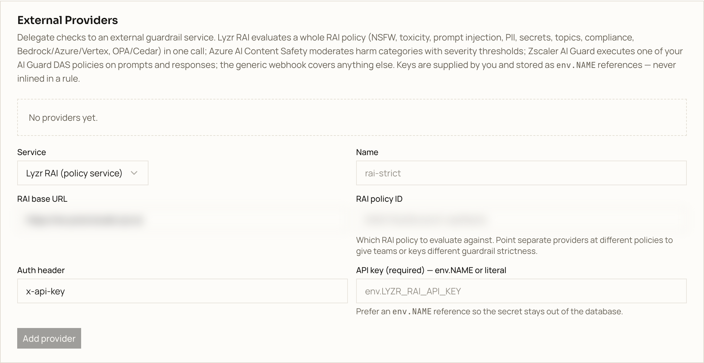

An external guardrail is a service that judges content for Rekori: toxicity, prompt injection, harmful categories,
your own company policy. You add the service once as a provider, then use it in [content rules](/llm-gateway/protect/content-rules)
like any other detection source.

## Add a provider

On **Policies** > **Content Rules**, under **External Providers**, choose a **Service**, give it a **Name**, fill in its
fields, and select **Add provider**.

{/* SCREENSHOT: guardrail-provider-card | crop | External Providers: Service Lyzr RAI (policy service), Name, RAI base URL and RAI policy ID blurred, Auth header x-api-key, API key env.LYZR_RAI_API_KEY. */}
<Frame caption="External Providers on Policies > Content Rules">
  
</Frame>

| **Service** | Use it for | You provide |
|---|---|---|
| **Lyzr RAI (policy service)** | A whole responsible-AI policy in one call: NSFW, toxicity, prompt injection, PII, secrets, topics | RAI base URL, RAI policy ID, API key |
| **Azure AI Content Safety** | Microsoft's harm categories with a **Severity threshold**: low (block 2+), medium (block 4+) or high (block 6 only) | Endpoint, and an API key or Entra tenant and client ID |
| **Zscaler AI Guard (DAS/API)** | One of your Zscaler AI Guard policies | Endpoint and API key |
| **generic HTTP webhook** | Any service you run | URL, and an optional auth header |

<Tip>
Enter keys as `env.NAME` (for example `env.LYZR_RAI_API_KEY`) so the secret is read from the server's environment and
never stored in the database.
</Tip>

Then add a content rule with **Detection source** **external provider** and pick the provider. Point different
providers at different policies to give teams or keys different strictness.

## Guardrails from OpenController

When Rekori is connected to OpenController, every guardrail created in OpenController is added here for you. It
appears in the **External provider** list of a content rule as `<guardrail name> (OpenController)`, ready to pick, with
no need to add it under **External Providers**.

<Note>
Change these guardrails in OpenController, not here: OpenController keeps them in step and puts back any change made
in Rekori. A guardrail can't be deleted in OpenController while a content rule uses it.
</Note>

## Build your own: the webhook contract

For **generic HTTP webhook**, Rekori sends:

```http
POST https://guard.example.com/check
Content-Type: application/json
Authorization: <your auth header value>

{"content": "the prompt or answer text"}
```

Your service answers with JSON. Rekori reads whether to act from `/blocked` (a JSON pointer, so `{"blocked": true}`),
and an optional reason from a pointer you choose:

```json
{ "blocked": true, "reason": "mentions an unreleased product" }
```

You can point Rekori at other fields if your service already answers in another shape.

<Note>
An external provider can only **block**. It cannot point at the exact words to redact, so use **Action** **block** with it.
</Note>

If the service is down or times out, the rule's **On error** decides: **fail closed** blocks the call, **fail open**
lets it through.
